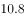
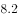
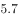
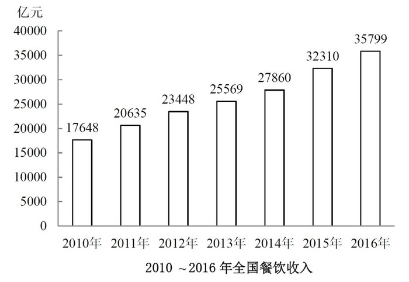

# 增长量计算与比较（计数）

考点：[[20-考点/资料分析/增长/增长量计算与比较（计数）|增长 / 增长量计算与比较（计数）]]
材料：[[15-材料/资料分析/200306 2010～2016年全国餐饮收入规模|200306 2010～2016年全国餐饮收入规模]]

**问法模型**：'某时间段内同比增量超过X的年份有几个' → 逐年用现期值−上年值求增量，与X逐一比较后计数

## 推理链
1. 第1步：从柱状图读取2010～2016年各年餐饮收入：2010年17648、2011年20635、2012年23448、2013年25569、2014年27860、2015年32310、2016年35799亿元；2011～2016年共6个同比增量，其中2011年的增量必须用2010年柱值17648作基期
2. 第2步：同比增量=现期值−上年值（差值，不是增速比值）
3. 第3步：逐年相减：2011年20635−17648=2987、2012年23448−20635=2813、2013年25569−23448=2121、2014年27860−25569=2291、2015年32310−27860=4450、2016年35799−32310=3489（亿元）
4. 第4步：与3000亿元逐一比较：2987、2813、2121、2291均低于3000，仅2015年4450和2016年3489超过3000
5. 第5步：超线年份共2个，与选项A（2）对照一致，故选A

**最快解法**：⚡ 相邻柱差值直减+临界精算：2015、2016年增量（4450、3489）明显超3000直接计入；其余年份差距明显不足，唯一需精算的是临界年份2011年：20635−17648=2987<3000（差13亿元），若估算成约3000以上就会误判，精算后确认不计入，最终计数为2

## 易错点
- ⚠ 2011年增量2987亿元是贴着3000的临界值（仅差13亿元），必须精确相减，不能毛估，否则极易把2011年误判为超线而错选B（3个）
- ⚠ 时间范围陷阱：问的是2011～2016年共6个增量，但2011年增量的基期是图中的2010年柱值17648，漏用2010年数据会导致2011年增量无法计算
- ⚠ 增量与增速混淆：'同比增量超过3000亿元'是比较差值（亿元），不是比较增长率百分数，不能拿柱子高低或增速替代差值判断

## 母题抽象
> 🧩 当题干出现'某时间段内同比增量超过X的年份有几个'且材料为逐年柱状图时，用相邻两柱直接相减逐年求增量，与X逐一比较后计数，其中贴线的临界年份必须精算验证

**同类特征**：同比增量、超过3000亿元、年份有几个、2011～2016年时间段、柱状图逐年数值、计数判断类

## 相关题
- [[10-真题/资料分析/增长/2264438 增长量计算与比较（首年基期反推型）|2264438]]（国考 2019，相关度2）
- [[10-真题/资料分析/增长/10297067 由同比增速求同比增量（现期×r-(1+r)）并比较多月变化趋势|10297067]]（天津 2025，相关度1）
- [[10-真题/资料分析/增长/12536399 增长量计算与增长量倍数比较（增长量=现期×r-(1+r)）|12536399]]（四川 2024，相关度1）
- [[10-真题/资料分析/平均数/12881912 平均数增长量（两期平均数作差求同比增量）|12881912]]（河北 2025，相关度1）
- [[10-真题/资料分析/增长/13504272 一般增长率计算与计数比较（同比增速-5%年份计数）|13504272]]（云南 2025，相关度1）

---

### 题干
2011～2016年间，全国餐饮收入同比增量超过3000亿元的年份有几个？

### 选项
- A. 2　✅
- B. 3
- C. 4
- D. 5

### 官方解析
定位柱状图可得各年份全国餐饮收入，代入计算即可。
2011年：；
2012年：；
2013年：；
2014年：；
2015年：；
2016年：。
同比增量超过3000亿元的年份有2015、2016年，共计两年。
故正确答案为A。

### 给定材料

<b>根据下列统计资料回答问题</b>

        2016年全国餐饮收入35799亿元，同比增长，餐饮收入占社会消费品零售总额的比重为。2016年全社会餐饮业经营单位为365.5万个，同比下降；从业人数为1846.0万人，同比增长。

