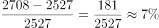

# 环比增长率计算（以限定时段内同比增速最高月为载体）

考点：[[20-考点/资料分析/增长/环比增长率计算（以限定时段内同比增速最高月为载体）|增长 / 环比增长率计算（以限定时段内同比增速最高月为载体）]]
材料：[[15-材料/资料分析/210316 2017年4月～2018年4月我国煤|210316 2017年4月～2018年4月我国煤]]

**问法模型**：'2017年下半年同比增速最高的月份，当月比上月约（升/降）多少'→先用折线在7～12月区间内锁定同比增速峰值月，再对该月与上月柱值套环比增长率=(本月-上月)/上月

## 推理链
1. 第1步：定位图1（煤炭），2017年下半年7～12月同比增速依次为-8.2%、-4.9%、10.8%、-1.3%、-18.2%、-15.0%，最高为2017年9月的10.8%（下半年唯一明显为正的月份）
2. 第2步：读柱值：2017年9月煤炭进口量2708万吨，其上月（2017年8月）为2527万吨
3. 第3步：所求'当月比上月'是环比增长率，公式为(2708-2527)/2527=181/2527
4. 第4步：截位估算181/2527≈180/2500=7.2%，且2708>2527，方向为上升
5. 第5步：对照选项，'上升约7.2%'对应C，故正确答案为C

**最快解法**：⚡ 折线速扫+截位直除：下半年6个月增速中仅9月10.8%为正值（其余全为负），一步锁定9月；再算(2708-2527)/2527≈181/2500≈7.2%，为上升，直接选C

## 易错点
- ⚠ 时段陷阱：'下半年'仅含7～12月共6个月，勿误用全图最高增速20.9%（2018年3月）或17年5月的16.6%，也不可把4～6月并入下半年
- ⚠ 同比/环比混淆：折线上的10.8%是同比增速，而所求'比上月'是环比，须用(2708-2527)/2527≈7.2%，若直接把10.8%当答案即中招
- ⚠ 看串图：图1煤炭与图2原油同构且数值量级相近（原油8月3398、9月3701），若误看图2会算成(3701-3398)/3398≈8.9%，做题前必须先确认是图1

## 母题抽象
> 🧩 当题干出现'某限定时段内同比增速最高的月份，当月比上月约'时，先用折线在限定区间内找增速峰值月，再用相邻两月柱值算环比=(本月-上月)/上月，并严格区分同比增速与环比结果

**同类特征**：同比增速最高的月份、2017年下半年（7-12月）、当月进口量比上月、上升/下降+百分数选项、煤炭进口量（图1）、折线定月+柱值做差

## 相关题
- [[10-真题/资料分析/平均数/4658508 平均数（单产）增长率——两期平均数比较|4658508]]（四川 2021，相关度1）
- [[10-真题/资料分析/增长/10297066 同比增速比较+增长量计算（两步连环：先按增速定月，再算该月产量增长量）|10297066]]（天津 2025，相关度1）
- [[10-真题/资料分析/平均数/4770009 两期平均数增长率（平均进口价格环比变化）|4770009]]（四川 2017，相关度1）

---

### 题干
2017年下半年煤炭进口量同比增速最高的月份，当月煤炭进口量比上月约：

### 选项
- A. 
下降

- B. 
下降

- C. 
上升
　✅
- D. 
上升

### 官方解析

由题干“当月煤炭进口量比上月约”，结合选项为上升/下降+%，可判定本题为一般增长率问题。定位图1，2017年下半年（7-12月）煤炭进口量同比增速最高的月份是2017年9月份，对应增长率为，进口量为2708万吨，上个月即2017年8月，进口量为2527万吨，故当月进口量比上月增长了。

故正确答案为C。

### 给定材料

 

