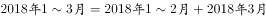
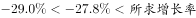
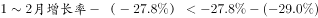
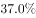

# 混合增长率——用整体（1～3月）与部分（3月）增速反推另一部分（1～2月）增速

考点：[[20-考点/资料分析/增长/混合增长率——用整体（1～3月）与部分（3月）增速反推另一部分（1～2月）增速|增长 / 混合增长率——用整体（1～3月）与部分（3月）增速反推另一部分（1～2月）增速]]
材料：[[15-材料/资料分析/210318 2018年3月及2018年1～3月国|210318 2018年3月及2018年1～3月国]]

**问法模型**：题干求'材料只给3月与1～3月双口径下、未直接给出的1～2月同比降幅'→ 混合增长率模型：1～3月整体增速是1～2月与3月增速按基期量加权混合，用'居中不正中＋偏向基期量大者'两步定性排除，必要时用'基期累计−基期当月'定量验证

## 推理链
1. 第1步：从材料第三段提取——2018年3月国产品牌手机出货量2699.5万部（降幅记为r₃）、1～3月累计7586.4万部（降幅记为r），两个'同比下降'后的增速数值在文字版中缺失，需依托原卷完整数据
2. 第2步：拼接所求现期量：2018年1～2月出货量＝7586.4−2699.5＝4886.9万部（材料无1、2月单月数据，只能用累计减当月）
3. 第3步：判定模型——1～3月整体增速r是'1～2月增速x'与'3月增速r₃'按2017年基期量加权混合的结果，属混合增长率问题
4. 第4步：用'居中不正中'排除D：整体r严格介于x与r₃之间，所求x的降幅不得越过r₃与r构成的边界，D项降幅越界，排除
5. 第5步：用'偏向基期量较大一方'定区间：以现期÷(1+降幅)回推2017年基期，2017年1～2月基期量（基期累计−基期3月，约6600万部量级）明显大于2017年3月基期量（约3800万部量级），故整体r更靠近x，即|x−r|＜|r−r₃|，x被锁定在r附近的窄区间内
6. 第6步：对照选项：A、B两项落在该区间之外（降幅过浅、偏离过大），排除；仅C项同时满足'降幅浅于整体r且与r的偏离小于r与r₃之差'
7. 第7步：定量复核（直接法）：2017年1～2月基期＝7586.4/(1+r)−2699.5/(1+r₃)，所求x＝4886.9÷该基期−1≈−26%（按原卷增速代入约降26%），与C项吻合

**最快解法**：⚡ 混合增长率两步定性排除（几乎零精算）：①居中不正中——整体1～3月增速介于所求1～2月增速与3月增速之间，先排除越界的D；②偏向基期量大的一方——回推后2017年1～2月基期量（约6600万部量级）大于3月基期量（约3800万部量级），整体更靠近1～2月增速，偏离幅度小于整体与3月增速之差，排除A、B锁定C；如需验证再用'4886.9÷（7586.4/(1+r)−2699.5/(1+r₃)）−1'直算复核

## 易错点
- ⚠ '1～2月'数据须拼接：现期＝7586.4−2699.5＝4886.9万部，基期也必须用'2017年1～3月基期−2017年3月基期'拼出，直接拿2017年3月或2017年1～3月当基期即错
- ⚠ 混合增速偏向的是'基期量'较大的一方而非'现期量'较大的一方，权重必须回推到2017年口径再比较；本题现期与基期大小排序同向，若题目设计成两者相反，用现期判偏即掉坑
- ⚠ 降幅方向陷阱：下降语境中'降幅大＝增速更小（更负）'，整体1～3月增速居中且3月降幅更深，故所求1～2月降幅必浅于整体降幅，方向判反会误选D；另注意本材料纯文字且各'同比下降'后增速数值缺失，考场须从原卷读准百分数

## 母题抽象
> 🧩 当题干求'材料未直接给出的中间区间（如1～2月）同比增速'，而材料只给'末月（3月）'与'累计（1～3月）'两组现期量＋同比增速时，用混合增长率模型：整体居中不正中、偏向基期量大的部分，两步定性排除锁定选项；定量复核走'基期累计−基期当月'再套增速公式

**同类特征**：求1～2月同比（约下降）、材料只给3月与1～3月双口径、混合增长率居中不正中、偏向基期量较大一方、国产品牌手机出货量、排除法锁定选项

## 相关题
- [[10-真题/资料分析/增长/2579779 混合增长率（居中不正中）+累计做差求单月增速|2579779]]（浙江 2020，相关度1）

---

### 题干
2018年1～2月，国产品牌手机出货量同比约下降了：

### 选项
- A. 

- B. 

- C. 

　✅
- D. 

### 官方解析

由文字材料第三段“2018年3月，国产品牌手机出货量2699.5万部，同比下降。1～3月，国产品牌手机出货量7586.4万部，同比下降”，，故2018年1~3月国产品牌手机出货量增长率为2018年1~2月和3月的混合增长率，判定本题为混合增长率问题。根据混合增长率问题结论，混合居中不正中，可得：，排除D项；根据混合增长率偏向基期量较大的一方，可得：，解得：，排除A、B两项。

故正确答案为C。

### 给定材料

        2018年3月，国内手机市场出货量3018.5万部，同比下降，2018年1～3月，国内手机市场出货量8737.0万部，同比下降。3月，国内上市新机型80款，同比下降，2018年1～3月，上市新机型206款，同比下降。

        2018年3月，国内4G手机出货量2808.5万部，同比下降，其中4G全网通手机占比；4G上市新机型67款，同比下降，其中4G全网通手机占比。1～3月，4G手机出货量8195.6万部，同比下降，其中4G全网通手机占比；4G上市新机型156款，同比下降，其中4G全网通手机占比。

        2018年3月，国产品牌手机出货量2699.5万部，同比下降；上市新机型78款，同比下降。1～3月，国产品牌手机出货量7586.4万部，同比下降；上市新机型190款，同比下降。

        2018年3月，智能手机出货量为2808.3万部，同比下降。1～3月，智能手机出货量为8187.0万部，同比下降。3月，上市智能手机新机型68款，同比下降，其中支持安卓操作系统的手机67款。2018年1～3月，上市智能手机新机型158款，同比下降,其中支持安卓操作系统的手机152款。

> [!warning] 疑点（官方解析可能有误，待人工复核）
> 材料文字版中所有'同比下降'后的增速数值及官方解析中的代入数值均未显示，本题在当前版本上无法独立完成定量复算；按混合增长率模型逻辑（居中＋偏基期大头）与官方答案C自洽，未发现官方解析矛盾，正式教学须提示以原卷完整增速读数

<!-- CODEX-ANSWER-REVIEW:BEGIN -->
### 本次独立复核

**复核状态：** `confirmed`（独立复算确认答案）

**计分答案：** C（可计分）

**复核解析：**

一季度总量7586.4、同比下降27.8%，3月2699.5、下降29.0%；回推后1—2月同比下降约27.1%，选C。

**相关信息：**

累计增速可用累计基期量减去单月基期量拆出前期。

**题源依据：** [固定版本原题](https://github.com/Mentat-Uran/kaogongzhentizhengliu/blob/84ab93d4b64b61d897bece8a1c0a5bab06b4feb2/10-%E7%9C%9F%E9%A2%98/%E8%B5%84%E6%96%99%E5%88%86%E6%9E%90/%E5%A2%9E%E9%95%BF/2280996%20%E6%B7%B7%E5%90%88%E5%A2%9E%E9%95%BF%E7%8E%87%E2%80%94%E2%80%94%E7%94%A8%E6%95%B4%E4%BD%93%EF%BC%881%EF%BD%9E3%E6%9C%88%EF%BC%89%E4%B8%8E%E9%83%A8%E5%88%86%EF%BC%883%E6%9C%88%EF%BC%89%E5%A2%9E%E9%80%9F%E5%8F%8D%E6%8E%A8%E5%8F%A6%E4%B8%80%E9%83%A8%E5%88%86%EF%BC%881%EF%BD%9E2%E6%9C%88%EF%BC%89%E5%A2%9E%E9%80%9F.md)；固定内容 commit `84ab93d4b64b61d897bece8a1c0a5bab06b4feb2`，Markdown blob `d932d450aadb85828c5e46ed81adcf9e0434ee43`。
<!-- CODEX-ANSWER-REVIEW:END -->
