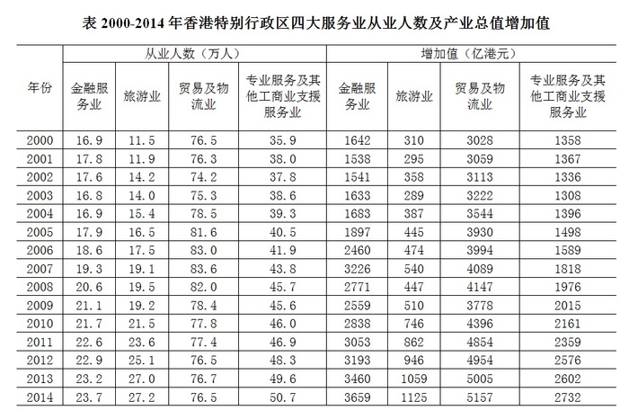

# 增长量计算（四列求和后两期比较）

考点：[[20-考点/资料分析/增长/增长量计算（四列求和后两期比较）|增长 / 增长量计算（四列求和后两期比较）]]
材料：[[15-材料/资料分析/213495 2000-2014年香港特别行政区G|213495 2000-2014年香港特别行政区G]]

**问法模型**：'与2008年相比，2009年……'且选项为'增加/减少+具体万人'→ 用现期2009年四行业之和减基期2008年四行业之和求增长量

## 推理链
1. 第1步：定位表格左半'从业人数（万人）'列，提取2008年四行业数据：金融20.6、旅游19.5、贸易及物流82.0、专业服务45.7
2. 第2步：同列提取2009年四行业数据：金融21.1、旅游19.2、贸易及物流78.4、专业服务45.6
3. 第3步：分别求和：2008年=20.6+19.5+82.0+45.7=167.8万人，2009年=21.1+19.2+78.4+45.6=164.3万人
4. 第4步：增长量=现期-基期=164.3-167.8=-3.5万人，即减少3.5万人（降幅约3.5/167.8≈2.1%）
5. 第5步：与选项对照，'减少了3.5万人'对应D，排除A/B/C

**最快解法**：⚡ 逐项作差再求和（避免两次大和相减）：21.1-20.6=+0.5，19.2-19.5=-0.3，78.4-82.0=-3.6，45.6-45.7=-0.1，合计+0.5-0.3-3.6-0.1=-3.5万人，直接锁定D，秒杀且规避求和精度错误

## 易错点
- ⚠ 看错列：误读表格右半'增加值（亿港元）'列（2008年2771/447/4147/1976），从业人数必须只用左半'万人'列
- ⚠ 混合方向误判：2008→2009金融人数上升（20.6→21.1），只看单项或被'金融业扩张'印象带偏会误判总量增加；实际旅游、贸易及物流、专业服务均降，总量减少
- ⚠ 符号与量级混淆：总量确实减少3.5万人而非0.5万人（B/C的0.5万人近似金融单项增量0.5的干扰）；注意'增加值'是产值概念，不能当增长量用

## 母题抽象
> 🧩 当题干出现'与A年相比，B年某合计总量'且选项为'增加/减少+具体数量'时，先核对指标列口径，再对两年逐年求和或逐项作差求和，用现期减基期定增减、定量级

**同类特征**：与2008年相比，2009年、四大服务业从业人数、增加/减少……万人、增长量计算、多列求和、分项有升有降的混合方向判断

## 相关题
- [[10-真题/资料分析/增长/7159 增长量计算|7159]]（北京 2009，相关度1）
- [[10-真题/资料分析/增长/2571729 增长量计算——每增长1个百分点对应的增量（基期量×1%）|2571729]]（山东 2020，相关度1）
- [[10-真题/资料分析/增长/3018839 增长量计算（负增长情形：基期减少量）|3018839]]（广东 2021，相关度1）
- [[10-真题/资料分析/增长/10204654 增长量计算（已知现期与同比下降率求下降量）|10204654]]（安徽 2024，相关度1）
- [[10-真题/资料分析/增长/13319362 现期增长量计算（已知现期值与同比增速，用r-(1+r)公式）|13319362]]（江苏 2025，相关度1）

---

### 题干
与2008年相比，2009年香港特别行政区四大服务业从业人数      。

### 选项
- A. 增加了0.5万人
- B. 增加了3.5万人
- C. 减少了0.5万人
- D. 减少了3.5万人　✅

### 官方解析
根据题干“与2008年相比，2009年······”，结合选项“增加······万人”、“减少······万人”，可知本题为增长量计算问题。定位表格可知，2008年香港特别行政区四大服务业从业人数为，2009年香港特别行政区四大服务业从业人数为。，即2009年比2008年减少了3.5万人。
故正确答案为D。

### 给定材料

