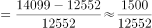
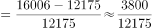
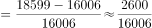
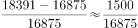

# 同比增长率比较（一般增长率比较问题）

考点：[[20-考点/资料分析/增长/同比增长率比较（一般增长率比较问题）|增长 / 同比增长率比较（一般增长率比较问题）]]
材料：[[15-材料/资料分析/215729 2007—2017年我国外商投资企业|215729 2007—2017年我国外商投资企业]]

**问法模型**：题干问'同比增速最快的年份'→ 对各选项年份分别用（现期值−上年值）/上年值 计算同比增速并比较大小

## 推理链
1. 第1步：从柱状图提取各年总额（亿美元）：2007年12552、2008年14099、2009年12175、2010年16006、2011年18599、2016年16875、2017年18391，选项四个年份的基期分别为2007、2009、2010、2016年
2. 第2步：同比增长率公式 r=（现期值−基期值）/基期值，图上无增速线需自算
3. 第3步：代入计算：2008年=1547/12552≈12.3%；2010年=3831/12175≈31.5%；2011年=2593/16006≈16.2%；2017年=1516/16875≈9.0%
4. 第4步：B项2010年分子3831最大、分母12175在四个基期中最小，其增速约31.5%显著高于其余三项，故增速最快的是2010年，对应B

**最快解法**：⚡ 分子分母定性比较+截位直除：四个增长量（分子）分别为1547、3831、2593、1516，四个基期（分母）分别为12552、12175、16006、16875；B项分子最大且分母最小，直接锁定，首两位直除商31远大于12、16、8，无需精算

## 易错点
- ⚠ 把'增速最快'误做成增长量比较：2011年增长量2593虽大于2008年的1547，但除以更大基期16006后增速反低于2008年；必须除以基期值
- ⚠ 基期取错：2010年的基期是2009年（12175，负增长低谷），正因基期偏小增速才高达约31.5%，若误用其他年份作基期会选错；2017年基期为2016年（16875）
- ⚠ 视觉误判陷阱：图上仅有柱值无增速线，2017年虽较2016年'回升'但增速仅约9%；2015、2016年为连续下滑、2009年为负增长，读数时勿凭柱形高低走势凭感觉判断增速

## 母题抽象
> 🧩 当题干出现'同比增速最快（最高）的年份是'且图表只给各年总量时，先列各选项年份的增长量与基期值，用'分子最大且分母较小'的项定性排除，再对剩余项截位直除验证（当年−上年）/上年

**同类特征**：同比增速最快、年份比较、柱状图仅标注总量、增速需自行计算、一般增长率比较、基期为上年

## 相关题
- [[10-真题/资料分析/增长/2385097 增长率比较（同比增速最快年份）|2385097]]（深圳市考 2019，相关度2）
- [[10-真题/资料分析/增长/2571717 增长率比较（同比增速最快年份比较）|2571717]]（山东 2020，相关度2）
- [[10-真题/资料分析/增长/2187792 同比增长率比较（增速最快年份判断）|2187792]]（黑龙江 2018，相关度1）
- [[10-真题/资料分析/增长/10297321 同比增速计算与比较（增长率比较）|10297321]]（浙江 2025，相关度1）
- [[10-真题/资料分析/增长/18643764 分段加总后的一般增长率比较|18643764]]（天津 2026，相关度1）

---

### 题干
下列年份中，外商投资企业进出口总额同比增速最快的是：

### 选项
- A. 2008
- B. 2010　✅
- C. 2011
- D. 2017

### 官方解析

由题干“······同比增速最快的是········”，可判定本题为一般增长率比较问题。代入公式：，可知：

A项：2008年增长率

B项：2010年增长率

C项：2011年增长率

D项：2017年增长率=

B选项的分子最大，分母最小，故增长率最大。

故正确答案为B。

### 给定材料

