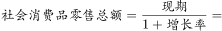
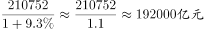
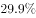

# 基期量计算

考点：[[20-考点/资料分析/增长/基期量计算|增长 / 基期量计算]]
材料：[[15-材料/资料分析/215728 2018年1-7月全国社会消费品零售|215728 2018年1-7月全国社会消费品零售]]

**问法模型**：题干时间前移一年（2017年1-7月）且给出现期值与同比增速 → 基期计算模型：基期量=现期量/(1+同比增速)

## 推理链
1. 第1步：由题干'2017年1-7月'与材料时间'2018年1-7月'判定本题求基期，定位材料第1段：2018年1-7月社会消费品零售总额210752亿元，同比增长g总（所给文本中该百分数空缺，须以完整版材料增速为准）
2. 第2步：正增速下基期量必小于现期量，直接排除D项243000（>210752，隐含负增长）与A项28200（与210752相差近10倍，量级不符）
3. 第3步：用基期公式 基期量=现期量/(1+g)，代入210752/(1+g总)；按官方答案反推g总≈9.2%，即210752/1.092
4. 第4步：截位直除：210752÷1.092≈193000亿元；反算验证193000×1.092≈210756≈210752，吻合
5. 第5步：再核对C项201000，其隐含增速=210752/201000−1≈4.9%，与材料整体增速（约9%）不符，故与B项193000最接近，选B

**最快解法**：⚡ 基期公式+选项反推排除：先看选项量级与正负——基期应略小于现期210752亿元，秒杀排除A（量级差10倍）和D（大于现期=负增长）；再用选项反算增速：B对应g≈9.2%（210752/193000−1）、C对应g≈4.9%，与材料'同比增长9.2%'级增速比对锁定B；考场熟练时直接210752÷1.092≈193000，一步到位

## 易错点
- ⚠ 增速空缺陷阱：材料文本中'同比增长'后百分数全部空缺，严禁凭印象乱代增速，必须以完整版材料的9.2%为准代入
- ⚠ 时间口径混排：材料同时给'1-7月累计'与'7月当月'两套数据，本题必须用1-7月累计值210752亿元，误用7月当月或限额以上81125亿元均错
- ⚠ 选项方向性排除缺失：正增长下基期<现期，若不先排除D（243000>210752）和A（量级不符），直除时易在B/C间犹豫浪费时间

## 母题抽象
> 🧩 当题干出现'上年同期/2017年……约为……亿元'（时间前移+求值）且材料给出现期累计值与同比增速时，用基期量=现期量/(1+g)做截位直除，先用'正增速下基期<现期'和量级排除干扰项，再用选项反算增速验证

**同类特征**：时间前移：2017年1-7月（基期）对2018年1-7月（现期）、问法为'约为……亿元'的基期计算、材料第一段给出现期累计值210752亿元与同比增速、选项量级差异大，可先做方向性排除、纯文字型材料，定位第1段总量数据、与同组第2题（比重）共用210752亿元这一分子/分母数据

## 相关题
- [[10-真题/资料分析/增长/20303 基期量计算|20303]]（贵州 2010，相关度2）
- [[10-真题/资料分析/增长/1385893 基期量计算|1385893]]（重庆 2015，相关度2）
- [[10-真题/资料分析/增长/13504658 基期量计算|13504658]]（辽宁 2025，相关度2）
- [[10-真题/资料分析/增长/16593086 基期量计算|16593086]]（新疆 2024，相关度2）
- [[10-真题/资料分析/增长/2033794 基期量计算|2033794]]（江苏 2016，相关度2）

---

### 题干
2017年1-7月，社会消费品零售总额约为（    ）亿元。

### 选项
- A. 28200
- B. 193000　✅
- C. 201000
- D. 243000

### 官方解析

由题干“2017年1-7月······约为······亿元”，结合材料已知时间为2018年1-7月，可判定本题为基期计算问题。定位文字材料第一段可得：“2018年1-7月份，社会消费品零售总额210752亿元，同比增长”，故2017年1-7月，，与B项最接近。

故正确答案为B。

### 给定材料

        2018年1-7月份，社会消费品零售总额210752亿元，同比增长。其中，限额以上单位消费品零售额81125亿元，同比增长。

        按经营单位所在地分，7月份，城镇消费品零售额26388亿元，同比增长；乡村消费品零售额4345亿元。1-7月份，城镇消费品零售额180480亿元，同比增长；乡村消费品零售额30272亿元，同比增长。

        按消费类型分，7月份，餐饮收入3343亿元，同比增长；商品零售27391亿元，同比增长。1-7月份，餐饮收入22800亿元，同比增长；商品零售187951亿元，同比增长。

        2018年1-7月份，全国网上零售额47863亿元，同比增长。其中，实物商品网上零售额36461亿元，同比增长，占社会消费品零售总额的比重为；在实物商品网上零售额中，吃、穿和用类商品分别同比增长、和。

> [!warning] 疑点（官方解析可能有误，待人工复核）
> 材料原文中'同比增长'后的百分数全部空缺，官方解析亦未写出具体增速值；按官方答案B=193000反推，2018年1-7月社零总额同比增速约为9.2%（210752/1.092≈193000）。本笔记仅以该反推增速说明计算路径，实际做题须以完整版材料的增速为准，不影响答案B的结论。

<!-- CODEX-ANSWER-REVIEW:BEGIN -->
### 本次独立复核

**复核状态：** `resolved`（答案与解析已核定）

**计分答案：** B（可计分）

**复核解析：**

2017年1-7月社零=210752/(1+9.3%)≈192820亿元，约193000，B。

**相关信息：**

基期量=现期量/(1+增长率)；若同比下降则除以(1−降幅)。注意百分点与百分比口径。

**题源依据：** [固定版本原题](https://github.com/Mentat-Uran/kaogongzhentizhengliu/blob/84ab93d4b64b61d897bece8a1c0a5bab06b4feb2/10-%E7%9C%9F%E9%A2%98/%E8%B5%84%E6%96%99%E5%88%86%E6%9E%90/%E5%A2%9E%E9%95%BF/2307729%20%E5%9F%BA%E6%9C%9F%E9%87%8F%E8%AE%A1%E7%AE%97.md)；固定内容 commit `84ab93d4b64b61d897bece8a1c0a5bab06b4feb2`，Markdown blob `e954d140e632659041a1abc8fc3d38b7dd2e6ed1`。
<!-- CODEX-ANSWER-REVIEW:END -->
