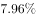
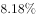
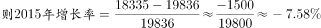

# 同比增长率计算（负增长）

考点：[[20-考点/资料分析/增长/同比增长率计算（负增长）|增长 / 同比增长率计算（负增长）]]
材料：[[15-材料/资料分析/215729 2007—2017年我国外商投资企业|215729 2007—2017年我国外商投资企业]]

**问法模型**：题干'2015年……同比约'且选项为下降/增长百分数 → 用（2015年−2014年）÷2014年计算同比增速，先看差值正负定升降方向，再估幅度选最接近项

## 推理链
1. 第1步：从柱状图提取2015年外商投资企业进出口总额18335亿美元，其同比基期为2014年的19836亿美元
2. 第2步：同比增速公式 = (现期−基期)÷基期×100%
3. 第3步：代入计算：(18335−19836)÷19836 = −1501÷19836 ≈ −7.6%，差值为负，即同比下降
4. 第4步：验证量级：19836×7.6%≈1508，与1501非常接近，确认幅度约7.6%
5. 第5步：与选项对照：A项为'下降约7.6%'方向一致、数值最接近，故选A

**最快解法**：⚡ 截位直除+先定方向：差值1501为负直接锁定'下降'（排除C/D）；再看1501/19836，因19836×10%=1983.6>1501，故降幅小于10%，约1501÷19836≈7.6%，与A项匹配

## 易错点
- ⚠ 方向陷阱：2015年（18335）低于2014年（19836），是负增长年份，必须选'下降'，误把差值绝对值当增幅会错选C/D
- ⚠ 基期取错：同比基期是2014年19836，误用2013年19183或后一年2016年16875做分母则算错幅度
- ⚠ 幅度量级误判：1501÷19836若截位粗放易估成10%以上或5%以下，应先乘10%基期值1983.6对比差值1501锁定7%~8%区间

## 母题抽象
> 🧩 当题干出现'某年××同比约'且选项为下降/增长百分数时，用（现期柱值−上年柱值）÷上年柱值，先看差值正负定升降方向，再截位直除估幅度选最接近项

**同类特征**：单点同比增速计算、柱状图读取相邻两年数值、负增长年份（2015年）、下降/增长方向判断、选项为百分数（约…%）、同比基期为上一年

## 相关题
（暂无）

---

### 题干
2015年外商投资企业进出口总额同比约：

### 选项
- A. 
下降
　✅
- B. 
下降

- C. 
增长

- D. 
增长

### 官方解析

由题干“2015年······同比约······”，结合选项为下降/增长百分数，可判定本题为一般增长率计算问题。定位2014年至2015年的全国外商投资企业进出口总额，代入公式：，，与A项最接近。

故正确答案为A。

### 给定材料

