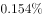
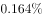
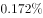
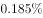
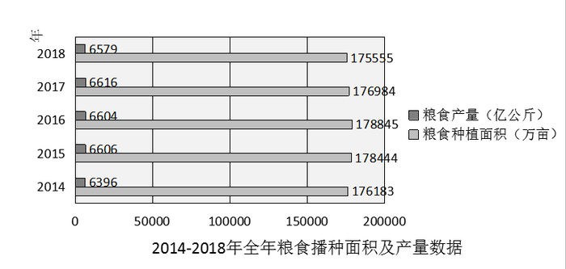
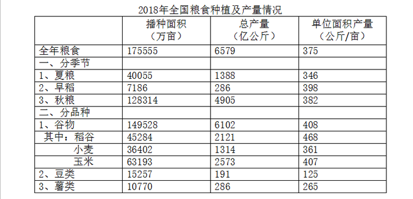

# 拉动增长率计算（部分增量拉动整体增长）

考点：[[20-考点/资料分析/增长/拉动增长率计算（部分增量拉动整体增长）|增长 / 拉动增长率计算（部分增量拉动整体增长）]]
材料：[[15-材料/资料分析/215727 国家统计局公布的2014—2018年|215727 国家统计局公布的2014—2018年]]

**问法模型**：题干出现'稻谷（部分）的总产量拉动谷物总产量（整体）增长了…'→ 用拉动增长率模型：拉动增长率=部分同比增量÷整体基期量，选项为百分数

## 推理链
1. 第1步：定位统计表'分品种'行：2018年稻谷总产量2121亿公斤（稻谷是谷物下的'其中'项）；定位文字材料：2018年谷物总产量6102亿公斤、比2017年下降（降幅数值原文留空，需由题干/选项补充）；条形图2017年只有粮食总量6616亿公斤，图中无谷物基期
2. 第2步：题干'若2018年稻谷总产量同比增长'给定稻谷增速（具体数值由题干补充），则稻谷同比增量=2121×增速÷(1+增速)，增速很小时可近似为2121×增速
3. 第3步：还原整体基期量：2017年谷物总产量=6102÷(1-谷物同比降幅)，与第2题（两期比重差）所需谷物基期同源、可连环复用；切勿误拿条形图2017年粮食6616亿公斤充当谷物基期（口径为'粮食'非'谷物'）
4. 第4步：代入公式：拉动增长率=稻谷同比增量÷2017年谷物产量，可等价近似为'稻谷占谷物基期比重×稻谷增速'≈(2121/谷物基期)×r≈约1/3×r（官方解析中增量与基期的代入数值以图片呈现/此处留空，按公式直接计算即得）
5. 第5步：将计算所得百分数与四个选项对照，落在C项，故正确答案为C（官方唯一事实，不得改写）

**最快解法**：⚡ 公式法+比重替代：拉动增长率≈部分基期占比×部分增速，稻谷占谷物比重2121/6102≈35%（约1/3强），故拉动增长率≈(1/3)×稻谷增速r，心算量级即可锁定选项；若需精确值，分母用6102÷(1-降幅)截位还原为谷物基期，分子2121×r截位直除

## 易错点
- ⚠ 基期/现期混淆：拉动增长率的分母是谷物基期（2017年）产量=6102÷(1-降幅)，不能用现期6102亿公斤，更不能用粮食口径的6616亿公斤
- ⚠ 口径错位：整体须为'谷物'（6102亿公斤）基期量；'粮食'（6579/6616）是包含关系不可替代，'早稻'（季节口径、单产398）与'稻谷'（品种口径、单产468、2121亿公斤）不可互换
- ⚠ 留空信息陷阱：文字中谷物降幅与题干稻谷增速均为留空/图片式补充，切勿脑补具体百分数，须按题干给定增速代入后以量级对照选项

## 母题抽象
> 🧩 当题干出现'A（部分）拉动B（整体）增长了…'特征时，用'拉动增长率=部分同比增量÷整体基期量'，整体基期=现期整体÷(1+整体同比增速)（由文字同比信息还原），速算可近似为部分基期占比×部分增速，再与选项量级对照

**同类特征**：拉动…增长了、若…同比增长（增速由题干给定）、稻谷（部分）、谷物总产量（整体）、选项为百分数、增量÷基期量

## 相关题
- [[10-真题/资料分析/增长/9629 一般增长率计算（现期需由增量倒推）|9629]]（安徽 2009，相关度1）
- [[10-真题/资料分析/比重/2604234 现期比重计算|2604234]]（广东 2020，相关度1）
- [[10-真题/资料分析/增长/27835 一般增长率计算（已知现期量与增长量求增长率）|27835]]（河北 2012，相关度1）
- [[10-真题/资料分析/平均数/10204497 平均数增长率（均价=值-量的比值增长率）|10204497]]（海南 2024，相关度1）
- [[10-真题/资料分析/增长/12536395 隔年（间隔）增长率|12536395]]（四川 2024，相关度1）

---

### 题干
若2018年稻谷的总产量同比增长，那么稻谷的总产量拉动谷物总产量增长了：

### 选项
- A. 

- B. 

- C. 

　✅
- D. 

### 官方解析
由题干“若2018年稻谷的总产量同比增长，稻谷的总产量拉动谷物总产量增长了”，结合选项为百分数，可判定本题为拉动增长率计算问题。定位文字材料及表格可知，2018年谷物总产量6102亿公斤，比2017年下降，稻谷总产量2121亿公斤，则2018年稻谷同比增长量=亿公斤，2017年谷物总产量为亿公斤，根据拉动增长率=。
故正确答案为C。

### 给定材料

        国家统计局公布的全国粮食生产数据显示，2018年全国粮食播种面积175555万亩，比2017年下降。全国粮食单位面积产量375公斤/亩，比2017年增长。谷物单位面积产量408公斤/亩，比2017年增长。粮食总产量6579亿公斤，比2017年下降；其中谷物（包括稻谷，小麦，玉米、大麦、高粱、荞麦、燕麦等）总产量6102亿公斤，比2017年下降。全年粮食产量虽有所下降，但减幅不大，仍处于高位水平，属于丰收年景。

> [!warning] 疑点（官方解析可能有误，待人工复核）
> 所给题干'2018年稻谷的总产量同比增长'后缺失具体增速数值，文字'谷物…比2017年下降'后降幅亦留空，四个选项与官方解析中的代入数值均以图片/留空形式呈现，故无法据现有信息完成数值级核验；此属呈现不完整而非答案口径矛盾，官方答案C按'拉动增长率=稻谷增量÷2017年谷物产量'口径与材料一致。
