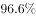

# 增长率计算之百分点换算（跨期增速倒推）

考点：[[20-考点/资料分析/增长/增长率计算之百分点换算（跨期增速倒推）|增长 / 增长率计算之百分点换算（跨期增速倒推）]]

**问法模型**：已知7月增速及'比上个月提高X个百分点'→上月增速=7月增速−提高的百分点数

## 推理链
1. 第1步：材料第一段提取条件：2009年7月钢材产量同比增长19.4%，增速比上个月提高5.4个百分点
2. 第2步：规则：'提高5.4个百分点'说明7月增速比6月增速高5.4个百分点，故6月增速=7月增速−5.4个百分点
3. 第3步：代入计算：19.4%−5.4%=14.0%
4. 第4步：与选项对照，B项为14.0%，与计算结果一致，故选B

**最快解法**：⚡ 百分点直减法：19.4%−5.4%=14.0%，一步口算锁定B，无需列式

## 易错点
- ⚠ 方向搞反：把'提高5.4个百分点'误加为19.4%+5.4%=24.8%，误选D
- ⚠ 百分点与百分数混淆：误把5.4个百分点当作增长率本身或做乘法运算，误选A
- ⚠ 时间口径错误：错用1—7月累计数据（钢材产量同比下降）来推6月增速

## 母题抽象
> 🧩 当题干出现'A增速为a%，比上月提高(降低)b个百分点'时，上月增速=a%−b%（降低则为a%+b%），用百分点直减/直加验证

**同类特征**：增速比上个月提高X个百分点、同比增长率、上月/上个月时间前推、百分点运算、单月增速而非累计增速

## 相关题
- [[10-真题/资料分析/增长/2015318 同比增长率计算|2015318]]（重庆 2016，相关度1）
- [[10-真题/资料分析/增长/2456363 基期量计算|2456363]]（浙江 2020，相关度1）
- [[10-真题/资料分析/增长/4695874 同比增长率计算（分量增速，一般增长率）|4695874]]（选调 2018，相关度1）
- [[10-真题/资料分析/增长/10204440 一般增长率计算与趋势图匹配（同比增长率逐年比较）|10204440]]（广东 2024，相关度1）
- [[10-真题/资料分析/增长/2261884 同比增长率计算与超阈值年份计数|2261884]]（湖北 2017，相关度1）

---

### 题干
2009年6月，全国钢材产量的同比增长率为：

### 选项
- A. 
5.4%

- B. 
14.0%
　✅
- C. 
19.4%

- D. 
24.8%

### 官方解析
定位文字材料第一段可得：“钢材产量同比增长19.4%，增速比上个月提高5.4个百分点。”故2009年6月，全国钢材产量的同比增长率为：。
故正确答案为B。

### 给定材料

根据所给资料，完成各题。

        2009年7月，全国粗钢产量同比增长，增速比上个月提高6.6个百分点；钢材产量同比增长，增速比上个月提高5.4个百分点；焦炭产量同比增长；铁合金产量同比增长。钢材出口181万吨，比上月增加38万吨；进口174万吨，比上月增加11万吨。钢坯进口57万吨，比上月增加19万吨。焦炭出口5万吨，比上月增加2万吨。

        1—7月，全国粗钢产量31731万吨，同比增长，增速同比下降6.4个百分点。钢材产量37784万吨，同比下降，增速同比下降4.1个百分点。焦炭产量19048万吨，同比下降，上年同期的同比增长率为。铁合金产量1124万吨，同比增长，增速同比下降16.8个百分点。钢坯进口323万吨，同比增长27.9倍。钢材出口1116万吨，同比下降；进口988万吨，同比增长。铁矿砂进口35525万吨，同比增长。焦炭出口28万吨，同比下降。

