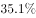
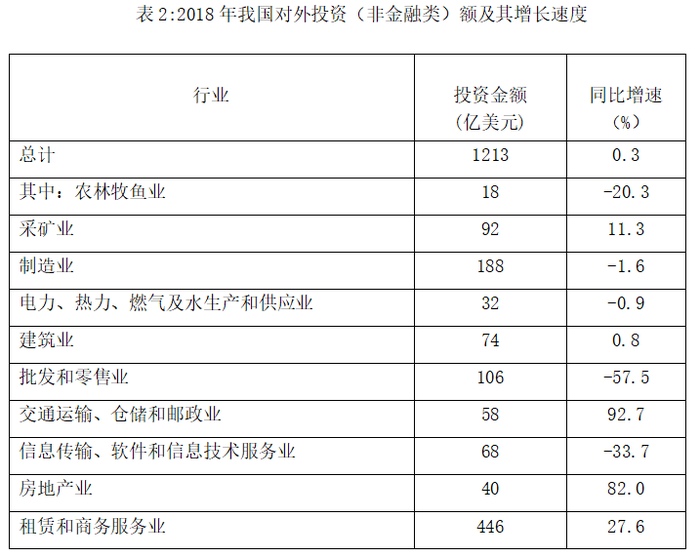

# 增长率（同比增速）读数与带符号排序比较

考点：[[20-考点/资料分析/增长/增长率（同比增速）读数与带符号排序比较|增长 / 增长率（同比增速）读数与带符号排序比较]]
材料：[[15-材料/资料分析/238899 2018年我国双向非金融类直接投资：|238899 2018年我国双向非金融类直接投资：]]

**问法模型**：题干要求将行业2018年外商直接在华投资额'按增幅从大到小排序'→ 直接定位表1'投资金额'对应的'同比增速(%)'列，按带符号数值比较各选项组合。

## 推理链
1. 第1步：题干排序对象是'投资额'的增幅，故定位表1第4列'投资金额(亿元)'右侧的'同比增速(%)'列，而非'企业数'增速列
2. 第2步：读出相关行业投资金额增速：农林牧渔业-26.4%、制造业20.1%、电力热力燃气及水23.6%、交通运输仓储邮政-16.0%、信息传输软件-44.4%、批发零售-16.5%、房地产业31.4%
3. 第3步：排除A项：农林牧渔业-26.4%＜电力热力燃气及水23.6%，农林牧渔业不可能排首位
4. 第4步：排除C项：信息传输-44.4%为相关行业中最低（负值最小），不可能排首位；排除D项：农林牧渔业-26.4%＜批发零售-16.5%（负数绝对值大反而小），顺序颠倒
5. 第5步：验证B项：房地产业31.4%＞电力热力燃气及水23.6%＞制造业20.1%，按带符号从大到小成立
6. 第6步：故正确答案为B

**最快解法**：⚡ 排除法+带符号比较：看每个选项的首位行业增速，A首位农林牧渔-26.4%、C首位信息传输-44.4%均为负值，不可能在'从大到小'中排首位；D中农林牧渔-26.4%＜批发零售-16.5%；仅剩B，验证31.4＞23.6＞20.1成立，秒选B。

## 易错点
- ⚠ 表1每行有两个同名'同比增速'列，分别对应企业数和投资金额，若误读企业数增速列（如信息传输+127.9%、批发零售+86.1%），排序将完全出错
- ⚠ 增速含负值（信息传输-44.4%、农林牧渔-26.4%、批发零售-16.5%、交通运输-16.0%），必须按带符号数值比较，勿按绝对值大小或忽略负号排序（如-26.4%＜-16.5%）
- ⚠ 题干'增幅'即同比增速（可正可负），勿误以为负增长行业增速应取绝对值参与比较

## 母题抽象
> 🧩 当题干出现'按增速/增幅从大到小（或从小到大）排序行业/地区'且选项为三项组合时，先检查各选项首位（或末位）行业增速的符号与大小做排除，再对剩余选项按带符号数值逐项验证，避免逐项全排。

**同类特征**：增幅从大到小排序、外商直接在华（非金融类）投资额、行业三项组合选项、统计表双增速列（企业数/投资金额）、负增速参与带符号比较、定位单一表格直接读数比较

## 相关题
（暂无）

---

### 题干
将下列行业中2018年外商直接在华非金融类投资额按增幅从大到小排序，正确的是：

### 选项
- A. 农林牧渔业＞电力、热力、燃气及水生产和供应业＞批发和零售业
- B. 房地产业＞电力、热力、燃气及水生产和供应业＞制造业　✅
- C. 信息传输、软件和信息技术服务业＞房地产业＞制造业
- D. 农林牧渔业＞批发和零售业＞交通运输、仓储和邮政业

### 官方解析
定位第一个统计表可知，2018年外商直接在华非金融类投资额增速分别为：
A项：农林牧渔业（）、电力、热力、燃气及水生产和供应业（）、批发和零售业（）；
B项：房地产业（）、电力、热力、燃气及水生产和供应业（）、制造业（）；
C项：信息传输、软件和信息技术服务业（）、房地产业（）、制造业（）；
D项：农林牧渔业（）、批发和零售业（）、交通运输、仓储和邮政业（）。
按照从大到小排序，只有B选项满足题意。
故正确答案为B。

### 给定材料

        自改革开放以来，外商在华投资势头良好。今年两会期间，《中华人民共和国外商投资法（草案）》成为重要议题。2018年，外商直接在华投资（非金融类）新设立企业60533家。外商直接在华投资金额8856亿元，折1350亿美元。其中“一带一路”沿线国家对华直接投资新设立企业4479家，对华直接投资424亿元。全年高技术制造业实际使用外资（非金融类）898亿元，增长。

        2018年，我国对外非金融类直接投资7974亿元，同比下降，其中对“一带一路”沿线国家非金融类直接投资156亿美元，同比增长。

