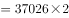
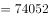
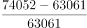
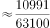

# 翻番目标倒推所需增长率（目标值=基期值×2，增速=目标值-现期值-1）

考点：[[20-考点/资料分析/增长/翻番目标倒推所需增长率（目标值=基期值×2，增速=目标值-现期值-1）|增长 / 翻番目标倒推所需增长率（目标值=基期值×2，增速=目标值/现期值-1）]]
材料：[[15-材料/资料分析/238900 2018年我国软件和信息技术服务业运|238900 2018年我国软件和信息技术服务业运]]

**问法模型**：题干出现'在2014年基础上翻番，则2019年同比增速要达到约'→ 先由基期值×2定出2019年目标收入，再用 目标增速=目标值÷2018年现期值−1 求解

## 推理链
1. 第1步：从图1提取数据——2014年软件业务收入37026亿元，2018年（现期）软件业务收入63061亿元
2. 第2步：'翻番'即变为原来的2倍，故2019年目标收入=37026×2=74052亿元
3. 第3步：2019年同比增速是相对2018年而言，所需增速=74052÷63061−1=10991÷63061
4. 第4步：截位计算10991/63061≈110/631≈0.174，即约17.4%
5. 第5步：与选项对照，A选项（约17.4%）最接近，故选A

**最快解法**：⚡ 截位直除：目标74052=37026×2，所需增速=74052/63061−1，分子分母各截三位得110/631≈17.4%，直接锁定A

## 易错点
- ⚠ '翻番'基期取错：应在2014年（37026亿元）基础上翻番，目标=37026×2=74052亿元，误用2018年63061×2或2013年30587×2都会算错
- ⚠ 增长率分母取错：2019年'同比'增速的分母是2018年现期值63061亿元，误除以2014年基期值37026会把增速算成约100%
- ⚠ 目标与现期混淆：所得17.4%是2019年相对2018年需达到的增速，不是2014—2018年间任何一年的实际增速（如2018年实际增速仅63061/55103−1≈14.4%），不能拿历史增速直接作答

## 母题抽象
> 🧩 当题干出现'要在某基期年基础上翻番/达到其2倍，求某年所需增速'时，先用 目标值=基期值×2，再用 所需增速=目标值÷最近一期现期值−1，截位直除后对照选项取最接近者

**同类特征**：翻番、在2014年基础上、2019年同比增速要达到约、目标值倒推、图1业务收入序列、一般增长率问题

## 相关题
- [[10-真题/资料分析/增长/2376601 增长率计算与两年增速差值（百分点）比较|2376601]]（重庆 2019，相关度1）
- [[10-真题/资料分析/增长/2719362 一般增长率计算（翻番目标模型：基期×2定目标→（目标−现期）-现期求所需同比增速）|2719362]]（国考 2021，相关度1）
- [[10-真题/资料分析/增长/3523613 增长率计算与阈值比较（同比增速超10%计数）|3523613]]（四川 2021，相关度1）
- [[10-真题/资料分析/增长/5521214 同比增长率计算与比较|5521214]]（深圳市考 2023，相关度1）
- [[10-真题/资料分析/增长/5746645 增长率比较（同比增速找最小）|5746645]]（江苏 2023，相关度1）

---

### 题干
如果我国2019年要实现在2014年基础上软件和信息技术服务业业务收入翻番的目标，则2019年业务收入同比增速要达到约：

### 选项
- A. 

　✅
- B. 

- C. 

- D. 

### 官方解析

根据问题“2019年业务收入同比增速要达到约”，可判断为一般增长率问题。定位图1，根据“我国2019年要实现在2014年基础上软件和信息技术服务业业务收入翻番的目标”，可得2019年软件和信息技术服务业业务收入（翻番指的是变为原来的2倍）亿元，则2019年业务收入同比增速要达到，A选项最接近。

故正确答案为A。

### 给定材料

        2018年，我国软件和信息技术服务业运行态势良好，收入和效益增长较快，吸纳就业人数稳定增长。2018年，全国软件和信息技术服务业规模以上企业3.78万家，累计完成软件业务收入63061亿元，软件和信息技术服务业实现利润总额8079亿元，同比增长，从业人数比上年增加25万人。

