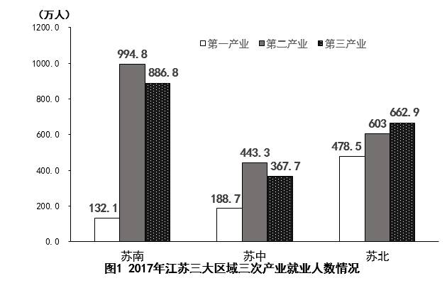

# 增长量计算（现期在文字段、基期需跨材料由三区域加总）

考点：[[20-考点/资料分析/增长/增长量计算（现期在文字段、基期需跨材料由三区域加总）|增长 / 增长量计算（现期在文字段、基期需跨材料由三区域加总）]]
材料：[[15-材料/资料分析/238951 江苏省及苏南、苏中、苏北三大区域20|238951 江苏省及苏南、苏中、苏北三大区域20]]

**问法模型**：题干'2018年……比上年增加'+选项带'亿元'单位 → 判定为增长量计算，用 增长量=现期量−基期量

## 推理链
1. 第1步：定位文字段，2018年江苏一般公共预算收入为8630亿元（现期量）；文字段中2017年数据缺失，基期须到表格中找
2. 第2步：定位表格（2017年数据），三大区域一般公共预算收入分别为苏南4913亿元、苏中1246亿元、苏北1508亿元
3. 第3步：表中只给三大区域口径，需加总拼出全省基期值：4913+1246+1508=7667亿元
4. 第4步：套用公式 增长量=现期量−基期量=8630−7667=963亿元
5. 第5步：与选项对照，A为963亿元，与计算结果一致；C(1963)、D(1971)量级约为真值两倍以上，排除

**最快解法**：⚡ 跨材料拼数+尾数法直减：先加总基期（尾数3+6+8=17，基期尾数7），现期8630尾数0减基期尾数7借位后结果尾数3，锁定尾数3的A/C；再量级校验：7667距8630不足1000，故选963（A），排除约2000量级的C、D

## 易错点
- ⚠ 年份混排陷阱：文字段是2018年、表格是2017年，同名指标'一般公共预算收入'跨两年出现，若把表内数据误当2018年现期值、或误以为文字段的8630是2017年值，则现基期颠倒
- ⚠ 跨材料拼数陷阱：表内只有苏南/苏中/苏北三列，无全省2017年合计，必须加总4913+1246+1508=7667亿元；若只拿苏南4913当基期，得8630−4913=3717亿元，无对应选项
- ⚠ 相近指标陷阱：表中'一般公共预算收入'紧邻'一般公共预算支出'，文字段还有支出11658亿元，抄数时易串行；另C(1963)/D(1971)是量级翻倍干扰项，需用差值应'小于1000'的量级直觉拦截

## 母题抽象
> 🧩 当题干出现'某年比上（一）年增加/减少'且选项带具体单位（亿元/万人等）时，用增长量=现期量−基期量；若现期在文字段、基期在图表且仅有分区域数据，先跨材料配对同名指标并将区域值加总成全省口径，再相减，并用尾数+量级双重验证选项

**同类特征**：'比上年增加/减少'类问法、选项带具体单位（亿元）、现期值在文字段、基期值在图表的跨材料配对、基期需多区域（苏南+苏中+苏北）加总、同名指标跨年份出现，需辨析2018与2017口径、差值结果可直接尾数验证

## 相关题
（暂无）

---

### 题干
2018年江苏一般公共预算收入比上年增加

### 选项
- A. 963亿元　✅
- B. 988亿元
- C. 1963亿元
- D. 1971亿元

### 官方解析
根据题干“2018年······比上年增加”，结合选项带单位，可判定本题为增长量计算问题。定位文字材料可知，2018年江苏一般公共预算收入8630亿元；定位表格材料可知，2017年苏南、苏中、苏北一般公共预算收入分别为4913亿元、1246亿元、1508亿元。则2017年江苏一般公共预算收入为4913+1246+1508=7667亿元。根据公式：增长量=现期量-基期量，则题干所求为8630-7667=963亿元。
故正确答案为A。

### 给定材料

        2018年江苏第一、二、三产业增加值分别为4142亿元、41248亿元和47205亿元；城镇常住居民人均可支配收入47200元，增长8.2，农村常住居民人均可支配收入20845元，增长8.8；一般公共预算收入8630亿元，一般公共预算支出11658亿元。

