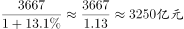

# 基期量计算（现期÷(1+增长率)）

考点：[[20-考点/资料分析/增长/基期量计算（现期÷(1+增长率)）|增长 / 基期量计算（现期÷(1+增长率)）]]
材料：[[15-材料/资料分析/238953 2013—2018年全国互联网业务收|238953 2013—2018年全国互联网业务收]]

**问法模型**：题干所求年份（2017年）早于材料现期年份（2018年）且问具体数值 → 基期量=现期量÷(1+同比增长率)，并用选项×(1+r)回乘验证。

## 推理链
1. 第1步：题干问“2017年电子商务平台收入为多少亿元”，材料现期为2018年，判定为基期计算；定位文字“2018年电子商务平台收入3667亿元，增长（13.1%）”，该增速在题面为空格、图中亦无此折线，必须回原卷文字取值（按官方答案D反推：3667÷3242−1≈13.1%）
2. 第2步：套用基期量公式：基期量=现期量÷(1+增长率)=3667÷(1+13.1%)
3. 第3步：截位直除：3667÷1.131≈3242（估算3667÷1.13≈3245，精确值3242）
4. 第4步：与选项对照：A2938、B3012、C3113、D3242，与计算值3242最接近的是D；回乘验证：3242×1.131≈3667，与现期3667亿元吻合，锁定D

**最快解法**：⚡ 基期直除＋选项回乘验证：增速回文字取13.1%，3667÷1.131≈3242，直除首两位'32'即可排除A、B、C直接锁定D；再用3242×1.131≈3667回验现期值即可放心作答。

## 易错点
- ⚠ 方向反了（现期当基期）：误算3667×(1+13.1%)≈4148，而所有选项均小于3667，可用'基期必小于现期（正增长时）'自查方向
- ⚠ 增速取数错位：图中折线21.0%是全国互联网业务收入的增速，电商平台的增速在题面为空格、图里查不到，若误用21.0%代算会得3667÷1.21≈3031而误选B，分项增速必须回文字原值
- ⚠ 口径层级混淆：3667亿元是信息服务收入8594亿元之下的'其中'分项，不是全国互联网业务收入9562亿元的直接分项，切勿拿9562或8594当现期、或把'信息服务增速'套在'电商平台'上

## 母题抽象
> 🧩 当题干出现'求上一年（材料现期之前）某量为多少'的特征时，用基期量=现期量÷(1+增长率)直除，增速必须从文字原文对应分项处取数，并用'选项×(1+r)≈现期'回乘验证锁定答案。

**同类特征**：所求年份（2017）早于材料现期年份（2018），求基期、问法为'……收入为（多少亿元）'的具体量值型、现期值在文字'其中'分项层（电商平台3667亿元）、对应增速在题面呈空格、图中无此数据，须回原卷文字取值、选项为量级相近的四位数亿元，需直除或回乘验证

## 相关题
（暂无）

---

### 题干
2017年全国互联网企业电子商务平台收入为

### 选项
- A. 2938亿元
- B. 3012亿元
- C. 3113亿元
- D. 3242亿元　✅

### 官方解析

由题干“2017年······为多少亿元”，结合材料时间为2018年，判定本题为基期计算问题。定位文字部分可得“2018年······其中，电子商务平台收入3667亿元，增长”。代入公式：，则2017年，全国互联网企业电子商务平台收入，与D项最接近。

故正确答案为D。

### 给定材料

        2018年全国互联网业务收入9562亿元，比上年增长。其中，广东、上海、北京互联网业务收入分别增长、和。2018年互联网企业信息服务收入8594亿元，比上年增长。其中，电子商务平台收入3667亿元，增长；网络游戏业务收入1948亿元，增长。2018年互联网行业研发投入490亿元，比上年增长。

> [!warning] 疑点（官方解析可能有误，待人工复核）
> 题面文字中电商平台增速处为空格，官方解析中公式代入的具体数值亦被省略；按官方答案D反推增长率=3667÷3242−1≈13.1%，与解析'与D项最接近'的结论自洽，无矛盾，但实际作答时须核对原卷文字该空格处增速是否给出。

<!-- CODEX-ANSWER-REVIEW:BEGIN -->
### 本次独立复核

**复核状态：** `resolved`（答案与解析已核定）

**计分答案：** D（可计分）

**复核解析：**

2018年电商平台收入3667亿元，图中同比增长13.1%。2017年收入=3667/1.131≈3241.4亿元，最接近3242亿元，选D。

**相关信息：**

基期量=现期量/(1+r)。

**题源依据：** [固定版本原题](https://github.com/Mentat-Uran/kaogongzhentizhengliu/blob/84ab93d4b64b61d897bece8a1c0a5bab06b4feb2/10-%E7%9C%9F%E9%A2%98/%E8%B5%84%E6%96%99%E5%88%86%E6%9E%90/%E5%A2%9E%E9%95%BF/2367775%20%E5%9F%BA%E6%9C%9F%E9%87%8F%E8%AE%A1%E7%AE%97%EF%BC%88%E7%8E%B0%E6%9C%9F%C3%B7(1%2B%E5%A2%9E%E9%95%BF%E7%8E%87)%EF%BC%89.md)；固定内容 commit `84ab93d4b64b61d897bece8a1c0a5bab06b4feb2`，Markdown blob `ff96e7fa69b907c552c6e5ec1bd6ab379bcce501`。
<!-- CODEX-ANSWER-REVIEW:END -->
