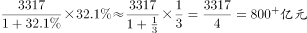
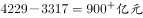
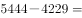
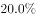
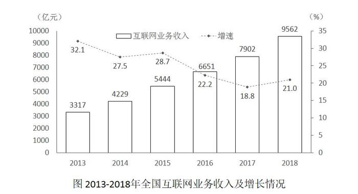

# 增长量比较（含基期未知年份的增量反推）

考点：[[20-考点/资料分析/增长/增长量比较（含基期未知年份的增量反推）|增长 / 增长量比较（含基期未知年份的增量反推）]]
材料：[[15-材料/资料分析/238953 2013—2018年全国互联网业务收|238953 2013—2018年全国互联网业务收]]

**问法模型**：题干问'增加最少的年份'→ 增长量比较模型：各年份增长量=当年值−上年值；若选项含材料首年（2013年）且基期2012年未给出，则该年增量用'现期×r/(1+r)'借增速32.1%反推后统一比大小

## 推理链
1. 第1步：选项仅含2013—2016年，故只需比较这四年；由图读柱值（左轴，亿元）：2013年3317、2014年4229、2015年5444、2016年6651，对应折线增速（右轴）：32.1%、27.5%、28.7%、22.2%
2. 第2步：2014—2016年增长量=当年柱值−上年柱值；2013年因图中无2012年基数，用公式'增长量=现期×r/(1+r)'，r=32.1%
3. 第3步：2013年增量=3317×0.321/1.321≈806亿元；2014年=4229−3317=912亿元；2015年=5444−4229=1215亿元；2016年=6651−5444=1207亿元
4. 第4步：比较四年增量：806＜912＜1207＜1215，最小者为2013年（即使延伸比较2017年1251、2018年1660亦不改结论），对应选项A

**最快解法**：⚡ 公式法+截位估算：2013年增量=3317×0.321/1.321，0.321/1.321≈0.243，3317×0.243≈806；其余三年柱值直接相减得912、1215、1207，一眼判定806最小选A；考场可先凭'2014年增量912已明显大于2013年反推值806'快速锁定，无需逐年精算

## 易错点
- ⚠ 漏算2013年：图中无2012年基数，易误以为只能比较2014—2018年，从而在B/C/D中错选；2013年增量须用增速32.1%反推（≈806亿元）
- ⚠ 把'增速最高'误当'增加最少'或反之：2013年增速32.1%是四年中最高的，但基期小、增量反而最小，增长率与增长量不能混判
- ⚠ 双轴图读错轴：柱对应左轴（亿元）、折线对应右轴（%），求增量必须用柱值，若误读折线数值（32.1等）作收入则全盘皆错

## 母题抽象
> 🧩 当题干出现'增加最多/最少的年份'且选项含材料首年、而首年基期未给出时，首年增量用'现期×r/(1+r)'借其增速反推，其余年份用数列值逐年作差，再统一比大小，切勿漏掉首年或用增速排序代替增量排序

**同类特征**：增加最少（最多）的年份、增长量比较、选项含材料起始年份2013、柱折双轴组合图、基期值图中缺失需增速反推、逐年现期−基期作差

## 相关题
- [[10-真题/资料分析/增长/2144598 增长量比较|2144598]]（选调 2018，相关度1）
- [[10-真题/资料分析/增长/23447 增长量比较（现期量×r-(1+r)）|23447]]（云南 2011，相关度1）
- [[10-真题/资料分析/增长/49789 增长量（变化绝对值）比较|49789]]（云南 2013，相关度1）
- [[10-真题/资料分析/增长/465283 增长量比较|465283]]（江苏 2014，相关度1）
- [[10-真题/资料分析/增长/12881989 增长量比较（部分=整体×比重跨图还原后逐年作差）|12881989]]（广东 2025，相关度1）

---

### 题干
2013—2018年全国互联网业务收入增加最少的年份是

### 选项
- A. 2013年　✅
- B. 2014年
- C. 2015年
- D. 2016年

### 官方解析

由提问“增加最少的年份”，判定本题为增长量比较问题。定位柱形图部分，可知2013-2018年每一年全国互联网业务收入及同比增速，因选项只有2013年至2016年，则只需比较这四年即可。

2013年的增长量：代入公式“”，可得：；

2014年的增长量：代入公式“”，可得：；

同理可得， 2015年增长量：；

2016年增长量：；

增长量最小的年份为2013年。

故正确答案为A。

### 给定材料

        2018年全国互联网业务收入9562亿元，比上年增长。其中，广东、上海、北京互联网业务收入分别增长、和。2018年互联网企业信息服务收入8594亿元，比上年增长。其中，电子商务平台收入3667亿元，增长；网络游戏业务收入1948亿元，增长。2018年互联网行业研发投入490亿元，比上年增长。

