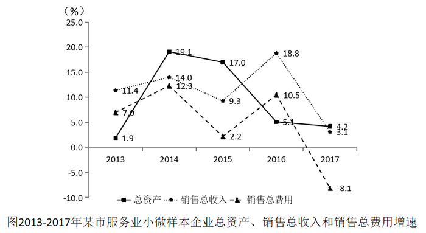

# 增速（增长率）大小比较——折线图读数比较，含负增速判'最慢'

考点：[[20-考点/资料分析/增长/增速（增长率）大小比较——折线图读数比较，含负增速判'最慢'|增长 / 增速（增长率）大小比较——折线图读数比较，含负增速判'最慢']]
材料：[[15-材料/资料分析/238954 某市调查总队抽样调查：2017年全市|238954 某市调查总队抽样调查：2017年全市]]

**问法模型**：题干问'某指标2013-2017年增速最快、最慢的年份' → 从统计图中认准该指标对应线型，读出逐年同比增速后直接比大小，取最大值与最小值所在年份

## 推理链
1. 第1步：在统计图三条线中锁定'销售总费用'（三角虚线），读出2013-2017各年同比增速：2013年7.0%、2014年12.3%、2015年2.2%、2016年10.5%、2017年-8.1%
2. 第2步：增速快慢即增速数值大小比较，无需任何计算，直接找最大值与最小值
3. 第3步：最大值为2014年12.3%（该线最高点）；最小值为2017年-8.1%（该线唯一落在0轴以下的负值）
4. 第4步：'最快2014年、最慢2017年'对照选项，与D项'2014年、2017年'完全吻合，故选D

**最快解法**：⚡ 读图直接比较法＋'负值必最慢'技巧：先认准三角虚线（销售总费用），扫一眼0轴以下——全图唯一负点-8.1%即2017年最慢；再看剩余四个正值中最高点12.3%即2014年最快，秒选D，全程不必逐点读数

## 易错点
- ⚠ 线型张冠李戴：2017年标签'4.2'与'3.1'位置贴近，4.2%属总资产（实线方块）、3.1%属销售总收入（点状虚线），销售总费用2017年是其下方落到0轴以下的-8.1%；误读为3.1%或4.2%即会排除2017年而错选A或B
- ⚠ 三条线数据点密集年份（2014年19.1/14.0/12.3、2016年18.8/10.5/5.1）读错线型，如把销售总收入的14.0%、18.8%当成销售总费用，会误判最快年份为2016年而错选C
- ⚠ 负增速处理：误认为'-8.1%下降'不能算'增速'或被绝对值8.1迷惑，从而漏掉2017年为最慢年份、误判最慢是2015年的2.2%

## 母题抽象
> 🧩 当题干出现'图中某指标增速最快/最慢的年份'特征时，认准图例对应线型逐点读数直接比大小：有负值则负增长（最低点）必为'最慢'，正值中取最高点为'最快'，无需任何换算

**同类特征**：增速最快、最慢的年份、销售总费用、折线图逐年同比增速、读数比大小、负增长为最慢、2013-2017五年区间

## 相关题
（暂无）

---

### 题干
2013-2017年该市服务业小微样本企业销售总费用增速最快、最慢的年份分别是

### 选项
- A. 2016年、2015年
- B. 2014年、2015年
- C. 2016年、2017年
- D. 2014年、2017年　✅

### 官方解析
定位材料统计图，2013-2017年该市服务业小微样本企业销售总费用增速分别为：、、、、，其中增速最快的年份为2014年，增速最慢的年份为2017年。
故正确答案为D。

### 给定材料

        2017年某市调查总队对全市服务业小微企业的抽样调查显示，2017年全市服务业小微样本企业总资产938.6亿元，销售总收入105.4亿元，销售总费用6.8亿元；人员薪酬19.3亿元，比上年增长；从业人员29028人，与上年持平；营业税金及附加1.1亿元，比上年下降；缴纳增值税2.3亿元，比上年增长。

