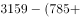
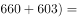

# 增长量比较（全年口径：文字现期 vs 图加总基期）

考点：[[20-考点/资料分析/增长/增长量比较（全年口径：文字现期 vs 图加总基期）|增长 / 增长量比较（全年口径：文字现期 vs 图加总基期）]]
材料：[[15-材料/资料分析/238958 2016年一季度至2018年四季度我|238958 2016年一季度至2018年四季度我]]

**问法模型**：'2018年产量比上年增加最多'→增长量比较模型：2018全年产量（文字）−2017全年产量（图中2017年四个季度之和），作差后取最大者。

## 推理链
1. 第1步：定位文字取2018年全年产量：硫酸5496、烧碱3159、纯碱2651、乙烯129万吨
2. 第2步：定位折线图加总2017年四个季度得基期全年产量：硫酸1437+1480+1470+1229=5616、烧碱785+776+783+699=3043、纯碱594+715+660+603=2572、乙烯36+40+44+24=144万吨
3. 第3步：增长量=2018全年−2017全年：硫酸5496−5616=−120万吨，烧碱3159−3043=+116万吨，纯碱2651−2572=+79万吨，乙烯129−144=−15万吨
4. 第4步：硫酸与乙烯为负增长（产量下降），'增加最多'只能在正增长的烧碱与纯碱中比较
5. 第5步：比较正增长量：烧碱+116＞纯碱+79，故增加最多的是烧碱，对应选项B

**最快解法**：⚡ 量级排除+截位加总：先看硫酸（5496<5616）与乙烯（129<144）均为负增长直接排除A、D；再对烧碱与纯碱用首位取整加总基期（烧碱≈785+776+783+699≈3040，纯碱≈594+715+660+603≈2570），作差得烧碱+116＞纯碱+79，锁定B。

## 易错点
- ⚠ 口径错配：拿文字2018年全年值直接减图中某当季值（如5496−1566），全年对当季是典型错误，必须先把2017年四个季度加总成全年
- ⚠ 基期年份取错：同比基期是图中2017年四个季度，不是2016年，也不是相邻季度
- ⚠ 忽略负增长与串线读数：硫酸（−120）、乙烯（−15）实为下降，不能参与'增加最多'；图中四条线标注密集，烧碱与纯碱同处600—900区间易把纯碱的715、603读成烧碱的数

## 母题抽象
> 🧩 当题干出现'某年产量比上年增加最多/最多'且材料为'文字给全年+图给当季'的复合结构时，先用图加总基期年四个季度得基期全年，再逐年作差比较增长量，负增长（产量下降）的产品直接排除后再比正增长量。

**同类特征**：比上年增加最多、增长量比较、文字全年+图季度拼合、四种产品横向对比、基期需季度加总、存在负增长干扰项

## 相关题
- [[10-真题/资料分析/增长/2741959 增长量比较（定基指数逐年增量作差）|2741959]]（江苏 2021，相关度2）
- [[10-真题/资料分析/增长/2144598 增长量比较|2144598]]（选调 2018，相关度1）
- [[10-真题/资料分析/增长/23447 增长量比较（现期量×r-(1+r)）|23447]]（云南 2011，相关度1）
- [[10-真题/资料分析/增长/49789 增长量（变化绝对值）比较|49789]]（云南 2013，相关度1）
- [[10-真题/资料分析/增长/465283 增长量比较|465283]]（江苏 2014，相关度1）

---

### 题干
2018年我国硫酸、烧碱、纯碱和乙烯产量比上年增加最多的是

### 选项
- A. 硫酸
- B. 烧碱　✅
- C. 纯碱
- D. 乙烯

### 官方解析

根据题干“2018年······增加最多”，判定本题为增长量比较问题。定位文字材料可得2018年，我国硫酸、烧碱、纯碱和乙烯产量情况；定位折线图可得，2017年一季度至四季度，我国硫酸、烧碱、纯碱和乙烯产量情况。根据公式可得，

2018年硫酸增长量为；

2018年烧碱增长量为万吨；

2018年纯碱增长量为万吨；

2018年乙烯增长量为。

则增长最多的是烧碱。

故正确答案为B。

### 给定材料

        2018年我国硫酸、烧碱、纯碱和乙烯产量分别为5496万吨、3159万吨、2651万吨和129万吨。2016年一季度至2018年四季度我国硫酸、烧碱、纯碱和乙烯产量见下图。

