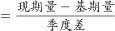
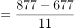

# 季均（年均）增长量计算

考点：[[20-考点/资料分析/增长/季均（年均）增长量计算|增长 / 季均（年均）增长量计算]]
材料：[[15-材料/资料分析/238958 2016年一季度至2018年四季度我|238958 2016年一季度至2018年四季度我]]

**问法模型**：题干出现『2016年二季度至2018年四季度……季平均增量』→ 年均增长量模型：季平均增量＝（末期值−基期值）÷间隔期数，基期取区间首季的上一季（2016Q1＝677），间隔期数＝11

## 推理链
1. 第1步：定位折线图烧碱线（方块标识）：2016年一季度产量677万吨，2018年四季度产量877万吨
2. 第2步：规则：区间『2016年二季度至2018年四季度』内每个季度的增量均与上一季比较（2016Q2较Q1、…、2018Q4较Q3），共11个季度增量，首项增量的基期为2016Q1，故季平均增量＝（877−677）÷11
3. 第3步：代入计算：总变化量＝877−677＝200万吨，季平均增量＝200÷11≈18.18≈18.2万吨
4. 第4步：对照选项：18.2万吨对应D；并验证干扰项来源——A≈141÷11＝12.8（基期误取2016Q2的736）、B＝141÷10＝14.1（间隔数误用10）、C＝200÷12≈16.7（间隔数误用12），均排除

**最快解法**：⚡ 公式法＋截位直除：直接取末值877与基期677，差为200，200÷11≈18.2（因11×18＝198，商约18.2），一步锁定D；核心动作是确认基期为2016Q1的677、间隔数为11

## 易错点
- ⚠ 基期口径：『2016年二季度至……』的首项增量是2016Q2较2016Q1的变化，故基期取2016Q1的677；若误取2016Q2的736为基期，得141÷11≈12.8（A）或141÷10＝14.1（B），恰是命题人设置的干扰项
- ⚠ 间隔数陷阱：2016Q1至2018Q4共12个季度值，间隔＝12−1＝11个；误用12个间隔得200÷12≈16.7（选项C）
- ⚠ 读线陷阱：烧碱为方块实线，与纯碱三角线同处600—900区间且局部贴近，认错图例线型则端点值全错

## 母题抽象
> 🧩 当题干出现『从X期至Y期的季均/年均增量』特征时，用年均增长量模型（Y期值−X期前一期值）÷间隔期数——区间内每期增量均与上一期比较，首项增量的基期为X期前一期；如本题（877−677）÷11≈18.2

**同类特征**：季平均增量、2016年二季度至2018年四季度、烧碱产量、折线图取首末端点值、间隔期数计算、平均增长量模型

## 相关题
（暂无）

---

### 题干
2016年二季度至2018年四季度，我国烧碱产量的季平均增量是

### 选项
- A. 12.8万吨
- B. 14.1万吨
- C. 16.7万吨
- D. 18.2万吨　✅

### 官方解析

根据题干“2016年二季度至2018年四季度······季平均增量”，判定本题为年均增长量问题。定位折线图可得，2016年一季度和2018年四季度，我国烧碱产量分别为677万吨和877万吨。则季平均增量万吨。

故正确答案为D。

### 给定材料

        2018年我国硫酸、烧碱、纯碱和乙烯产量分别为5496万吨、3159万吨、2651万吨和129万吨。2016年一季度至2018年四季度我国硫酸、烧碱、纯碱和乙烯产量见下图。

> [!warning] 疑点（官方解析可能有误，待人工复核）
> 材料导读断言『平均增量＝（877−736）÷10，误用11或12会错』（即14.1，对应选项B），与官方解析口径（基期取2016Q1的677、间隔11个季度，（877−677）÷11≈18.2）直接冲突；依铁律以官方答案D为唯一事实，本笔记按官方口径整理，导读该句疑为错误口径提示。另官方解析文本中公式缺失（『则季平均增量____万吨』），按端点值与正确答案D反推应为(877−677)÷11≈18.2。

<!-- CODEX-ANSWER-REVIEW:BEGIN -->
### 本次独立复核

**复核状态：** `resolved`（答案与解析已核定）

**计分答案：** B（可计分）

**复核解析：**

2016年第二季度到2018年第四季度共10个季度间隔。图中烧碱产量由736万吨增至877万吨，季度平均增量=(877−736)/10=14.1万吨，选B。旧解析使用2016年第一季度677万吨作为起点，与题干起始季度不符。

**相关信息：**

季度平均增量的间隔数应按端点差计算；2016Q2→2018Q4为10个季度间隔。

**题源依据：** [固定版本原题](https://github.com/Mentat-Uran/kaogongzhentizhengliu/blob/84ab93d4b64b61d897bece8a1c0a5bab06b4feb2/10-%E7%9C%9F%E9%A2%98/%E8%B5%84%E6%96%99%E5%88%86%E6%9E%90/%E5%A2%9E%E9%95%BF/2367899%20%E5%AD%A3%E5%9D%87%EF%BC%88%E5%B9%B4%E5%9D%87%EF%BC%89%E5%A2%9E%E9%95%BF%E9%87%8F%E8%AE%A1%E7%AE%97.md)；固定内容 commit `84ab93d4b64b61d897bece8a1c0a5bab06b4feb2`，Markdown blob `3d9ebdd5fbc2aced3cffb33a3d49bc72efcfaef4`。
<!-- CODEX-ANSWER-REVIEW:END -->
