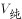
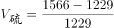
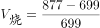
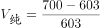
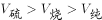

# 同比增长率大小比较（同季度对同季度）

考点：[[20-考点/资料分析/增长/同比增长率大小比较（同季度对同季度）|增长 / 同比增长率大小比较（同季度对同季度）]]
材料：[[15-材料/资料分析/238958 2016年一季度至2018年四季度我|238958 2016年一季度至2018年四季度我]]

**问法模型**：题干'设2018年四季度硫酸、烧碱、纯碱同比增速分别为v硫酸、v烧碱、v纯碱，关系正确的是'→对三个产品分别套(现期-基期)/基期算同比增速，再排序对照选项

## 推理链
1. 第1步：同比须同季度对同季度，从图取2018年四季度产量：硫酸1566、烧碱877、纯碱700万吨；基期为2017年四季度：硫酸1229、烧碱699、纯碱603万吨（勿误取2018Q3的1289/747/671）
2. 第2步：套增长率公式：同比增速=(现期-基期)/基期
3. 第3步：硫酸增速=(1566-1229)/1229=337/1229≈27.4%
4. 第4步：烧碱增速=(877-699)/699=178/699≈25.5%
5. 第5步：纯碱增速=(700-603)/603=97/603≈16.1%
6. 第6步：排序27.4%＞25.5%＞16.1%，即v硫酸＞v烧碱＞v纯碱，对照选项得A

**最快解法**：⚡ 分数比较（分子分母倍数法+截位直除）：纯碱97/603分子最小，先锁定最小；硫酸337/1229与烧碱178/699比较，分子倍数337/178≈1.9大于分母倍数1229/699≈1.76，故硫酸＞烧碱；或直除取首两位27%、25%、16%，得v硫酸＞v烧碱＞v纯碱，选A

## 易错点
- ⚠ 同比基期取错：硫酸2017Q4恰为全图低谷1229，若误取相邻2018Q3的1289作基期即把同比做成环比，增速由27%误算为21.5%
- ⚠ 四线读数串行：烧碱与纯碱同处600-900区间且局部贴近，2017Q4处烧碱699（方块线）与纯碱603（三角线）易互串读混
- ⚠ 只比增量不比基期：增量337＞178＞97不能直接推出增速同序，硫酸337/1229与烧碱178/699仅差约2个百分点，必须除以各自基期精算；另注意2017Q4低谷配2018Q4峰值的基数效应放大了硫酸增速

## 母题抽象
> 🧩 当题干出现'设若干对象同比增速分别为……，下列关系正确的是'时，锁定同一季度的现期值与去年同期值，套(现-基)/基分别直除（可用分子分母倍数法速判），按百分比排序对照选项

**同类特征**：同比增速、设……分别为、下列关系正确的是、三个对象增速排序、同季度对同季度、增长率大小比较

## 相关题
- [[10-真题/资料分析/增长/19283744 同比增速（增长率）逐年比较|19283744]]（国考 2025，相关度2）
- [[10-真题/资料分析/增长/4673212 同比增长率（同比增幅）大小比较|4673212]]（广东 2022，相关度1）
- [[10-真题/资料分析/综合/10297333 综合分析选非题（同比增速逐年比较+年均增长量+比重百分点还原）|10297333]]（浙江 2025，相关度1）
- [[10-真题/资料分析/增长/13504272 一般增长率计算与计数比较（同比增速-5%年份计数）|13504272]]（云南 2025，相关度1）
- [[10-真题/资料分析/增长/14403675 同比增长率比较（逐年增速取最大）|14403675]]（山东 2025，相关度1）

---

### 题干

设2018年四季度我国硫酸、烧碱、纯碱产量的同比增速分别为、、，则下列关系正确的是

### 选项
- A. 

　✅
- B. 

- C. 

- D. 

### 官方解析

由题干“同比增速”，选项中有，判定本题为一般增长率比较问题。定位折线图可得：2018年四季度和2017年四季度我国硫酸、烧碱、纯碱的产量。代入公式：，则

；

；

。

比较可得。

故正确答案为A。

### 给定材料

        2018年我国硫酸、烧碱、纯碱和乙烯产量分别为5496万吨、3159万吨、2651万吨和129万吨。2016年一季度至2018年四季度我国硫酸、烧碱、纯碱和乙烯产量见下图。

