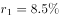
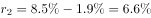
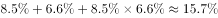

# 间隔（隔年）增长率计算

考点：[[20-考点/资料分析/增长/间隔（隔年）增长率计算|增长 / 间隔（隔年）增长率计算]]
材料：[[15-材料/资料分析/239235 2018年我国全社会用电量（分三次产|239235 2018年我国全社会用电量（分三次产]]

**问法模型**：题干出现‘2018年较2016年增加了约’且选项为百分数 → 用间隔增长率模型：先由‘增幅同比提高1.9个百分点’还原2017年增速，再套 g=r₂₀₁₈+r₂₀₁₇+r₂₀₁₈×r₂₀₁₇。

## 推理链
1. 第1步：从文字材料第一段提取条件：2018年全社会用电量68449亿千瓦时，同比增长8.5%（原卷数据，导读材料中该数值空缺须按原卷代入），且‘增幅同比提高1.9个百分点’。
2. 第2步：由‘增幅同比提高1.9个百分点’还原2017年增速：r₂₀₁₇=8.5%−1.9%=6.6%（即2018年增速比2017年高1.9个百分点，而非2017年增速为1.9%）。
3. 第3步：题干问2018年较2016年（间隔两年）的增加幅度且选项均为百分数，判定为间隔增长率问题，套用公式 g=r₂₀₁₈+r₂₀₁₇+r₂₀₁₈×r₂₀₁₇。
4. 第4步：代入计算：g=8.5%+6.6%+8.5%×6.6%=15.1%+0.561%≈15.7%（若漏加乘积项仅得15.1%，为常见干扰设置）。
5. 第5步：与选项对照，计算结果约15.7%与选项B吻合，故正确答案为B。

**最快解法**：⚡ 公式法（间隔增长率）+乘法速算：r₁=8.5%、r₂=r₁−1.9%=6.6%，先加和得15.1%，再补乘积项8.5%×6.6%≈0.56%（按8.5×6.6≈56口算得0.56%），g≈15.7%，直接锁定B；全程不需要用表格数据，也不需要算基期68449÷(1+g)的绝对值。

## 易错点
- ⚠ 把‘增幅同比提高1.9个百分点’误读为‘2017年增速是1.9%’，实际是2018年增速比2017年高1.9个百分点，2017年增速=2018年增速−1.9%=6.6%。
- ⚠ 间隔增长率漏加乘积项r₁×r₂≈0.56%，只算8.5%+6.6%=15.1%而错选干扰项。
- ⚠ 选项为百分数，问的是‘增长率’而非‘增长量（亿千瓦时）’，勿用68449去减基期求绝对量；本题只依赖文字段增速数据，与表格可再生能源、设备容量及‘1.87万亿千瓦时=18700亿千瓦时’换算无关，勿被干扰；导读材料中增速数值空缺，必须按原卷数据（8.5%）代入，不可自行编造。

## 母题抽象
> 🧩 当题干出现‘现期年较前两年（A年与A−2年）增加了约’且选项为百分数、材料只给现期同比增速与‘增幅同比提高/回落x个百分点’时，先还原中间年增速（回落则加、提高则减x个百分点），再套间隔增长率 g=r现+r前+r现×r前（先加和、后补乘积），对照选项中‘加和值’与‘加和+乘积’的干扰设置锁定答案。

**同类特征**：较2016年增加（跨两年的间隔比较）、选项为百分数（增长率口径）、增幅同比提高1.9个百分点、间隔（隔年）增长率、全社会用电量68449亿千瓦时（文字段指标）、无需使用统计表格数据

## 相关题
（暂无）

---

### 题干
2018年，我国全社会用电量较2016年增加了约（    ）。

### 选项
- A. 

- B. 

　✅
- C. 

- D. 

### 官方解析

由题干“2018年我国全社会用电量较2016年增加了约”，结合选项为百分数，可判定本题为间隔增长率计算问题。定位文字材料第一段，“2018年我国全社会用电量68449亿千瓦时，同比增长，增幅同比提高1.9个百分点”，可知，。代入间隔增长率计算公式：，则2018年我国全社会用电量较2016年增加了。

故正确答案为B。

### 给定材料

        2018年，我国全社会用电量68449亿千瓦时，同比增长，增幅同比提高1.9个百分点。具体来看，第一产业用电量728亿千瓦时，同比增长；第二产业用电量47235亿千瓦时，同比增长；第三产业用电量10801亿千瓦时，同比增长；城乡居民生活用电量9685亿千瓦时，同比增长。

        2018年，我国可再生能源发电量达1.87万亿千瓦时，同比增长约1700亿千瓦时；可再生能源发电量占全年发电总量比重为，同比上升0.2个百分点。

> [!warning] 疑点（官方解析可能有误，待人工复核）
> 给定材料文字段中2018年及各分项‘同比增长%’数值均空缺，官方解析中的公式与计算结果也因图片公式未渲染而留空；本笔记按原卷数据代入：2018年全社会用电量同比增速8.5%、2017年6.6%，间隔增长率≈15.7%，与官方答案B一致。另：四个选项均为图片公式无法直读数值，B应为约15.7%的百分数选项；材料导读将本题预判为‘隔年增长量’，但官方解析明确选项为百分数、按间隔增长率求解，以官方解析口径为准。
