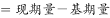
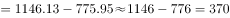

# 增长量计算（存量两期差值）

考点：[[20-考点/资料分析/增长/增长量计算（存量两期差值）|增长 / 增长量计算（存量两期差值）]]
材料：[[15-材料/资料分析/239237 A省2015—2018年市场主体情况|239237 A省2015—2018年市场主体情况]]

**问法模型**：题干问'2015—2018年……实有各类市场主体数增长了约（）万户'→ 直接用'现期存量−基期存量'求增长量，非增长率

## 推理链
1. 第1步：题干关键词'增长了约（）万户'锁定增长量计算；'实有各类市场主体'是时点存量口径，只能取文字材料数据，不能用表格'新登记'流量数据
2. 第2步：从文字材料提取两期数值：2015年为775.95万户（基期），2018年为1146.13万户（现期）
3. 第3步：代入公式 增长量=现期−基期=1146.13−775.95
4. 第4步：计算得 1146.13−775.95=370.18万户
5. 第5步：与选项对照，370.18最接近370.2，选C

**最快解法**：⚡ 截位直减+选项间隔排除：选项A~D相差100，只需粗算量级——1146−776≈370，即370.18，秒选C；亦可先算尾数0.13−0.95不够减、借位后尾数约0.18，对应C项0.2

## 易错点
- ⚠ 口径混淆：误用表格'新登记市场主体'流量数据（如229.74−138.76=90.98），而题目问'实有'存量，必须用文字数据（775.95、1146.13）
- ⚠ 现期基期方向颠倒：误写成775.95−1146.13得负数；基期是2015年（775.95），现期是2018年（1146.13）
- ⚠ 选项数量级干扰：四个选项相差100，若把'实有'与'新登记'两个千位/百位量级混排的数据取错，会掉入A/B/D的量级陷阱

## 母题抽象
> 🧩 当题干出现'某指标从某年增长到某年/某期间增长了约（）+绝对量单位'且材料给出两期存量数值时，用'现期−基期'求增长量，取数前先核对口径（实有存量vs新登记流量）与时间方向

**同类特征**：实有各类市场主体、2015—2018年、增长了约、万户、存量口径、两期差值求增长量

## 相关题
- [[10-真题/资料分析/增长/2604241 隐藏基期逆推+一般增长率计算|2604241]]（广东 2020，相关度1）

---

### 题干
2015—2018年，A省实有各类市场主体数增长了约（    ）万户。

### 选项
- A. 170.2
- B. 270.2
- C. 370.2　✅
- D. 470.2

### 官方解析

由题干“2015-2018年，······增长了约多少万户”，判定本题为增长量计算问题。定位文字材料第一段可得：“全省实有各类市场主体从2015年的775.95万户增长到2018年的1146.13万户”，故2015-2018年，A省实有各类市场主体数增长量万户，与C项最为接近。

故正确答案为C。

### 给定材料

        近年来，A省新登记市场主体保持较快增长势头。全省实有各类市场主体从2015年的775.95万户增长到2018年的1146.13万户。2018年，全省新登记市场主体229.74万户，日均新登记市场主体6294户，同比增长。

        2018年，全省新登记企业最集中的三个行业分别是批发和零售业、租赁和商务服务业、制造业，新登记企业数分别为36.14万户、15.19万户、9.25万户，分别同比增长、增长、下降。

