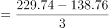
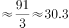

# 年均增长量计算

考点：[[20-考点/资料分析/增长/年均增长量计算|增长 / 年均增长量计算]]
材料：[[15-材料/资料分析/239237 A省2015—2018年市场主体情况|239237 A省2015—2018年市场主体情况]]

**问法模型**：题干出现'2015—2018年……年均增长约多少万户'→ 用年均增长量模型：(现期值−基期值)÷年份差n，n=2018−2015=3

## 推理链
1. 第1步：题干问的是'新登记市场主体数'（年度流量），锁定统计表'新登记市场主体'总量行，不得混用文字中'实有市场主体'存量数据；表格年份由2018到2015倒序，基期2015年在最右一列
2. 第2步：从表格提取数据——现期2018年为229.74万户，基期2015年为138.76万户
3. 第3步：年均增长量公式=(现期−基期)÷n，其中n=末年−首年=2018−2015=3（2015→2018只有3个增长期，而非4个年份）
4. 第4步：代入计算：(229.74−138.76)÷3=90.98÷3≈30.3万户
5. 第5步：与选项对照：30.3正对应C项；若误除以4得约22.7、误用其他期数均落不到C，锁定C

**最快解法**：⚡ 截位直除：分子截位91÷3≈30.3，一步锁定C；关键心法是年均增长量n取'年份差3'（2015→2018三个增长期），不取年份数4

## 易错点
- ⚠ 期数n误取4：2015—2018共4个年份但只有3个增长期，误除4得约22.7，会掉入B类干扰项
- ⚠ 口径混淆：误用文字中'实有各类市场主体'存量数据（1146.13−775.95=370.18）代替表格'新登记'流量数据（229.74−138.76=90.98），量级完全不同
- ⚠ 表格年份倒序排列，横向取数易把2016年161.58或2017年195.00误当基期/现期，取错列导致计算偏差

## 母题抽象
> 🧩 当题干出现'某年—某年……年均增长约多少（带量的单位）'时，用年均增长量公式(现期−基期)÷n，并验证n=末年−首年（增长期数）而非年份数，同时确认基期现期数据取自同一口径（此处为表格新登记流量）

**同类特征**：年均增长约、单位为万户（求量不求率）、现期2018年/基期2015年、新登记市场主体（表格流量口径）、选项为小数估算值、年份跨度4年但n=3

## 相关题
- [[10-真题/资料分析/增长/15419190 年均增长量计算|15419190]]（湖北 2025，相关度2）
- [[10-真题/资料分析/增长/2742310 年均增长量计算|2742310]]（北京 2021，相关度2）
- [[10-真题/资料分析/增长/2742290 年均增长量计算|2742290]]（北京 2021，相关度2）
- [[10-真题/资料分析/增长/12881983 年均增长量计算|12881983]]（广东 2025，相关度2）
- [[10-真题/资料分析/增长/13319337 年均增长量计算|13319337]]（江苏 2025，相关度2）

---

### 题干
2015—2018年，A省新登记市场主体数年均增长约（    ）万户。

### 选项
- A. 15.1
- B. 23.2
- C. 30.3　✅
- D. 36.4

### 官方解析

由题干“2015-2018年，······年均增长约多少万户”，判定本题为年均增长量问题。定位表格材料可得： 2018年新登记市场主体为229.74万户；2015年新登记市场主体为138.76万户。故2015-2018年，A省新登记市场主体数年均增长量万户。

故正确答案为C。

### 给定材料

        近年来，A省新登记市场主体保持较快增长势头。全省实有各类市场主体从2015年的775.95万户增长到2018年的1146.13万户。2018年，全省新登记市场主体229.74万户，日均新登记市场主体6294户，同比增长。

        2018年，全省新登记企业最集中的三个行业分别是批发和零售业、租赁和商务服务业、制造业，新登记企业数分别为36.14万户、15.19万户、9.25万户，分别同比增长、增长、下降。

