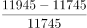
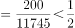
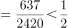
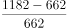
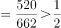
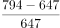
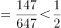

# 增长率比较（同比增幅大小排序）

考点：[[20-考点/资料分析/增长/增长率比较（同比增幅大小排序）|增长 / 增长率比较（同比增幅大小排序）]]
材料：[[15-材料/资料分析/239235 2018年我国全社会用电量（分三次产|239235 2018年我国全社会用电量（分三次产]]

**问法模型**：题干问'2017年……同比增幅最大的是'→ 增长率比较模型：各分项用（2017年值−2016年值）/2016年值计算增长率后比较大小

## 推理链
1. 第1步：题干限定年份为'2017年同比'，即现期=2017年、基期=2016年，定位表格2017年与2016年两列（2018年列本题不用）
2. 第2步：同比增幅（增长率）公式为（现期值−基期值）/基期值，此处即（2017年值−2016年值）/2016年值
3. 第3步：代入四组分项数据：水电=（11945−11745）/11745=200/11745≈1.7%；风电=（3057−2420）/2420=637/2420≈26.3%；光伏=（1182−662）/662=520/662≈78.5%；生物质=（794−647）/647=147/647≈22.7%
4. 第4步：比较四个增长率，光伏发电约78.5%远超其余三项（次大为风电约26.3%），故同比增幅最大的是光伏发电，对照选项锁定C

**最快解法**：⚡ 分数比较法（目测增长量与基期值之比）：光伏增长量520与基期662接近（比值近80%），显然远超水电200/11745（<2%）、风电637/2420（≈26%）、生物质147/647（≈23%），无需精算即可锁定C

## 易错点
- ⚠ 时间口径陷阱：问的是2017年同比，须用2017年与2016年数据，误用2018年与2017年数据（表格最右侧列更醒目）即口径错误
- ⚠ 增长率与增长量混淆：生物质增长量147为四项最小，但增长率≈22.7%并非最小（最小是水电≈1.7%），不能按增长量绝对值排序
- ⚠ 指标范围混淆：表格最后一行'全口径发电设备容量（万千瓦）'是装机单位且非发电量，不纳入本题四选项比较

## 母题抽象
> 🧩 当题干出现'某年……同比增幅（增速）最大/最小的是'且表格给出相邻两年数据时，用增长率=（现期−基期）/基期，先看增长量与基期值的接近程度粗判，再对接近项截位直除验证

**同类特征**：同比增幅最大、可再生能源发电量分类比较、水电/风电/光伏/生物质四选项、表格相邻两年数据（2017与2016列）、增长率比较、需从三年并列数据中选对年份

## 相关题
- [[10-真题/资料分析/增长/2166228 增长率比较（季度累计值同比增幅比较）|2166228]]（深圳市考 2018，相关度2）
- [[10-真题/资料分析/增长/2187792 同比增长率比较（增速最快年份判断）|2187792]]（黑龙江 2018，相关度1）
- [[10-真题/资料分析/增长/4658521 增长率（同比降幅）大小比较|4658521]]（四川 2021，相关度1）
- [[10-真题/资料分析/增长/4673212 同比增长率（同比增幅）大小比较|4673212]]（广东 2022，相关度1）
- [[10-真题/资料分析/增长/18643713 跨期增长率比较（2024年对2020年4年总增速，先合并价位档再比较）|18643713]]（天津 2026，相关度1）

---

### 题干
2017年，下列可再生能源发电量同比增幅最大的是（    ）。

### 选项
- A. 水电
- B. 风电
- C. 光伏发电　✅
- D. 生物质发电

### 官方解析

由题干“2017年···同比增幅最大的是”，可判定本题为增长率比较问题。定位表格可知2016年、2017年各项可再生资源发电量，根据，2017年各项增长率分别为：

水电：；

风电：；

光伏发电：；

生物质发电：。

则同比增幅最大的是光伏发电。

故正确答案为C。

### 给定材料

        2018年，我国全社会用电量68449亿千瓦时，同比增长，增幅同比提高1.9个百分点。具体来看，第一产业用电量728亿千瓦时，同比增长；第二产业用电量47235亿千瓦时，同比增长；第三产业用电量10801亿千瓦时，同比增长；城乡居民生活用电量9685亿千瓦时，同比增长。

        2018年，我国可再生能源发电量达1.87万亿千瓦时，同比增长约1700亿千瓦时；可再生能源发电量占全年发电总量比重为，同比上升0.2个百分点。

