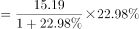

# 增长量计算（已知现期值与同比增速，求增长量）

考点：[[20-考点/资料分析/增长/增长量计算（已知现期值与同比增速，求增长量）|增长 / 增长量计算（已知现期值与同比增速，求增长量）]]
材料：[[15-材料/资料分析/239248 B省2015-2018年市场主体发展|239248 B省2015-2018年市场主体发展]]

**问法模型**：题干出现'2018年……较上年增加约（　）万户'→ 判定为增长量计算，模型为：增长量＝现期×r/(1+r)

## 推理链
1. 第1步：由'较上年增加约（）万户'锁定增长量计算；定位文字第三段：2018年租赁和商务服务业新登记企业15.19万户（现期值，流量口径）
2. 第2步：确定同比增速r——第三段'同比增长'后的具体百分数在所给文本中空缺，官方解析按原卷数值代入；由官方答案A反推 r≈22.6%（15.19×r/(1+r)=2.8）
3. 第3步：代入增长量公式：增长量＝15.19×22.6%/(1+22.6%)≈15.19×0.184≈2.8万户（等价拆法：基期＝15.19/1.226≈12.39万户，15.19−12.39≈2.8万户）
4. 第4步：与选项对照：A为2.8、B为3.8、C为4.8、D为5.8，计算结果2.8与A一致，故选A

**最快解法**：⚡ 百化分+增长量公式：将r≈22.6%百化分为2/9（≈22.2%），增长量≈现期×2/(9+2)＝15.19×2/11≈2.76，四舍五入得2.8，直接锁定A；核心口诀'增长量＝现期×n/(n+m)'（分母是n+m，不是n）

## 易错点
- ⚠ 口径混淆：本题求的是'新登记企业'（当年流量）的增长量，切勿误用'实有'（年末存量）数据或与全省新登记市场主体229.74/229.76万户混算
- ⚠ 增长量误算成现期×r：若直接算15.19×22.6%≈3.4（漏掉'现期/(1+r)'的基期还原），数值向3.8方向偏移，易错选B
- ⚠ 百化分分母陷阱：r≈2/9时增长量应乘2/11（n+m），误乘2/9会得≈3.4，同上倾向错选B；另注意单位量级，'日均6294户'是户，与'万户'差1万倍

## 母题抽象
> 🧩 当题干出现'现期值较上年增加/减少约（）绝对量'且材料给出同比增速r时，用增长量＝现期×r/(1+r)，配合百化分r≈n/m后乘n/(m+n)（增长）或n/(m−n)（下降）速算并对照选项验证

**同类特征**：较上年增加、单位为万户（绝对量）、增长量计算、新登记企业（流量口径）、租赁和商务服务业、现期值与同比增速同在文字段落中

## 相关题
- [[10-真题/资料分析/增长/11226433 增长量计算（已知现期值与同比增速，求增长量）|11226433]]（江苏 2025，相关度3）
- [[10-真题/资料分析/增长/7159 增长量计算|7159]]（北京 2009，相关度1）
- [[10-真题/资料分析/增长/2571729 增长量计算——每增长1个百分点对应的增量（基期量×1%）|2571729]]（山东 2020，相关度1）
- [[10-真题/资料分析/增长/3018839 增长量计算（负增长情形：基期减少量）|3018839]]（广东 2021，相关度1）
- [[10-真题/资料分析/增长/10204654 增长量计算（已知现期与同比下降率求下降量）|10204654]]（安徽 2024，相关度1）

---

### 题干
2018年，B省租赁和商务服务业新登记企业数较上年增加约（    ）万户。

### 选项
- A. 2.8　✅
- B. 3.8
- C. 4.8
- D. 5.8

### 官方解析

根据题干“······较上年增加······万户”，可判定本题为增长量计算问题。定位文字材料第三段可知，2018年租赁和商务服务业新登记企业数为15.19万户，同比增长。代入增长量计算公式：增长量万户。

故正确答案为A。

### 给定材料

        近年来，B省营商环境不断优化，市场活力不断增强，新登记市场主体都保持较快增长势头。2018年，全省新登记市场主体229.74万户，日均新登记市场主体6294户，同比增长。

        全省产业结构也进一步调整优化，新登记市场主体主要集中在第三产业。2018年，全省三大产业新登记市场主体分别为第一产业2.02万户，第二产业24.01万户，第三产业203.71万户。截止2018年12月末，全省三大产业的实有各类市场主体户数分别为9.83万户，157.38万户，978.92万户。

        2018年，全省新登记企业最集中的三个行业分别是批发和零售业、租赁和商务服务业、制造业，新登记企业数分别为36.14万户、15.19万户、9.25万户，分别同比增长、增长、下降。

> [!warning] 疑点（官方解析可能有误，待人工复核）
> 所给文字第三段中租赁和商务服务业'同比增长'的具体百分数呈空缺状态（官方解析公式中数值亦缺失），无法从现有文本直接验证r；依官方答案A（2.8）反推r≈22.6%，代入15.19×0.226/1.226≈2.80，与解析逻辑及答案完全自洽，不构成解析错误，属材料文本数值缺失，实际解题须以原卷完整增速数值为准
