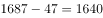
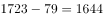
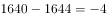

# 增长量倒推基期量与差值比较（2013年与'十二五'年均出生人口）

考点：[[20-考点/资料分析/增长/增长量倒推基期量与差值比较（2013年与'十二五'年均出生人口）|增长 / 增长量倒推基期量与差值比较（2013年与'十二五'年均出生人口）]]
材料：[[15-材料/资料分析/239308 我国2014—2017年“单独两孩”|239308 我国2014—2017年“单独两孩”]]

**问法模型**：题干给出'某年比上年增加××'与'某年比年均基准多××'两组差值→分别倒推出2013年与'十二五'年均出生人口，再作差判断增减

## 推理链
1. 第1步：从材料第一段提取'2014年出生人口1687万人，比上年增加47万人'，故2013年出生人口=1687-47=1640万人（2013是2014的基期，'增加'倒推须做减法）
2. 第2步：同段提取'2017年出生人口1723万人，比十二五时期年平均出生人口多出79万人'，故'十二五'年平均出生人口=1723-79=1644万人
3. 第3步：作差：2013年-'十二五'年均=1640-1644=-4万人，负号表示2013年更少
4. 第4步：与选项对照，'减少4万人'对应A项，故选A

**最快解法**：⚡ 口算倒推+作差：1687-47=1640万，1723-79=1644万，1640-1644=-4万；数字均为整数级，无需截位直除，30秒内锁定A

## 易错点
- ⚠ 加减方向弄反：'比上年增加47万'倒推2013年应做减法，若误加成1687+47=1734万，会错选'增加'类选项
- ⚠ 比较基准张冠李戴：'比十二五年平均多79万'的主语是2017年(1723万)，不是2014年或2013年，不能用1687-79或1640-79倒推年均值
- ⚠ 口径混淆：'十二五'年平均出生人口(1644万)与年平均出生率是两个指标，题干比较的是人口数（万人），与0.84个千分点等'率'的差值无关，不可混用

## 母题抽象
> 🧩 当题干出现'某年比上一年增加/减少××、另一年比某平均基准多/少××'求两个倒推量之差时，用'现期∓差值分别还原两数→相差定符号'模型，验证差值正负与选项'增加/减少'表述方向一致

**同类特征**：比上年增加47万人（倒推基期2013年）、比'十二五'时期年平均出生人口多79万（倒推年均1644万）、两次差值倒推后作差、选项为'增加/减少+具体万人数'、纯文字材料、无数值空缺阻碍（两处空缺值本题用不到）、人口数口径（万人）而非出生率口径

## 相关题
（暂无）

---

### 题干
2013年我国出生人口比“十二五”时期年平均出生人口：

### 选项
- A. 减少4万人　✅
- B. 增加5万人
- C. 减少9万人
- D. 增加47万人

### 官方解析

定位文字资料第一段“2014年我国······出生人口1687万人，比上年增加47万人······2017年我国出生人口1723万人·······但比‘十二五’时期年平均出生人口多出79万人”，可知2013年我国出生人口为万人，“十二五”时期年平均出生人口为万人。万人，则2013年我国出生人口比“十二五”时期年平均出生人口减少4万人。

故正确答案为A。

### 给定材料

根据以下资料，回答下列问题。

        2014年我国实施“单独两孩”生育政策，出生人口1687万人，比上年增加47万人。2016 年实施“全面两孩”生育政策，出生人口1786万人，比上年增加131万人；出生率与“十二五”时期年平均出生率相比，提高了0.84个千分点。2017 年我国出生人口1723万人，虽然比上年减少63万人，但比“十二五”时期年平均出生人口多出79万人；出生率为，比上一年降低0.52个千分点。2017年二孩数量进一步上升至883万人，二孩占全部出生人口的比重达到，比2016年的占比提高了11个百分点。

        2017年出生人口最多的省份是山东，出生人口174.98万人，但是比2016年减少2.08万人。广东和河南出生人口也超过百万，其中广东出生人口151.63万人，同比增加22.18万人；河南出生人口140.13 万人，较上年减少2.48万人。此外，出生人口排名前十的省份依次还有河北、四川、湖南、安徽、广西、江苏、湖北。其中，河北、四川、湖南出生人口超90万人，湖北最少，为74.26万人。

        从人口增量来看，2017年广东出生人口增量最大，出生人口较2016年增加22.18万人。安徽、四川、河北出生人口增量超过5万，此外，江苏、湖南、山东、河南出生人口较2016年有所减少。其中，河南减少最多，出生人口减少2.48万人。

