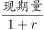
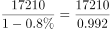
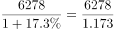
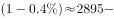
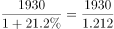
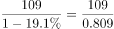
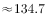
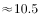
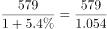

# 基期量计算与大小排序比较（选非题）

考点：[[20-考点/资料分析/增长/基期量计算与大小排序比较（选非题）|增长 / 基期量计算与大小排序比较（选非题）]]
材料：[[15-材料/资料分析/239309 2011-2017年我国服务进出口（|239309 2011-2017年我国服务进出口（]]

**问法模型**：题干问2016年（基期）各分类进口额大小排序哪项错误 → 用 基期=2017年现期值÷(1+同比) 逐类倒推2016年进口额，再对照各选项三元组排序找错

## 推理链
1. 第1步：题干要求判断2016年各服务分类进口额排序，表2只给2017年当期值和同比（2017对2016），故所有类别均需倒推基期：基期=2017值÷(1+同比)，负增长除以(1-|同比|)
2. 第2步：先精算各选项共用的高频值——运输：2017年进口6278.0、同比17.3%，2016年=6278.0÷1.173≈5352.1亿元
3. 第3步：A项：旅行17210.0÷(1-0.008)≈17339、其他商业服务2895.0÷1.004≈2883.5，得旅行17339＞运输5352.1＞其他商业服务2883.5，A排序正确，排除
4. 第4步：B项：知识产权使用费1930.0÷1.212≈1592、建筑579.0÷1.054≈549，而运输2016年为5352.1，实际排序应为运输＞知识产权使用费＞建筑，B项写成知识产权使用费＞建筑＞运输，排序错误，当选
5. 第5步：C项：金融服务109.0÷(1-0.191)≈134.7、加工服务12.0÷1.142≈10.5，运输5352.1＞金融服务134.7＞加工服务10.5，C排序正确，排除
6. 第6步：D项：建筑549＞金融服务134.7＞加工服务10.5，D排序正确，排除；本题为选非题，故选B

**最快解法**：⚡ 基期公式法+截位直除+选项复用：先算选项交集里必考的运输2016年=6278÷1.173≈5352；再看B项——知识产权使用费1930÷1.212≈1592、建筑579÷1.054≈549，两者均远小于5352，而B却把运输排在末位，量级一眼即矛盾，直接锁定B，A/C/D无需全部精算（旅行17210量级碾压可目测，金融服务≈134.7与建筑≈549用百位级粗算即可）

## 易错点
- ⚠ 口径混淆：表2中『进出口额』≠『进口额』，如旅行进出口19826.0最大但进口额为17210.0，加工服务出口1223.0远大于进口12.0，取错列则全盘皆错
- ⚠ 负增长符号代错：金融服务进口同比-19.1%、旅行-0.8%，基期应÷(1-|同比|)，如109.0÷0.809≈134.7；误按÷(1+同比)计算会得出错误基期值
- ⚠ 选非题惯性陷阱：A/C/D均为正确排序，按『选正确排序』的做题惯性会误选A；且跨表时2016年进口总额30030只在本题用作背景（兄弟题第4、5题才需要），本题勿被导读干扰额外计算比重

## 母题抽象
> 🧩 当题干出现『基期年份（现期前一年）多个分类指标的大小排序（选对/选错）』特征时，用 基期=现期÷(1+同比)（负增长除以1-|同比|）逐项倒推，优先精算各选项共现、被反复引用的类别（如本题运输），再按量级粗排对照选项验证，选错项即答案

**同类特征**：2016年进口额、大小排序错误（选非）、表2分类数据倒推基期、负增长类别（金融服务-19.1%、旅行-0.8%）、多选项复用同一基期结果、进出口额与进口额口径区分

## 相关题
（暂无）

---

### 题干
下列关于2016年进口额大小排序错误的是：

### 选项
- A. 
旅行运输其他商业服务

- B. 
知识产权使用费建筑运输
　✅
- C. 
运输金融服务加工服务

- D. 
建筑金融服务加工服务

### 官方解析

定位表格材料二可得：2017年我国各服务分类进口额及同比增长。根据公式：可得：

A项：旅行进口额17210.0亿元，同比增长；运输进口额6278.0亿元，同比增长；其他商业服务进口额2895.0亿元，同比增长。故2016年旅行进口额亿元，运输进口额亿元，其他商业服务进口额，故2016年旅行运输其他商业服务，排序正确，排除；

B项：知识产权使用费进口额1930.0亿元，同比增长；建筑进口额579.0亿元，同比增长；2016年运输进口额A项已经计算，为5352.1亿元。故2016年知识产权使用费进口额亿元2016年运输进口额5352.1亿元，排序错误，当选；

C项：2016年运输进口额A项已经计算，为5352.1亿元；2017年金融服务进口额109.0亿元，同比增长；加工服务进口额12.0亿元，同比增长。故2016年金融服务进口额亿元，加工服务进口额亿元，故2016年运输金融服务加工服务，排序正确，排除；

D项：2017年建筑进口额579.0亿元，同比增长，故2016年进口额亿元；2016年金融服务进口额、加工服务进口额C项已经计算，分别为134.7亿元、10.5亿元。故2016年建筑金融服务加工服务，排序正确，排除。

本题为选非题，故正确答案为B。

### 给定材料

根据以下资料，回答下列问题。

（注：顺差是指在国际收支上，一定时期内收入大于支出的差额；逆差指的是在国际收支上，一定时期内支出大于收入的差额；表中同比数据为正的代表同比增长，同比数据为负的代表同比下降）

