# 增长量计算（同比增加额）

考点：[[20-考点/资料分析/增长/增长量计算（同比增加额）|增长 / 增长量计算（同比增加额）]]
材料：[[15-材料/资料分析/239311 2017年我国渔业经济情况：全社会渔|239311 2017年我国渔业经济情况：全社会渔]]

**问法模型**：题干出现'同比增加约为'+选项带具体单位'元'→判定为增长量计算，模型：增长量=现期−基期=现期×r/(1+r)

## 推理链
1. 第1步：定位材料第4段提取条件：2017年全国渔民人均纯收入18452.78元，'比上年增长'后增速被挖空，2016年基数未给出（数据缺口）
2. 第2步：题干'同比增加约为'且选项带单位'元'，判定为增长量计算，用公式：增长量=现期−基期=现期×r/(1+r)
3. 第3步：增速留空，按导读'留白回填/依赖选项'处理：由A项1550元反推增速r≈1550/(18452.78−1550)=1550/16902.78≈9.2%
4. 第4步：代入计算：增长量=18452.78×0.092/1.092≈1555元（等价于基期16902.78×9.2%≈1555元）
5. 第5步：与选项对照：约1555元与A项1550元最接近；而B项1700≈18452.78×9.2%≈1698元，恰为漏除(1+r)的陷阱值，故正确答案为A

**最快解法**：⚡ 百化分+选项反推：增速挖空时先由A反推r≈9.2%，百化分9.2%≈1/10.9，则增长量=现期/(n+1)=18452.78/11.9≈1551元，一步锁定A；若考场原题增速已给出，百化分可直接出答案

## 易错点
- ⚠ 公式漏除(1+r)：误算增长量≈现期×r=18452.78×9.2%≈1698元会错选B（1700元），B项正是该陷阱
- ⚠ 增长量与增长率混淆：问'增加约为'+单位'元'是求增长量，不是求增长率，方向判定错则全盘皆错
- ⚠ 本题为数据缺口题：材料增速挖空、2016年基数未给，不能直接取数，须按留白回填或由选项反推，勿凭空编造基数或增速

## 母题抽象
> 🧩 当题干出现'同比增加约+带单位数值（元/万吨等）'特征时，判定增长量计算：增长量=现期×r/(1+r)，增速用百化分速算（r≈1/n则增长量≈现期/(n+1)）；若增速在材料中留空，可由选项量级反推增速回填后再验证

**同类特征**：同比增加约为、选项带具体单位'元'、现期值18452.78元直接可得、增速挖空/数据缺口、单一现期年度数据、增长量计算

## 相关题
- [[10-真题/资料分析/增长/2376734 增长量计算（已知现期量与同比增长率，r-(1+r)公式法）|2376734]]（吉林 2019，相关度2）
- [[10-真题/资料分析/增长/7159 增长量计算|7159]]（北京 2009，相关度1）
- [[10-真题/资料分析/增长/2571729 增长量计算——每增长1个百分点对应的增量（基期量×1%）|2571729]]（山东 2020，相关度1）
- [[10-真题/资料分析/增长/3018839 增长量计算（负增长情形：基期减少量）|3018839]]（广东 2021，相关度1）
- [[10-真题/资料分析/增长/10204654 增长量计算（已知现期与同比下降率求下降量）|10204654]]（安徽 2024，相关度1）

---

### 题干
2017年全国渔民人均纯收入同比增加约为

### 选项
- A. 1550元　✅
- B. 1700元
- C. 1850元
- D. 1900元

### 官方解析

根据题干“同比增加······”，结合选项带具体单位，可判定本题为增长量计算问题。定位文字材料第四段“2017年全国渔民人均纯收入18452.78元，比上年增长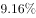”，2017年的增长量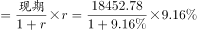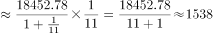元，与A项最接近。

故正确答案为A。

### 给定材料

根据以下资料，回答下列问题。

        据统计，按当年价格计算，2017年我国全社会渔业经济总产值2.48万亿元，其中渔业产值1.23万亿元，渔业工业和建筑业产值0.57万亿元，渔业流通和服务业产值0.68万亿元。

        渔业产值中，海洋捕捞产值1987.65亿元，海水养殖产值3307.40亿元，淡水捕捞产值461.75亿元，淡水养殖产值5876.25亿元，水产苗种产值680.80亿元。

        渔业产值中（不含苗种），海水产品与淡水产品的产值比例为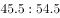，养殖产品与捕捞产品的产值比例为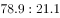。

        据对全国1万户渔民家庭收支情况调查，2017年全国渔民人均纯收入18452.78元，比上年增长。

        2017年，全国水产品总产量6445.33万吨，比上年增长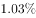。其中，养殖产量4905.99万吨，同比增长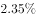；捕捞产量1539.34万吨，同比降低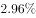；养殖产品与捕捞产品的产量比例为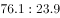，海水产品产量3321.74万吨，同比增长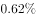；淡水产品产量3123.59万吨，同比增长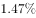；海水产品与淡水产品的产量比例为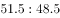。

        2017年，全国水产品人均占有量46.37千克（总人口139008万人），比上年减少0.23千克，降低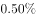。

> [!warning] 疑点（官方解析可能有误，待人工复核）
> 所给材料第4段'比上年增长'后增速被挖空且未给2016年基数，官方解析的计算式也不完整（'2017年的增长量……元'缺中间过程），仅凭本材料无法直接复算增长量；按导读'数据缺口·留白回填'口径处理：由答案A反推增速≈9.2%（1550/16902.78≈9.17%），代入验证18452.78×0.092/1.092≈1555元与A最接近，官方答案A予以保留，不改写。

<!-- CODEX-ANSWER-REVIEW:BEGIN -->
### 本次独立复核

**复核状态：** `confirmed`（独立复算确认答案）

**计分答案：** A（可计分）

**复核解析：**

原图给出渔民收入增速9.16%，现期18452.78元；同比增加=18452.78×9.16%/109.16%≈1548元，最接近1550元，选A。

**相关信息：**

以现期量和同比率求增长量，不能直接用现期乘增速。

**题源依据：** [固定版本原题](https://github.com/Mentat-Uran/kaogongzhentizhengliu/blob/84ab93d4b64b61d897bece8a1c0a5bab06b4feb2/10-%E7%9C%9F%E9%A2%98/%E8%B5%84%E6%96%99%E5%88%86%E6%9E%90/%E5%A2%9E%E9%95%BF/2376597%20%E5%A2%9E%E9%95%BF%E9%87%8F%E8%AE%A1%E7%AE%97%EF%BC%88%E5%90%8C%E6%AF%94%E5%A2%9E%E5%8A%A0%E9%A2%9D%EF%BC%89.md)；固定内容 commit `84ab93d4b64b61d897bece8a1c0a5bab06b4feb2`，Markdown blob `700644a1343a59d9bce3bc291a4a591800179ee5`。
<!-- CODEX-ANSWER-REVIEW:END -->
