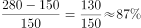

# 增长率计算与两年增速差值（百分点）比较

考点：[[20-考点/资料分析/增长/增长率计算与两年增速差值（百分点）比较|增长 / 增长率计算与两年增速差值（百分点）比较]]
材料：[[15-材料/资料分析/239310 2011—2017年全国马拉松赛事发|239310 2011—2017年全国马拉松赛事发]]

**问法模型**：题干出现'A年同比增速比B年快/慢约多少个百分点' → 分别用相邻两期数据算出两年增长率，再作差并判断方向

## 推理链
1. 第1步：从文字段①提取三年参与人次：2017年498万人次、2016年280万人次、2015年150万人次（均为当期值）
2. 第2步：增长率公式 =（现期−基期）/基期，2017年增速基期为2016年280万，2016年增速基期为2015年150万
3. 第3步：2017年增速 =（498−280）/280 = 218/280 ≈ 78%；2016年增速 =（280−150）/150 = 130/150 ≈ 87%
4. 第4步：作差 78% − 87% ≈ −9个百分点，即2017年增速比2016年慢约9个百分点
5. 第5步：对照选项，方向为'慢'、数值约9个百分点，锁定B（慢约9个百分点）

**最快解法**：⚡ 截位直除：218/280≈22/28≈0.78（约78%），130/150≈13/15≈0.87（约87%），差≈9个百分点且2017年数值更小→'慢约9个百分点'，直接选B，无需精算

## 易错点
- ⚠ 方向陷阱：2017年增速（约78%）小于2016年（约87%），应为'慢'，只算出差值约9个百分点而不看方向会误选A
- ⚠ 基期错配：2016年增速的基期是2015年150万，若误用280万自身或拿498/280当2016年增速则全错
- ⚠ 指标混淆：材料中'参与人次'（498/280/150万）与'完赛人次'（26.89万、45.29万）是不同指标，本题只能用参与人次三年数据，不能混入完赛数据

## 母题抽象
> 🧩 当题干出现'某年同比增速比另一年快/慢约多少个百分点'时，取该指标连续三年当期值，分别套（现期−基期）/基期算两次增长率再作差，并以数值大小定'快/慢'方向、以差值定百分点数

**同类特征**：同比增速比、快/慢约多少个百分点、两年增速比较、参与人次、连续三年当期值、一般增长率问题

## 相关题
- [[10-真题/资料分析/增长/3523613 增长率计算与阈值比较（同比增速超10%计数）|3523613]]（四川 2021，相关度1）
- [[10-真题/资料分析/增长/5521214 同比增长率计算与比较|5521214]]（深圳市考 2023，相关度1）
- [[10-真题/资料分析/增长/5746645 增长率比较（同比增速找最小）|5746645]]（江苏 2023，相关度1）
- [[10-真题/资料分析/增长/18643848 一般增长率计算（上季度基期缺失，需经同比增速反推基期量）|18643848]]（四川 2026，相关度1）
- [[10-真题/资料分析/增长/5102381 基期增速还原与增速作差比较（百分点运算）|5102381]]（浙江 2022，相关度1）

---

### 题干
2017年马拉松赛事参与人次的同比增速比2016年：

### 选项
- A. 快约9个百分点
- B. 慢约9个百分点　✅
- C. 快约7个百分点
- D. 慢约7个百分点

### 官方解析

根据题干“2017年···的同比增速比2016年”，可判定本题为一般增长率问题。定位文字材料第一段可得：2017年、2016年、2015年马拉松赛事的参与人次分别为498万人次、280万人次、150万人次。根据增长率，可得2017年的增长率为，2016年的增长率为，则，即2017年同比增速比2016年慢约9个百分点。

故正确答案为B。

### 给定材料

根据以下资料，回答下列问题。

        2017年全国举办马拉松赛事达1102场，其中，中国田径协会举办的A类赛事223场，B类赛事33场。2017年马拉松赛事的参与人次达到了498万人次，2016年、2015年马拉松赛事的参与人次分别为280万人次、150万人次。 

        2017年全年马拉松直接从业人口数72万，间接从业人口数200万。年度产业总规模达700亿元，比去年同期增长约，中国田径协会设置的发展目标是到2020年，全国马拉松规模赛事超过1900场，其中中国田径协会认证赛事达到350场，各类赛事参赛人数超过1000万人次，马拉松运动产业规模达到1200亿元。

        规模赛事数量方面，2017年排名前三的省份为浙江省、江苏省和广东省，分别为152场、149场和103场，而2016年的前三名分别为江苏省37场，北京市33场，广东省25场。

        从2017年全年赛事的覆盖区域来看，马拉松赛事地域分布更为广泛，中国境内马拉松及相关赛事已经涵盖了含西藏在内的全国31个省、区、市的234个城市，较上年增加了101个城市。

        在赛事类型方面，2017年1102场规模赛事中，全程马拉松参赛人次最高，突破了235万人次，其次为半程马拉松赛事，参赛人次超过134万人次。在中国田径协会认证的A类、B类赛事中，2017年全程马拉松项目完赛26.89万人次，同比增长；半程马拉松项目完赛45.29万人次，同比减少了0.03万人次。

        按照跑者户籍所在地统计，2017年参加中国田径协会认证赛事的跑者中，来自江苏的数量最多，共有76469人参赛，在全国占比。湖北、广东、山东、福建、浙江等省紧随其后。而在全部参赛选手中，共有3663人次的男选手在全程项目中跑进3小时，772人次女选手跑进3小时20分。

