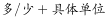
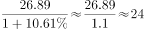

# 基期量计算与基期差值比较（基期和差问题）

考点：[[20-考点/资料分析/增长/基期量计算与基期差值比较（基期和差问题）|增长 / 基期量计算与基期差值比较（基期和差问题）]]
材料：[[15-材料/资料分析/239310 2011—2017年全国马拉松赛事发|239310 2011—2017年全国马拉松赛事发]]

**问法模型**：题干用2017年现期数据问'2016年A比同期B多/少多少'→ 基期和差模型：先分别还原2016年基期量，再作差定方向、定数值

## 推理链
1. 第1步：定位文字段⑤：田协认证A/B类赛事中，2017年全程马拉松完赛26.89万人次且同比增速为g（文字版数值空缺），半程完赛45.29万人次、同比减少0.03万人次
2. 第2步：全程给同比增速→基期=现期÷(1+g)用除法；半程给减少的绝对量→基期=现期+减少量用加法，两项目还原方式不同
3. 第3步：2016年半程完赛=45.29+0.03=45.32万人次；2016年全程完赛=26.89÷(1+g)≈24.32万人次（按官方解析结果反推g≈10.6%）
4. 第4步：作差：24.32−45.32=−21万人次，全程基期远小于半程基期，方向为'少'，差值约21万
5. 第5步：对照选项，'少21万'对应D；'少23万'B需差值再大约2万，与官方增速下全程基期≈24.3万不符，排除

**最快解法**：⚡ 先定方向再定数值：2016年半程=45.29+0.03=45.32万；全程2017年26.89万已小于45.32万，基期只会更小，故2016年全程必小于半程→先排除'多'的A、C；再截位直除26.89÷(1+增速)≈24.3万，45.32−24.3≈21万→选D

## 易错点
- ⚠ 还原方式相反：半程'同比减少0.03万人次'是绝对减少量，基期=45.29+0.03用加法；全程给同比增速，基期=26.89÷(1+g)用除法，两者混淆则差值必错
- ⚠ '完赛人次'≠'参赛人次'：26.89万/45.29万是认证赛事完赛口径，不能误用全程参赛235万、半程参赛134万计算
- ⚠ 先判方向（少）再比21与23可快速锁定答案；文字版全程增速数值空缺，须以原版完整百分数为准，不可凭空填补

## 母题抽象
> 🧩 当题干给出两个指标的现期值及不同形式的变化（一个给同比增速、一个给增减绝对量），并问上一年'谁比谁多/少多少'时，分别用基期公式还原（给增速用除法、给增减量用加减法）后作差，先定方向再定数值

**同类特征**：问2016年（基期）差值、完赛人次（非参赛人次）、田协认证A类B类赛事口径、同比减少0.03万人次（绝对量而非增速）、选项为多/少+具体万数、基期和差问题

## 相关题
- [[10-真题/资料分析/增长/12536430 基期量计算与基期和差比较|12536430]]（四川 2024，相关度1）
- [[10-真题/资料分析/增长/2434309 基期量计算（基期和差问题）|2434309]]（新疆 2019，相关度1）
- [[10-真题/资料分析/增长/2444743 基期量和差（基期量反推+期间差求单月值）|2444743]]（四川 2019，相关度1）
- [[10-真题/资料分析/增长/2050950 基期量计算——基期和差（2014年玉米与小麦基期差值）|2050950]]（江西 2017，相关度1）
- [[10-真题/资料分析/增长/2616168 基期和差（环比基期差值计算）|2616168]]（海南 2020，相关度1）

---

### 题干
在中国田径协会认证的A类、B类赛事中，2016年全程马拉松项目完赛人次比同期半程马拉松项目完赛人次：

### 选项
- A. 多23万
- B. 少23万
- C. 多21万
- D. 少21万　✅

### 官方解析

根据题干“······2016年全程马拉松项目完赛人次比同期半程马拉松项目完赛人次”，并结合选项为“”，且材料数据为2017年，可判定本题为基期和差问题。定位文字材料第五段可得：“在中国田径协会认证的A类、B类赛事中，2017年全程马拉松项目完赛26.89万人次，同比增长；半程马拉松项目完赛人次45.29万人次，同比减少了0.03万人次”，代入基期量公式：，则2016年全程马拉松项目完赛人次为：万人次，2016年半程马拉松项目完赛人次为：万人次，故2016年全程马拉松项目完赛人次与同期半程马拉松项目完赛人次差为：，即少21万人次。

故正确答案为D。

### 给定材料

根据以下资料，回答下列问题。

        2017年全国举办马拉松赛事达1102场，其中，中国田径协会举办的A类赛事223场，B类赛事33场。2017年马拉松赛事的参与人次达到了498万人次，2016年、2015年马拉松赛事的参与人次分别为280万人次、150万人次。 

        2017年全年马拉松直接从业人口数72万，间接从业人口数200万。年度产业总规模达700亿元，比去年同期增长约，中国田径协会设置的发展目标是到2020年，全国马拉松规模赛事超过1900场，其中中国田径协会认证赛事达到350场，各类赛事参赛人数超过1000万人次，马拉松运动产业规模达到1200亿元。

        规模赛事数量方面，2017年排名前三的省份为浙江省、江苏省和广东省，分别为152场、149场和103场，而2016年的前三名分别为江苏省37场，北京市33场，广东省25场。

        从2017年全年赛事的覆盖区域来看，马拉松赛事地域分布更为广泛，中国境内马拉松及相关赛事已经涵盖了含西藏在内的全国31个省、区、市的234个城市，较上年增加了101个城市。

        在赛事类型方面，2017年1102场规模赛事中，全程马拉松参赛人次最高，突破了235万人次，其次为半程马拉松赛事，参赛人次超过134万人次。在中国田径协会认证的A类、B类赛事中，2017年全程马拉松项目完赛26.89万人次，同比增长；半程马拉松项目完赛45.29万人次，同比减少了0.03万人次。

        按照跑者户籍所在地统计，2017年参加中国田径协会认证赛事的跑者中，来自江苏的数量最多，共有76469人参赛，在全国占比。湖北、广东、山东、福建、浙江等省紧随其后。而在全部参赛选手中，共有3663人次的男选手在全程项目中跑进3小时，772人次女选手跑进3小时20分。

> [!warning] 疑点（官方解析可能有误，待人工复核）
> 文字版材料中全程完赛同比增速数值空缺（'同比增长 %'），官方解析公式中该百分数亦未显示；按官方答案D反推2016年全程基期≈24.32万人次、对应增速约10.6%，计算与官方结论一致、不影响答案，标注时需回原版材料核对完整百分数

<!-- CODEX-ANSWER-REVIEW:BEGIN -->
### 本次独立复核

**复核状态：** `resolved`（答案与解析已核定）

**计分答案：** D（可计分）

**复核解析：**

2016全马完赛约26.89/(1+10.61%)≈24.3万人；半马完赛约45.29+0.03=45.32万人；全马少约21万人，D。

**相关信息：**

基期量=现期量/(1+增长率)；若同比下降则除以(1−降幅)。注意百分点与百分比口径。

**题源依据：** [固定版本原题](https://github.com/Mentat-Uran/kaogongzhentizhengliu/blob/84ab93d4b64b61d897bece8a1c0a5bab06b4feb2/10-%E7%9C%9F%E9%A2%98/%E8%B5%84%E6%96%99%E5%88%86%E6%9E%90/%E5%A2%9E%E9%95%BF/2376602%20%E5%9F%BA%E6%9C%9F%E9%87%8F%E8%AE%A1%E7%AE%97%E4%B8%8E%E5%9F%BA%E6%9C%9F%E5%B7%AE%E5%80%BC%E6%AF%94%E8%BE%83%EF%BC%88%E5%9F%BA%E6%9C%9F%E5%92%8C%E5%B7%AE%E9%97%AE%E9%A2%98%EF%BC%89.md)；固定内容 commit `84ab93d4b64b61d897bece8a1c0a5bab06b4feb2`，Markdown blob `f0297ae65562a9ca362629b2f5773f5cc894d933`。
<!-- CODEX-ANSWER-REVIEW:END -->
