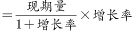
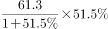
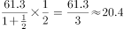
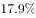
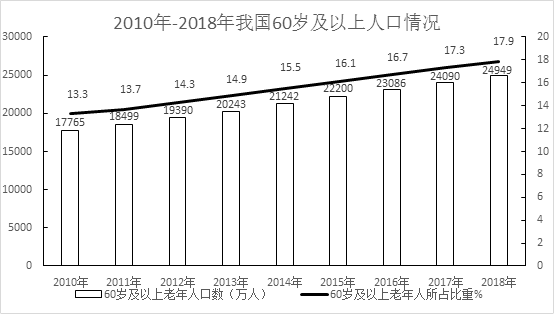
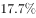

# 增长量计算（已知现期量与同比增长率，r-(1+r)公式法）

考点：[[20-考点/资料分析/增长/增长量计算（已知现期量与同比增长率，r-(1+r)公式法）|增长 / 增长量计算（已知现期量与同比增长率，r/(1+r)公式法）]]
材料：[[15-材料/资料分析/239322 2010—2018年我国60岁及以上|239322 2010—2018年我国60岁及以上]]

**问法模型**：题干出现'同比增加约为'+数值选项 → 采用增长量计算模型：增长量=现期×r/(1+r)，配'百化分/n+1'速算

## 推理链
1. 第1步：由'2018年……同比增加约为'锁定题型为增长量计算，定位文字第一段：2018年享受护理补贴的老年人61.3万人，比上年增长r（原文该处数值空白，原卷完整材料为48.4%，可由官方答案反推验证：61.3×0.484/1.484≈20.0万人）
2. 第2步：写出增长量公式：增长量=现期×r/(1+r)=61.3×r/(1+r)万人
3. 第3步：将r=48.4%百化分为1/2，则增长量≈61.3/(2+1)=61.3/3≈20.4万人（精确计算61.3×0.484/1.484≈20.0万人）
4. 第4步：与选项对照：20.0～20.4万人与B项'20万人'最接近，A的10万、C的30万、D的40万均不符，故选B

**最快解法**：⚡ 百化分/n+1法则：把护理补贴同比增速48.4%百化分为1/2（n=2），增长量≈现期/(n+1)=61.3/3≈20.4万人，直接锁定B（20万人），一步除法即可，无需精算

## 易错点
- ⚠ 增速信息缺口陷阱：原文'比上年增长'处数值空白，须以原卷完整材料增速（约48.4%）代入，切勿照抄或臆造其他补贴的增速
- ⚠ 同名近似指标陷阱：高龄补贴2682.2万人、护理补贴61.3万人、养老服务补贴354.4万人三类名称相近、量级悬殊，本题只取护理补贴61.3万人，若误取354.4万或2682.2万将完全错选
- ⚠ 基期现期混淆：增长量=现期×r/(1+r)，若误算成现期×r=61.3×48.4%≈29.7万人会误选C（30万人）
- ⚠ 时间口径错位：护理补贴属文字第一段（2018年底数据），勿与第二、三段2017年底的孤儿、特困数据混配

## 母题抽象
> 🧩 当题干出现'某现期量同比增加约为'且材料给出'现期量+同比增长率'特征时，用增长量=现期×r/(1+r)，并把r百化分为1/n后按现期/(n+1)速算，验证与选项量级最接近者

**同类特征**：同比增加约为、增长量计算、护理补贴61.3万人、现期量与同比增长率均已知、单位为万人、选项为整十万人量级

## 相关题
- [[10-真题/资料分析/增长/2376597 增长量计算（同比增加额）|2376597]]（吉林 2019，相关度2）
- [[10-真题/资料分析/增长/7159 增长量计算|7159]]（北京 2009，相关度1）
- [[10-真题/资料分析/增长/2571729 增长量计算——每增长1个百分点对应的增量（基期量×1%）|2571729]]（山东 2020，相关度1）
- [[10-真题/资料分析/增长/3018839 增长量计算（负增长情形：基期减少量）|3018839]]（广东 2021，相关度1）
- [[10-真题/资料分析/增长/10204654 增长量计算（已知现期与同比下降率求下降量）|10204654]]（安徽 2024，相关度1）

---

### 题干
2018年我国享受护理补贴的老年人同比增加约为：

### 选项
- A. 10万人
- B. 20万人　✅
- C. 30万人
- D. 40万人

### 官方解析

根据题干“2018年······同比增加约为”可判断本题为增长量计算。定位文字材料第一段可知“享受护理补贴的老年人61.3万人，比上年增长”，根据增长量计算公式：增长量，2018年我国享受护理补贴的老年人同比增加约为≈万人，与B项最接近。

故正确答案为B。

### 给定材料

根据以下资料，回答下列问题。 

        截至2018年底，全国60周岁及以上老年人口24949万人，占总人口的，其中65周岁及以上老年人口16658万人，占总人口的。全国共有老龄事业单位1600个，老年法律援助中心2.0万个，老年维权协调组织6.4万个，老年学校4.9万所，在校学习人员704.0万人，各类老年活动室35.0万个；享受高龄补贴的老年人2682.2万人，比上年增长；享受护理补贴的老年人61.3万人，比上年增长；享受养老服务补贴的老年人354.4万人，比上年增长。

        截至2017年底，全国共有孤儿41.0万人，其中集中供养孤儿8.6万人，社会散居孤儿32.4万人，2017年全国办理收养登记近1.9万件，其中内地居民收养登记近1.7万件，港澳台华侨收养登记103件，外国人收养登记2228件。

        截至2017年底，全国共有农村特困人员466.9万人，比上年减少。全年各级财政共支出农村特困人员救助供养资金269.4亿元，比上年增长。全国共有城市特困人员25.4万人，全年各级财政共支出城市特困人员救助供养资金21.2亿元。

> [!warning] 疑点（官方解析可能有误，待人工复核）
> 材料文本中护理补贴同比增速数值被隐去（空白处），官方解析亦未给出具体增速值，属信息缺口；由官方答案B反推增速应约为48.4%（61.3×0.484/1.484≈20.0万人，恰对应选项20万人），实际做题须以原卷完整材料的增速数值代入，不影响官方答案B的正确性
