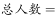
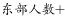
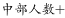
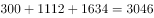

# 基期值逆推（现期+减少量）与分地带总量拼合

考点：[[20-考点/资料分析/增长/基期值逆推（现期+减少量）与分地带总量拼合|增长 / 基期值逆推（现期+减少量）与分地带总量拼合]]
材料：[[15-材料/资料分析/239333 党的十八大以来（2012—2017年|239333 党的十八大以来（2012—2017年]]

**问法模型**：问两个时点的全国农村贫困人口总数 → 全国总量未直接给出，先用'现期+减少量'补出东部基期，再按东+中+西同一分层加总两个时点

## 推理链
1. 第1步：材料未直接给出全国总数；第3段的贫困地区、连片特困地区、民族八省区口径交叉重叠，不能相加求全国，只能用第2段东、中、西三地带数据拼合
2. 第2步：东部只给现期与减少量，用'基期=现期+减少量'：东部2012年末=300+1067=1367万人
3. 第3步：2012年末全国总数=1367+3446（中部）+5086（西部）=9899万人
4. 第4步：2017年末全国总数=300+1112（中部）+1634（西部）=3046万人
5. 第5步：交叉验证：9899−3046=6853万人，与材料'贫困地区减贫4139万人占全国六成'（4139/6853≈60.4%）、'民族八省区减贫2089万人占三成'（2089/6853≈30.5%）均吻合
6. 第6步：对照选项，D为9899万人和3046万人，故选D

**最快解法**：⚡ 尾数法+逆推：先补东部基期300+1067=1367；2012年尾数7+6+6=19取尾9→9899，2017年尾数0+2+4=6→3046，直接锁定D

## 易错点
- ⚠ 漏算东部基期：东部2012年末1367万人材料未直接给出，需300+1067逆推；漏掉东部即得B（8532=3446+5086、2746=1112+1634）
- ⚠ 把五年全国减贫总规模6853万人误当人口存量选A（6853=9899−3046是减少量，不是任一年末总数）
- ⚠ 误用第3段贫困区域数据相加求全国：贫困地区/连片特困地区/民族八省区口径交叉重叠，且与东中西不是同一分层

## 母题抽象
> 🧩 当题干求'全国/总体'某指标而材料只给分块数据时，先确认同一分层的全部部分，缺失部分用'现期±增减量'补齐后加总，再交叉验证两时点之差是否等于材料中另一维度的减贫/增长总量

**同类特征**：全国农村贫困人口总数、2012年末和2017年末两个时点、总量需自行拼合未直接给出、东部仅有现期与减少量、东中西三地带加总、选项含减贫规模6853作干扰

## 相关题
（暂无）

---

### 题干
2012年末和2017年末我国农村贫困人口总数分别为多少万人?

### 选项
- A. 6853  4513
- B. 8532  2746
- C. 9599  3813
- D. 9899  3046　✅

### 官方解析

定位文字材料第二段“2017年末，东部地区农村贫困人口300万人，比2012年末减少1067万人······中部地区农村贫困人口由2012年末的3446万人减少到2017年末的1112万人······西部地区农村贫困人口由2012年末的5086万人减少到2017年末的1634万人”，由于，则2017年末我国农村贫困人口总数为万人，2012年末我国农村贫困人口总数为万人。

故正确答案为D。

### 给定材料

根据以下资料，回答下列问题。 

        党的十八大以来，党中央，国务院实施精准扶贫、精准脱贫基本方略，深入实施东西部扶贫协作，区域性整体贫困明显缓解，为实现到2020年现行标准下农村贫困人口脱贫，贫困县全部摘帽，解决区域性整体贫困打下了坚实基础。

        从地区看，东部地区已率先基本脱贫，中西部地区贫困人口数量全面下降，2017年末，东部地区农村贫困人口300万人，比2012年末减少1067万人，五年累计下降；农村贫困发生率由2012年末的下降到，下降3.1个百分点，已率先基本实现脱贫。中部地区农村贫困人口由2012年末的3446万人减少到2017年末的1112万人，累计减少2334万人，下降幅度为。农村贫困发生率由下降到，下降7.1个百分点。西部地区农村贫困人口由2012年末的5086万人减少到2017年末的1634万人，累计减少3452万人，下降幅度为；农村贫困发生率由2012年末的下降到2017年末的，下降12.0个百分点。

        从贫困区域看，贫困地区、集中连片特困地区，民族八省区减贫成效更加突出，区域性整体贫困明显缓解。贫困地区2017年末农村贫困人口1900万人，比2012年末减少4139万人，减贫规模占全国农村减贫总规模的六成；农村贫困发生率从2012年末的下降至2017年末的，五年累计下降16.0个百分点，年均下降3.2个百分点。集中连片特困地区2017年末农村贫困人口1540万人，比2012年末减少3527万人，下降幅度为；农村贫困发生率从2012年末的下降至2017年末的，累计下降17.0个百分点，年均下降3.4个百分点。内蒙古、广西、贵州、云南、西藏、青海、宁夏、新疆等民族八省区2017年末农村贫困人口1032万人，比2012年末减少2089万人，下降幅度为，减贫规模占全国农村减贫规模的三成；农村贫困发生率从2012年末的下降至2017年末的，累计下降14.2个百分点，年均下降2.8个百分点。

> [!warning] 疑点（官方解析可能有误，待人工复核）
> 官方解析中公式部分文字缺失（'由于，则…总数为万人'处数值空缺），但结论9899/3046经核算与材料数据一致，无实质矛盾

<!-- CODEX-ANSWER-REVIEW:BEGIN -->
### 本次独立复核

**复核状态：** `resolved`（答案与解析已核定）

**计分答案：** D（可计分）

**复核解析：**

2012农村贫困人口按东/中/西合计1367+3446+5086=9899万人；2017总数图表为3046万人，选D。

**相关信息：**

基期量=现期量/(1+增长率)；若同比下降则除以(1−降幅)。注意百分点与百分比口径。

**题源依据：** [固定版本原题](https://github.com/Mentat-Uran/kaogongzhentizhengliu/blob/84ab93d4b64b61d897bece8a1c0a5bab06b4feb2/10-%E7%9C%9F%E9%A2%98/%E8%B5%84%E6%96%99%E5%88%86%E6%9E%90/%E5%A2%9E%E9%95%BF/2376883%20%E5%9F%BA%E6%9C%9F%E5%80%BC%E9%80%86%E6%8E%A8%EF%BC%88%E7%8E%B0%E6%9C%9F%2B%E5%87%8F%E5%B0%91%E9%87%8F%EF%BC%89%E4%B8%8E%E5%88%86%E5%9C%B0%E5%B8%A6%E6%80%BB%E9%87%8F%E6%8B%BC%E5%90%88.md)；固定内容 commit `84ab93d4b64b61d897bece8a1c0a5bab06b4feb2`，Markdown blob `6b73a1d1f49bc1ab3d6e22a3f8616b91a2c55f4d`。
<!-- CODEX-ANSWER-REVIEW:END -->
