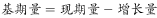
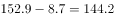

# 基期量计算（基期=现期-增量）

考点：[[20-考点/资料分析/增长/基期量计算（基期=现期-增量）|增长 / 基期量计算（基期=现期-增量）]]
材料：[[15-材料/资料分析/239338 全国医疗卫生机构床位：2017年末总|239338 全国医疗卫生机构床位：2017年末总]]

**问法模型**：题干时间（2016年末）早于材料现期（2017年末）且问某分项床位数 → 用'基期量=现期量-同比增量'直接作差

## 推理链
1. 第1步：题干问'2016年末'基层医疗卫生机构床位数，材料给的是2017年末数据，判定为基期计算问题
2. 第2步：从文字材料提取：2017年末基层医疗卫生机构床位152.9万张，与上年比较基层床位增加8.7万张（注意：8.7是基层自己的增量，不是医院的43.1，也不是总量53.0）
3. 第3步：套用公式基期量=现期量-增量，代入得2016年末基层床位=152.9-8.7=144.2万张
4. 第4步：对照选项，144.2对应D；C的152.9是现期值未减增量，为典型干扰项，故选D

**最快解法**：⚡ 直接减法+尾数锁定：152.9-8.7=144.2，看尾数'.2'即可排除A/B/C，秒选D，无需截位或速算

## 易错点
- ⚠ 把现期当基期：误选C（152.9万张），未做'减去增量'这一步
- ⚠ 增量张冠李戴：把总增量53.0或医院增量43.1误当基层增量；且43.1+8.7=51.8<53.0，总增量中还有约1.2万张未列出的其他类机构增量，绝不能用53.0在'医院与基层'间强行拆分
- ⚠ 误用增速反推：看到图中2017年同比增长7.1%就想用794.0/(1+7.1%)求基期，但那是全国总量口径；基层基期只能用基层现期152.9减基层增量8.7

## 母题抽象
> 🧩 当题干出现'上一年/基期时点+某一分项数量'，且材料给出该分项'现期值+同比增量'时，用基期=现期-增量直接作差；注意增量必须与该分项口径一一对应，且现期-增量只在该分项内完成，勿混用总量或增速

**同类特征**：2016年末、上年基期、基层医疗卫生机构、床位数量（万张）、增加X万张（同比增量）、基期=现期-增量

## 相关题
- [[10-真题/资料分析/平均数/2453134 现期平均数逆推总量（总量=人均量×人口数）+ 量级单位换算（万平方米→亿平方米）|2453134]]（北京 2020，相关度1）
- [[10-真题/资料分析/增长/2453096 增长量比较（同比增量=现期存量−基期存量）|2453096]]（上海 2020，相关度1）

---

### 题干
2016年末，全国基层医疗卫生机构拥有床位数量为多少万张？

### 选项
- A. 714
- B. 568.9
- C. 152.9
- D. 144.2　✅

### 官方解析

根据题干“2016年末······床位数量”，及材料给的是2017年末的数据，可以判定本题为基期计算问题。定位文字材料第一段：“2017年末，基层医疗卫生机构152.9万张······，与上年比较，基层医疗卫生机构床位增加8.7万张”，根据可得，2016年末全国基层医疗卫生机构拥有床位数为万张。

故正确答案为D。

### 给定材料

根据以下资料，回答下列问题。

        2017年末，全国医疗卫生机构床位794.0万张，其中：医院612.0万张（占），基层医疗卫生机构152.9万张（占）。医院中，公立医院床位占，民营医院床位占。与上年比较，床位增加53.0万张，其中：医院床位增加43.1万张，基层医疗卫生机构床位增加8.7万张。每千人口医疗卫生机构床位数由2016年5.37张增加到2017年5.72张。

