# 间隔增长率（隔年增长率）

考点：[[20-考点/资料分析/增长/间隔增长率（隔年增长率）|增长 / 间隔增长率（隔年增长率）]]
材料：[[15-材料/资料分析/239338 全国医疗卫生机构床位：2017年末总|239338 全国医疗卫生机构床位：2017年末总]]

**问法模型**：题干问'2016年床位数比2014年（隔年）增加了'且选项为百分数 → 采用间隔增长率模型 r=r1+r2+r1×r2（r1=2016年同比5.6%，r2=2015年同比6.3%），约得12.3%

## 推理链
1. 第1步：题干'2016年床位数仍然比2014年增加了'且选项为百分数，判定为间隔增长率问题；'2014-2016增速持续下滑'仅为背景干扰，不影响计算
2. 第2步：从图中折线（右轴，比上年增长%）读取：2016年同比增速r1=5.6%，2015年同比增速r2=6.3%
3. 第3步：代入间隔增长率公式 r=r1+r2+r1×r2=5.6%+6.3%+5.6%×6.3%≈11.9%+0.35%≈12.3%
4. 第4步：用柱值（左轴，万张）交叉验证：741÷660.1-1=80.9÷660.1≈12.3%，与公式结果一致
5. 第5步：与选项对照，A项（约12.3%）最接近，故选A

**最快解法**：⚡ 间隔增长率公式法：r=5.6%+6.3%+5.6%×6.3%，前两项加总11.9%，乘积项按'5.6%×6.3%≈0.35%'心算补上，合计≈12.3%直接锁定A；不放心可用截位直除验证741/660.1≈1.12，即增约12%

## 易错点
- ⚠ 两种'增加'口径陷阱：本题选项为百分数，求的是2016对2014的间隔增长率（≈12.3%），不是跨两年累计增量741-660.1=80.9万张，'增加了'配百分数选项只能按增长率处理
- ⚠ 年份增速错配+漏乘积项：应取2016年增速5.6%与2015年增速6.3%，勿误用2014年的6.8%或2017年的7.1%；只加5.6%+6.3%=11.9%偏小，必须补上r1×r2≈0.35%
- ⚠ 双轴图柱线混读：柱读左轴（万张存量）、线读右轴（同比%增速），勿把柱值当增速、增速当增量；且2014-2016增速连续下滑（6.8→6.3→5.6）不等于床位减少，床位逐年增加，'下滑'仅是题干背景干扰

## 母题抽象
> 🧩 当题干出现'现期年比隔年基期增加了'且选项为百分数时，识别为间隔增长率，用 r=r1+r2+r1×r2（r1取现期同比、r2取中间年同比，均读自折线），再用柱值 现期÷隔年基期-1 交叉验证

**同类特征**：比2014年增加（隔年比较）、选项为百分数、增长速度持续下滑（背景干扰）、间隔增长率、折线读两年同比增速、柱值交叉验证

## 相关题
- [[10-真题/资料分析/增长/16592960 间隔增长率（隔年增长率）|16592960]]（青海 2024，相关度2）
- [[10-真题/资料分析/增长/9629 一般增长率计算（现期需由增量倒推）|9629]]（安徽 2009，相关度1）
- [[10-真题/资料分析/比重/2604234 现期比重计算|2604234]]（广东 2020，相关度1）
- [[10-真题/资料分析/增长/27835 一般增长率计算（已知现期量与增长量求增长率）|27835]]（河北 2012，相关度1）
- [[10-真题/资料分析/平均数/10204497 平均数增长率（均价=值-量的比值增长率）|10204497]]（海南 2024，相关度1）

---

### 题干
虽然2014-2016年间全国医疗卫生机构床位数增长速度持续下滑，但2016年床位数仍然比2014年增加了：

### 选项
- A. 
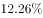
　✅
- B. 
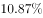

- C. 
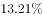

- D. 
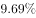

### 官方解析

根据题干“······2016年床位数仍然比2014年增加了”，及选项为百分数，可判定本题为间隔增长率问题。定位统计图，2016年全国医疗卫生机构增速为，2015年全国医疗卫生机构增速为，根据间隔增长率的计算公式：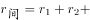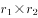，可得全国医疗卫生机构2016年相较于2014年增长率为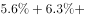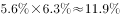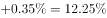，与A项最接近。

故正确答案为A。

### 给定材料

根据以下资料，回答下列问题。

        2017年末，全国医疗卫生机构床位794.0万张，其中：医院612.0万张（占），基层医疗卫生机构152.9万张（占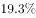）。医院中，公立医院床位占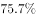，民营医院床位占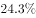。与上年比较，床位增加53.0万张，其中：医院床位增加43.1万张，基层医疗卫生机构床位增加8.7万张。每千人口医疗卫生机构床位数由2016年5.37张增加到2017年5.72张。

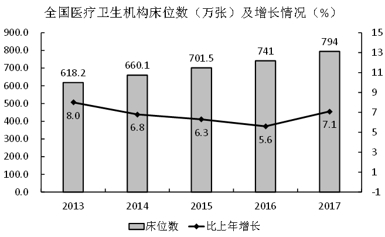

