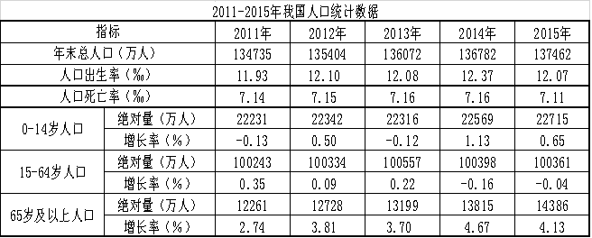

# 增长率比较（人口增长率=出生率−死亡率作差）

考点：[[20-考点/资料分析/增长/增长率比较（人口增长率=出生率−死亡率作差）|增长 / 增长率比较（人口增长率=出生率−死亡率作差）]]
材料：[[15-材料/资料分析/239354 2011-2015年我国人口统计数据|239354 2011-2015年我国人口统计数据]]

**问法模型**：题干问'2012-2015年哪一年人口增长率最高'→逐年计算增长率再比大小；本题可直接用'人口增长率=出生率−死亡率'对表中两行‰数据逐年作差比较，避开大数减除

## 推理链
1. 第1步：题干要求比较2012-2015四年的人口增长率，从表格提取出生率与死亡率：2012年12.10‰/7.15‰、2013年12.08‰/7.16‰、2014年12.37‰/7.16‰、2015年12.07‰/7.11‰
2. 第2步：采用官方口径'人口增长率=人口出生率−人口死亡率'逐年作差
3. 第3步：2012年=12.10−7.15=4.95‰，2013年=12.08−7.16=4.92‰，2014年=12.37−7.16=5.21‰，2015年=12.07−7.11=4.96‰
4. 第4步：比较得5.21‰＞4.96‰＞4.95‰＞4.92‰，2014年增长率最高
5. 第5步：校验（增量口径）：2014年总人口增量136782−136072=710万人为四年最大且各年基数相近，710/136072≈0.52%确为最高，两种口径结论一致，对应选项C

**最快解法**：⚡ 口算作差+极差观察：死亡率四年仅在7.11~7.16‰间微幅波动（极差仅0.05‰），增长率排序基本由出生率主导，而2014年出生率12.37‰为四年最高（高出次高2012年的12.10‰达0.27‰），直接锁定2014年，全程无需大数减法或除法

## 易错点
- ⚠ 拿错'率'：表中年龄段'增长率'（如65岁及以上2014年4.67%）是%口径的自身同比增速，与'我国人口增长率'无关，不能用来作答
- ⚠ 口径混用：出生率−死亡率（‰，如2012年4.95‰）与总人口增量/上年总量（%，如2012年669/134735≈0.497%）数值不同，两种口径不可交叉比较年份；本题恰好两口径排序一致（均为2014年最高），但换成其他年份组合就可能出错
- ⚠ 舍简就繁：误用年末总人口五位数逐年相减再相除（如137462−136782=680再除以136782），计算量大且易错，其实两行‰数据口算作差即可秒判

## 母题抽象
> 🧩 当题干出现'哪一年/哪一期增长率最高（低）'且材料给出两组可作差的率时，用'率A−率B'逐年口算比较；若其中一率各期波动极小，可直接由另一率的最大（小）值所在期锁定答案，再用增量/基数口径快速校验

**同类特征**：哪一年增长率最高、多年份增速比较选最大、出生率与死亡率（‰）两行数据、两率作差即自然增长率、2012-2015四年区间、无需计算总人口增量

## 相关题
（暂无）

---

### 题干
2012-2015年我国人口增长率最高的年份是哪一年？

### 选项
- A. 2012
- B. 2013
- C. 2014　✅
- D. 2015

### 官方解析
根据人口增长率=人口出生率-人口死亡率，定位表格第三行和第四行可知2011-2015年我国每年的人口出生率和死亡率，可得：2012年人口增长率，2013年人口增长率 ，2014年人口增长率，2015年人口增长率， 故2014年人口增长率最高。
 故正确答案为C。

### 给定材料

根据以下资料，回答下列问题 

 

> [!warning] 疑点（官方解析可能有误，待人工复核）
> 官方解析将'人口增长率'按'出生率−死亡率'（自然增长率口径）处理；若按年末总人口增量/上年总量口径（如2012年669/134735≈0.497%、2014年710/136072≈0.522%、2015年680/136782≈0.497%），数值口径不同但排序完全一致，2014年仍最高，答案C不受影响，仅提示存在两种口径差异
