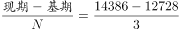
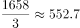

# 年均增长量计算

考点：[[20-考点/资料分析/增长/年均增长量计算|增长 / 年均增长量计算]]
材料：[[15-材料/资料分析/239354 2011-2015年我国人口统计数据|239354 2011-2015年我国人口统计数据]]

**问法模型**：题干出现'2012-2015年……65岁及以上人口年均增长量大约是多少万人'→采用年均增长量模型：年均增长量=（末期量−基期量）÷间隔年数，本题按官方口径基期取2012年、间隔3年

## 推理链
1. 第1步：从表格'65岁及以上人口—绝对量（万人）'行提取数据：2012年12728万人、2015年14386万人（对应题干区间2012-2015年）
2. 第2步：由'年均增长量……万人'判定题型为年均增长量计算，所用公式：年均增长量=（末期量−基期量）÷间隔年数
3. 第3步：按官方口径，2012-2015年区间含3个年度增量，基期取区间首年2012年、间隔n=3
4. 第4步：代入计算：14386−12728=1658，1658÷3≈552.7≈553万人
5. 第5步：与选项对照：553与D项（553）最接近，锁定答案D；注意（14386−12261）÷4≈531为C项干扰值，勿误选

**最快解法**：⚡ 首尾差公式法+截位直除：直接取2015年与2012年绝对量作差14386−12728=1658，再除以间隔3年（3×550=1650，余8）≈552.7≈553万人，一步锁定D，无需逐年相减

## 易错点
- ⚠ 基期与间隔数口径：官方按基期取2012年、间隔3年计算得553；若误按基期2011年、除以4，得（14386−12261）÷4=531.25会错选C（531），这是本题最大陷阱，须以官方答案口径为准
- ⚠ 增长率≠增长量：表中'增长率'是同比%（如2012年2.74%对应增量约12728×2.74%≈467万人），且出生率/死亡率为‰口径，均不能直接当增长量使用
- ⚠ 年均增长量（平均值）与逐年净增量（2012-2015年约467/471/616/571万人，供兄弟题3作图用）口径不同，勿混淆两列差值的用途

## 母题抽象
> 🧩 当题干出现'××-××年某指标年均增长量约多少'时，用（末期量−基期量）÷间隔年数，间隔=末年−基年（区间首年作基期，如2012-2015年取n=3），用首尾差+截位直除速算并对照选项

**同类特征**：'年均增长量'提问、限定年份区间'2012-2015年'、主体为65岁及以上人口（年龄段绝对量列）、单位为'万人'、'大约是多少'提示粗算即可、年末时点存量数据

## 相关题
- [[10-真题/资料分析/增长/2374711 年均增长量计算|2374711]]（广东 2019，相关度2）
- [[10-真题/资料分析/增长/15419190 年均增长量计算|15419190]]（湖北 2025，相关度2）
- [[10-真题/资料分析/增长/2742310 年均增长量计算|2742310]]（北京 2021，相关度2）
- [[10-真题/资料分析/增长/2742290 年均增长量计算|2742290]]（北京 2021，相关度2）
- [[10-真题/资料分析/增长/12881983 年均增长量计算|12881983]]（广东 2025，相关度2）

---

### 题干
2012-2015年，我国65岁及以上人口年均增长量大约是多少万人？

### 选项
- A. 414
- B. 425
- C. 531
- D. 553　✅

### 官方解析

根据题干所求“2012-2015年，······年均增长量······万人”可判定此题为年均增长量计算问题。定位表格可得，2012、2015年我国65岁及以上人口分别为12728万人、14386万人。根据年均增长量的公式：年均增长量=万人，与D项最接近。

故正确答案为D。

### 给定材料

根据以下资料，回答下列问题 

 

> [!warning] 疑点（官方解析可能有误，待人工复核）
> 官方答案为D（553），反推其口径为（14386−12728）÷3≈552.7，即基期取2012年、间隔3年；但按常见'首尾年均'口径（基期取2011年、除以4）计算（14386−12261）÷4=531.25≈531，应对应C项，与官方答案D存在口径矛盾；且官方解析原文公式被截断（'年均增长量=万人'处缺失），无法核实其原始算式，仅能按答案D反推口径。依铁律以官方答案D为准，未更改答案。
