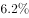

# 分月同比增速读图比较（纯读数题）

考点：[[20-考点/资料分析/增长/分月同比增速读图比较（纯读数题）|增长 / 分月同比增速读图比较（纯读数题）]]
材料：[[15-材料/资料分析/239356 2018年中国社会消费品零售总额的总|239356 2018年中国社会消费品零售总额的总]]

**问法模型**：题干给出四个具体月份、问社会消费品零售总额分月同比名义增速最快 → 直接从图1折线图定位各选项月份的增速数值，逐一比大小，无需计算

## 推理链
1. 第1步：题干限定'分月同比名义增长速度'，选项月份为2017年12月、2018年5月、2018年7月、2018年9月，需回到图1折线图逐点读数
2. 第2步：图1横轴共12个点，数值依次为：2017年12月9.4%、2018年1-2月9.7%、3月10.1%、4月9.4%、5月8.5%、6月9.0%、7月8.8%、8月9.0%、9月9.2%、10月8.6%、11月8.1%、12月8.2%
3. 第3步：提取选项对应数值：A.2017年12月9.4%，B.2018年5月8.5%，C.2018年7月8.8%，D.2018年9月9.2%
4. 第4步：比较得9.4%＞9.2%＞8.8%＞8.5%，最快的是2017年12月的9.4%，与选项A对应

**最快解法**：⚡ 纯读数比大小：在折线图上直接定位四个选项月份对应的点，比较纵轴读数即可（9.4%＞9.2%＞8.8%＞8.5%）；无需任何计算，关键只在准确定位横轴首点的'2017年12月'标签

## 易错点
- ⚠ 误把横轴第一点'2017年12月(9.4%)'当作不能用的对照点排除，从而错选D(2018年9月9.2%)；该点虽是2017年12月对2016年12月的增速，但题干问的恰是'该月自身的同比增速'，其9.4%正是可比数据，且官方答案即取此点
- ⚠ 横轴首点'2017年12月'为斜排标签且与'2018年1-2月(9.7%)''2018年12月(8.2%)'相邻，易定位错点；同时注意全局最高点3月10.1%并不在选项中，不能因'3月最高'而否定选项内比较
- ⚠ 口径陷阱：题干要'分月'增速，若误拿表格中12月当月8.2%或全年9.0%参与比较即错；折线图各点均为名义增速，与题干'名义'要求一致，不需做实际增速换算

## 母题抽象
> 🧩 当题干出现'下列月份/时期中，某指标增速最快(高)的是'且选项为具体时间点时，直接在折线图/表格中定位各选项对应数值横向比大小；特别注意横轴首尾点的年份标签归属和名义/实际口径，全程零计算

**同类特征**：下列月份中、分月同比名义增长速度、最快的是、折线图逐点读数、2017年12月与2018年各月混选

## 相关题
- [[10-真题/资料分析/增长/1796220 环比增速比较（增长率分数比较）|1796220]]（黑龙江 2016，相关度1）
- [[10-真题/资料分析/增长/13504295 年均增长率比较（以2014年为基准，n相同比现期-基期倍数）|13504295]]（甘肃 2025，相关度1）
- [[10-真题/资料分析/增长/2388067 同比增长率（增速）读图比较|2388067]]（河北 2019，相关度1）

---

### 题干
下列月份中，社会消费品零售总额分月同比名义增长速度最快的是：

### 选项
- A. 2017年12月　✅
- B. 2018年5月
- C. 2018年7月
- D. 2018年9月

### 官方解析

定位折线图可得：2017年12月、2018年5月、7月、9月的分月同比名义增长速度分别为、、、，则增长速度最快的是，即2017年12月。

故正确答案为A。

### 给定材料

根据以下资料，回答下列问题 

        2018年1-12月，社会消费品零售总额380987亿元，比上年增长（扣除价格因素实际增长，以下除特殊说明外均为名义增长）。

        2018年，限额以上零售业单位中的超市、百货店、专业店和专卖店零售额比上年分别增长、、和。

