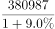
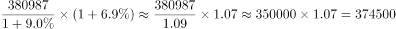

# 名义与实际增速区分及不变价（扣除价格因素）换算

考点：[[20-考点/资料分析/增长/名义与实际增速区分及不变价（扣除价格因素）换算|增长 / 名义与实际增速区分及不变价（扣除价格因素）换算]]
材料：[[15-材料/资料分析/239356 2018年中国社会消费品零售总额的总|239356 2018年中国社会消费品零售总额的总]]

**问法模型**：题干出现‘按2017年价格计算现期总量’→采用不变价换算模型：不变价现期值＝现价现期÷(1+名义增速)×(1+实际增速)

## 推理链
1. 第1步：题干要求‘按2017年价格计算’，定位正文：2018年社会消费品零售总额380987亿元，比上年增长9.0%（名义增速，与表1-12月列9.0%一致），扣除价格因素实际增长6.9%（题给文本中该数值被隐去，可由C项反推373647÷349529≈1.069验证）
2. 第2步：模型：按2017年价格计算的2018年值＝2017年现价总额×(1+实际增速)，其中2017年总额须用名义增速倒推：380987÷(1+9.0%)
3. 第3步：截位直除：380987÷1.09≈349529亿元（恰为A项，即2017年现价总额）
4. 第4步：349529×(1+6.9%)＝349529×1.069≈373647亿元
5. 第5步：对照选项：实际增速6.9%＜名义增速9.0%，结果必小于现价380987亿元，D（409223）方向即错；A漏乘(1+6.9%)只是基期值，B≈380987÷1.069误把实际增速当除数，锁定C

**最快解法**：⚡ 公式法＋截位直除：380987÷1.09≈349529（恰为A项基期值），再×1.069→349529×1.069≈373647，选C；方向秒杀：实际增速6.9%＜名义增速9.0%，结果必小于380987，先排除D，A漏乘(1+6.9%)、B误用1.069作除数，均可排除

## 易错点
- ⚠ 名义/实际增速口径混用：倒推2017年基期必须用名义9.0%，正向推2018年不变价值必须用实际6.9%，两者不可互换或只用其一（全用6.9%去除即落入B=356396陷阱）
- ⚠ ‘按2017年价格计算’≠‘2017年的值’：A项349529亿元只是380987÷1.09的基期值，漏乘(1+6.9%)即错选A
- ⚠ 缺方向校验：实际增速＜名义增速时结果必小于现价380987亿元，大于它的D可秒排；另注意正文括号内实际增速在题给文本被隐去，须按原卷6.9%代入，勿拿表格中的名义增速顶替

## 母题抽象
> 🧩 当题干出现‘按××年价格计算/扣除价格因素’特征时，用不变价换算模型：不变价现期＝现价现期÷(1+名义增速)×(1+实际增速)，并用‘结果介于基期值与现价现期之间’做方向校验

**同类特征**：按2017年价格计算、扣除价格因素实际增长、名义增速与实际增速双口径、不变价换算、现期值计算、结果应小于现价总量

## 相关题
- [[10-真题/资料分析/增长/2256398 CPI增长率推算（名义增长率与实际增长率换算）|2256398]]（江西 2018，相关度1）

---

### 题干
按2017年价格计算2018年社会消费品零售总额约为：

### 选项
- A. 349529亿元
- B. 356396亿元
- C. 373647亿元　✅
- D. 409223亿元

### 官方解析

根据题干“按2017年价格计算2018年社会消费品零售总额为”，可判定本题为现期计算问题。定位为文字材料第一段可得：2018年1-12月，社会消费品零售总额380987亿元，名义增长率为，扣除价格因素实际增长。“按2017年价格计算”，即扣除2018年价格上涨因素造成的增长，也就是按2017年的实际增长率来计算。2017年社会消费品零售总额为，按2017年的实际增长率来计算，2018年社会消费品零售总额为亿元，与C项最接近。

故正确答案为C。

### 给定材料

根据以下资料，回答下列问题 

        2018年1-12月，社会消费品零售总额380987亿元，比上年增长（扣除价格因素实际增长，以下除特殊说明外均为名义增长）。

        2018年，限额以上零售业单位中的超市、百货店、专业店和专卖店零售额比上年分别增长、、和。

> [!warning] 疑点（官方解析可能有误，待人工复核）
> 题给正文与官方解析中‘扣除价格因素实际增长’的数值均被隐去，仅凭现文本无法独立算出答案；由C反推实际增速＝373647÷(380987÷1.09)−1≈6.9%（即原卷括号内的6.9%），按此计算与C完全吻合，官方解析逻辑与答案本身无误，属材料转录缺数而非解析错误

<!-- CODEX-ANSWER-REVIEW:BEGIN -->
### 本次独立复核

**复核状态：** `resolved`（答案与解析已核定）

**计分答案：** C（可计分）

**复核解析：**

名义同比增长9.0%，扣除价格因素后的实际增长6.9%。按2017年价格计算，即以2017年现价总额为基期，再按实际增速扩展：2017现价=380987/1.09≈349529亿元；2018不变价总额=349529×1.069≈373647亿元，选C。取值与选项精确吻合。

**相关信息：**

“按2017年价格”表示剔除价格因素，使用实际增速；金额单位亿元，按题目四舍五入到选项值。

**题源依据：** [固定版本原题](https://github.com/Mentat-Uran/kaogongzhentizhengliu/blob/84ab93d4b64b61d897bece8a1c0a5bab06b4feb2/10-%E7%9C%9F%E9%A2%98/%E8%B5%84%E6%96%99%E5%88%86%E6%9E%90/%E5%A2%9E%E9%95%BF/2376996%20%E5%90%8D%E4%B9%89%E4%B8%8E%E5%AE%9E%E9%99%85%E5%A2%9E%E9%80%9F%E5%8C%BA%E5%88%86%E5%8F%8A%E4%B8%8D%E5%8F%98%E4%BB%B7%EF%BC%88%E6%89%A3%E9%99%A4%E4%BB%B7%E6%A0%BC%E5%9B%A0%E7%B4%A0%EF%BC%89%E6%8D%A2%E7%AE%97.md)；固定内容 commit `84ab93d4b64b61d897bece8a1c0a5bab06b4feb2`，Markdown blob `5edb6eed4448b61958be4a1862f8d74d11e3095c`。
<!-- CODEX-ANSWER-REVIEW:END -->
