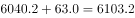

# 基期量计算（已知增减量型）

考点：[[20-考点/资料分析/增长/基期量计算（已知增减量型）|增长 / 基期量计算（已知增减量型）]]
材料：[[15-材料/资料分析/239371 2016年全国水资源供水量与用水量状|239371 2016年全国水资源供水量与用水量状]]

**问法模型**：题干问材料现期（2016年）之前一年的量（2015年），材料只给'现期量6040.2亿立方米+较上年减少63.0亿立方米'（绝对增减量，非增长率）→ 用基期量=现期量−同比增减量，'减少'即增减量为负，故2015年=6040.2+63.0

## 推理链
1. 第1步：题干求'2015年全国供用水总量'，早于材料现期2016年，判定为基期计算问题；材料第1段给出2016年总量6040.2亿立方米、较上年减少63.0亿立方米
2. 第2步：材料给的是增减量（亿立方米）而非增长率，故不能用基期=现期÷(1+r)折算，只能用'现期量∓增减量'：同比减少63.0，即2016年比2015年少63.0，基期量=6040.2+63.0
3. 第3步：代入计算：6040.2+63.0=6103.2亿立方米
4. 第4步：与选项对照：B为6103.2，正确；C的5977.2=6040.2−63.0是方向做反的陷阱值，A的6040.2是现期值，D的1057.2疑似与地下水源1057.0数字混淆，均排除

**最快解法**：⚡ 方向口诀+'减少则加回'一步加法：材料说2016年'较上年减少63.0'，说明2015年更多，直接6040.2+63.0=6103.2，尾数0.2+0=0.2锁定B；全程口算，无需动笔

## 易错点
- ⚠ 方向做反：见'较上年减少63.0'误算成6040.2−63.0=5977.2，正中C选项陷阱；'减少'是指2016比2015少，求基期要加回
- ⚠ 现期/基期混淆：忽略题干问2015年，直接选现期值6040.2（A选项）
- ⚠ 数字串位干扰：D选项1057.2与材料中'地下水源供水量1057.0亿立方米'高度相似，属干扰性数字，勿被带偏

## 母题抽象
> 🧩 当题干问材料年份之前一年的量、且材料只给'现期值+较上年增减的绝对量'时，用基期量=现期量∓增减量（减少加回、增加减去），并用尾数法/量级与选项互验，警惕'减少做减法'的反向陷阱选项

**同类特征**：问上一年的量（2015年）、材料时间为2016年（现期）、已知'较上年减少63.0亿立方米'为绝对增减量、未给增长率、求基期量、选项含现期值与反向运算陷阱

## 相关题
- [[10-真题/资料分析/其他/2452599 基期量计算（降幅求基期）|2452599]]（江苏 2020，相关度1）

---

### 题干
2015年全国供用水总量为：

### 选项
- A. 6040.2亿立方米
- B. 6103.2亿立方米　✅
- C. 5977.2亿立方米
- D. 1057.2亿立方米

### 官方解析

根据题干所求“2015年全国···为”，结合材料时间为2016年，可判定此题为基期计算问题。定位第1段文字材料可知，2016年全国供用水总量为6040.2亿立方米，较上年减少63.0亿立方米，则2015年全国供用水总量为亿立方米。

故正确答案为B。

### 给定材料

根据所给资料，回答下列问题。

        2016年全国供用水总量为6040.2亿立方米，较上年减少63.0亿立方米。其中，地表水源供水量4912.4亿立方米，占供水总量的；地下水源供水量1057.0亿立方米，占供水总量的；其他水源供水量70.8亿立方米，占供水总量的。与2015年相比，地表水源供水量减少57.1亿立方米，地下水源供水量减少12.2亿立方米，其他水源供水量增加6.3亿立方米。

        2016年，全国生活用水821.6亿立方米，占用水总量的；工业用水1308.0亿立方米，占用水总量的；农业用水3768.0亿立方米，占用水总量的；人工生态环境补水142.6亿立方米，占用水总量的。与2015年相比，农业用水量减少84.2亿立方米，生活用水量及人工生态环境补水量分别增加28.1亿立方米和19.9亿立方米。

        2016年全国万元国内生产总值（当年份）用水量81立方米，万元工业增加值（当年份）用水量52.8立方米，农田灌溉水有效利用系数0.542。按可比价计算，万元国内生产总值用水量和万元工业增加值用水量分别比2015年下降和。

        注：

