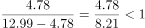
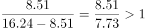
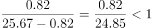
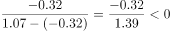

# 增长率比较（基期值=现期值−增长量）

考点：[[20-考点/资料分析/增长/增长率比较（基期值=现期值−增长量）|增长 / 增长率比较（基期值=现期值−增长量）]]
材料：[[15-材料/资料分析/239373 2018年中国就业市场CIER景气指|239373 2018年中国就业市场CIER景气指]]

**问法模型**：题干'与第三季度相比，第四季度……上升最快'→ 增长率比较模型：先以'基期=现期−增长量'反推第三季度指数，再比较'变化量÷第三季度指数'的大小

## 推理链
1. 第1步：从表2提取四个选项的第四季度CIER指数与'比上一季度变化'：社区/居民/家政服务12.99、4.78；教育/培训16.24、8.51；技工/操作工25.67、0.82；高级管理1.07、-0.32
2. 第2步：明确'上升最快'比的是增长率（变化量÷基期值），而表中'比上一季度变化'是指数点增量，故第三季度指数=第四季度指数−变化量
3. 第3步：代入计算：A项4.78÷(12.99−4.78)=4.78÷8.21≈58%；B项8.51÷(16.24−8.51)=8.51÷7.73≈110%；C项0.82÷(25.67−0.82)=0.82÷24.85≈3%
4. 第4步：D项变化量为-0.32，第四季度指数较第三季度下降，不满足'上升'，直接排除
5. 第5步：比较增长率110%>58%>3%，最大为教育/培训，对应B项

**最快解法**：⚡ 基期反推+截位直除：先用变化量符号排除D（负增量即下降）；再抓两端——B的增量8.51最大且其基期仅16.24−8.51≈7.7，8.51/7.73>100%，而A的4.78/8.21≈58%、C的0.82/24.85≈3%，B明显最大，无需精算四项

## 易错点
- ⚠ 把'上升最快'误当成'比上一季度变化（指数点增量）最大'来比较——虽然本题增量最大者同为B，但概念上必须除以基期换算成增长率，若选项设置不同极易错选
- ⚠ 基期反推模型用错：表中变化量是增量而非增长率，须用'第三季度=第四季度−变化量'，不能按'现期÷(1+变化率)'处理
- ⚠ 忽视变化量符号：高级管理变化量为-0.32，实际是下降，不可能'上升最快'；反推其基期时应为1.07−(−0.32)=1.39，负增量处理时符号易弄反

## 母题抽象
> 🧩 当题干出现'与基期（上期）相比上升/增长最快'且材料只给现期值与增长量时，先用'基期=现期−增长量'反推，再按'增长率=增长量÷基期'比较，并先排除增长量为负的选项；切勿把增量大小当成快慢

**同类特征**：与第三季度相比、第四季度CIER指数、上升最快、职业、比上一季度变化、表2职业口径

## 相关题
- [[10-真题/资料分析/增长/2377071 基期值比较（基期=现期−增长量，指数点增量反推）|2377071]]（选调 2019，相关度1）
- [[10-真题/判断推理/类比推理/2187879 逻辑关系-对应关系（职业与工作内容）|2187879]]（山东 2018，相关度1）

---

### 题干
与第三季度相比，第四季度CIER指数上升最快的职业是：

### 选项
- A. 社区/居民/家政服务
- B. 教育/培训　✅
- C. 技工/操作工
- D. 高级管理

### 官方解析

根据题干“与第三季度相比，第四季度CIER指数上升最快的职业是”，可判定本题为增长率比较问题。定位表格2可得：2018年第四季度社区/居民/家政服务、教育/培训、技工/操作工、高级管理的指数分别为12.99、16.24、25.67、1.07，比上一季度变化量分别为4.78、8.51、0.82、-0.32。根据，可得各项增长率分别为：

A项，；

B项，；

C项，；

D项，。

可知增长率最大的为B项，即上升最快的职业为教育/培训。

故正确答案为B。

### 给定材料

根据以下资料，回答下列问题。

        CIER指数用来反映就业市场景气程度，其计算方法是：。根据有关机构发布的数据，2018年第一季度CIER指数为1.91，第二季度为1.88，第三季度为1.97，第四季度为2.38。2018年第三季度，招聘需求人数环比下降，求职申请人数环比下降；第四季度招聘需求人数环比增加，求职申请人数环比增加。

