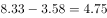
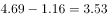
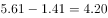
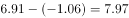

# 基期值比较（基期=现期−增长量，指数点增量反推）

考点：[[20-考点/资料分析/增长/基期值比较（基期=现期−增长量，指数点增量反推）|增长 / 基期值比较（基期=现期−增长量，指数点增量反推）]]
材料：[[15-材料/资料分析/239373 2018年中国就业市场CIER景气指|239373 2018年中国就业市场CIER景气指]]

**问法模型**：题干'根据第四季度数据，推断第三季度CIER指数最高的行业'→用'基期（第三季度）=现期（第四季度）−比上一季度变化（指数点增量）'逐项反推后比较大小

## 推理链
1. 第1步：从表1（行业表）提取四个选项的第四季度指数及比上一季度变化：教育/培训/院校 8.33与3.58；医药/生物工程 4.69与1.16；互联网/电子商务 5.61与1.41；中介服务 6.91与-1.06
2. 第2步：明确'比上一季度变化'是指数点的绝对增量而非增长率，故第三季度指数=第四季度指数−变化量
3. 第3步：A项8.33−3.58=4.75；B项4.69−1.16=3.53；C项5.61−1.41=4.20；D项中介服务变化量为负，6.91−(−1.06)=7.97
4. 第4步：比较四个第三季度指数：7.97＞4.75＞4.20＞3.53，最高的是中介服务（7.97）
5. 第5步：与选项对照，锁定D项，与官方答案一致

**最快解法**：⚡ 符号判断优先＋减法直算：先扫一眼'比上一季度变化'列，四个选项中只有中介服务为负增量（-1.06），其第三季度=6.91+1.06=7.97必大于第四季度值6.91；而第四季度最高的教育/培训/院校反推仅8.33−3.58≈4.75，明显低于7.97，再用4.69−1.16≈3.5、5.61−1.41≈4.2验算B、C更小即可秒选D

## 易错点
- ⚠ 把'比上一季度变化'误当增长率，套用现期÷(1+变化率)，而它实为指数点增量，必须用'现期−增量'求基期
- ⚠ 中介服务变化量为-1.06，符号处理错误（错算成6.91−1.06=5.85）会误判最高为A；负增量意味着第三季度反而高于第四季度
- ⚠ 只按第四季度排名选指数最高的教育/培训/院校（8.33），忽略第三季度排序与第四季度不一致的命题陷阱

## 母题抽象
> 🧩 当题干出现'根据某期数据推断上一期最高/最大'且表中给出'比上期变化'增量列时，用'基期=现期−增量'反推比较，特别警惕负增量（基期=现期+|增量|）反超现期排名的陷阱

**同类特征**：根据第四季度数据、推断第三季度、CIER指数最高、行业口径（表1）、比上一季度变化、基期比较

## 相关题
- [[10-真题/资料分析/增长/2377070 增长率比较（基期值=现期值−增长量）|2377070]]（选调 2019，相关度1）
- [[10-真题/资料分析/增长/2377192 基期值计算（现期−增长量反推基期）并比较最值|2377192]]（云南 2019，相关度1）

---

### 题干
根据第四季度数据，可以推断下列行业在第三季度CIER指数最高的是：

### 选项
- A. 教育/培训/院校
- B. 医药/生物工程
- C. 互联网/电子商务
- D. 中介服务　✅

### 官方解析

由题干“根据第四季度数据，可以推断······在第三季度CIER指数最高的是”，结合表格材料1给出的第四季度数据及比上一季度变化量，可判定本题为基期比较问题。，可知各选项第三季度CIER指数分别为：

A项，；

B项，

C项，；

D项，。

可知第三季度CIER指数最高的是D项。

故正确答案为D。

### 给定材料

根据以下资料，回答下列问题。

        CIER指数用来反映就业市场景气程度，其计算方法是：。根据有关机构发布的数据，2018年第一季度CIER指数为1.91，第二季度为1.88，第三季度为1.97，第四季度为2.38。2018年第三季度，招聘需求人数环比下降，求职申请人数环比下降；第四季度招聘需求人数环比增加，求职申请人数环比增加。

