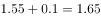
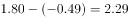
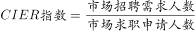
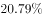
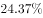
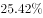

# 基期值计算（基期=现期−增长量）与阈值计数

考点：[[20-考点/资料分析/增长/基期值计算（基期=现期−增长量）与阈值计数|增长 / 基期值计算（基期=现期−增长量）与阈值计数]]
材料：[[15-材料/资料分析/239373 2018年中国就业市场CIER景气指|239373 2018年中国就业市场CIER景气指]]

**问法模型**：题干问'已列职业中第三季度CIER指数不低于1.5的个数'→对表2两栏共20个职业逐项用'第三季度指数=第四季度指数−比上一季度变化'反推基期后按阈值计数

## 推理链
1. 第1步：从表2提取较好栏10个职业第四季度指数（25.67~7.67）及'比上一季度变化'（8.51~0.81，全为正），较差栏10个职业第四季度指数（1.07~1.81）及变化（−0.49~0.41，有正有负）
2. 第2步：所用规则为基期计算：第三季度指数=第四季度指数−变化量，变化量为负时相当于加回其绝对值
3. 第3步：较好栏整栏排除：最低反推值为翻译7.67−1.58=6.09，仍远大于1.5，故较好栏10个职业全部≥1.5
4. 第4步：较差栏中变化量为负的3个职业反推：高级管理=1.07−(−0.32)=1.39，IT管理/项目协调=1.55−(−0.1)=1.65，汽车制造=1.8−(−0.49)=2.29
5. 第5步：较差栏中变化量为正的职业反推后必低于其现期值，最高者为环境科学/环保=1.81−0.41=1.40（其余如项目管理/项目协调1.39、生产管理/运营1.35等均更低），全部<1.5
6. 第6步：汇总计数：10（较好栏）+2（IT管理/项目协调、汽车制造）=12个，对照选项C

**最快解法**：⚡ 分栏筛选法+反推基期：较好栏只需验算最临界一项7.67−1.58=6.09>1.5即可整栏计10个；较差栏先看负增量行（高级管理1.39、IT管理/项目协调1.65、汽车制造2.29），再验正增量行中现期最高的环境科学/环保1.81−0.41=1.40<1.5即可排除整组，合计10+2=12，选C

## 易错点
- ⚠ 表中'比上一季度变化'是指数点增量而非增长率，负增量反推时符号极易弄反：1.55−(−0.1)=1.65、1.8−(−0.49)=2.29，若错算成1.45、1.31会漏数2个而误选B(10个)或A(10个)
- ⚠ '已列职业'须将表2较好栏与较差栏拼接共20个职业，只数较好栏会误得10个（选项A）
- ⚠ 较差栏多个反推值紧贴阈值1.5（高级管理1.39、项目管理/项目协调1.39、环境科学/环保1.40），不能目测取舍，须精确计算；另注意表1为行业口径、表2为职业口径，'教育/培训'与'教育培训院校'等近似名称不可跨表混用

## 母题抽象
> 🧩 当题干出现'已列主体中基期值（第三季度）不低于某阈值的个数'时，用'基期=现期−增长量'分栏筛选：先以栏内最临界项（现期最低、增量最大）做整栏排除，再对负增量行和临界行逐项精确反推计数，最后两栏相加验证选项

**同类特征**：已列职业中、第三季度CIER指数、不低于1.5、个数为、比上一季度变化（增量）、较好+较差两栏合并统计

## 相关题
- [[10-真题/资料分析/其他/5519037 正增长个数计数（增速正负判读+清点）|5519037]]（湖北 2021，相关度1）

---

### 题干
已列职业中，在第三季度CIER指数不低于1.5的个数为：

### 选项
- A. 10
- B. 11
- C. 12　✅
- D. 13

### 官方解析

题干“已列职业中，在第三季度CIER指数不低于1.5的个数为”，结合表格材料2给出的第四季度数据及比上一季度变化量，可判定本题为基期计算问题。根据，通过表格可知，就业景气较好的10个职业在第三季度的CIER指数均大于1.5；在就业景气较差的十个职业中，IT管理/项目协调、汽车制造这2个职业在第三季度的CIER指数分别为：、也均大于1.5。故已列职业中，在第三季度CIER指数不低于1.5的个数为12。

故正确答案为C。

### 给定材料

根据以下资料，回答下列问题。

        CIER指数用来反映就业市场景气程度，其计算方法是：。根据有关机构发布的数据，2018年第一季度CIER指数为1.91，第二季度为1.88，第三季度为1.97，第四季度为2.38。2018年第三季度，招聘需求人数环比下降，求职申请人数环比下降；第四季度招聘需求人数环比增加，求职申请人数环比增加。

