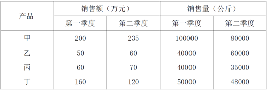

# 增长量计算（四产品合计总量的变化方向判断）

考点：[[20-考点/资料分析/增长/增长量计算（四产品合计总量的变化方向判断）|增长 / 增长量计算（四产品合计总量的变化方向判断）]]
材料：[[15-材料/资料分析/239407 某水产公司甲、乙、丙、丁四种鱼类产品|239407 某水产公司甲、乙、丙、丁四种鱼类产品]]

**问法模型**：问'第二季度与第一季度相比，四种产品销售总额/销售总量的变化'→ 将四种产品的增长量分别求和（或分别加总两期合计），看总和的正负号定方向

## 推理链
1. 第1步：从表格提取两期数据：销售额甲200→235、乙50→60、丙60→70、丁160→120（万元）；销售量甲100000→80000、乙40000→60000、丙40000→35000、丁50000→48000（公斤）
2. 第2步：依据'增长量=现期-基期'，四种产品销售额增长量为+35、+10、+10、-40，销售量增长量为-20000、+20000、-5000、-2000
3. 第3步：分别求和：销售总额变化=35+10+10-40=+15万元（合计470→485），销售总量变化=-20000+20000-5000-2000=-7000公斤（合计230000→223000）
4. 第4步：销售总额增加（+15万元）、销售总量减少（-7000公斤），与选项对照，只有B'销售总额增加，销售总量减少'符合

**最快解法**：⚡ 正负抵消+尾数加总：销售量中甲-20000与乙+20000先抵消，仅剩丙-5000、丁-2000，合计-7000<0，总量必减；销售额增长量35+10+10-40=+15>0（或合计470→485），总额必增，两步即锁定B

## 易错点
- ⚠ 量价反向变动直觉陷阱：甲销售量降2万公斤但销售额升35万元，整体呈现'额增量减'，凭'卖得少就是总收入少'的直觉会误选D
- ⚠ '销售总额/总量'必须四种产品加总后再比较，只盯某一产品（如只看甲或只看丁）会判断错方向
- ⚠ 甲、乙销售量增减量恰为±20000，若配对抵消后漏算丙-5000和丁-2000，会误判销售总量为'不变/增加'

## 母题抽象
> 🧩 当题干出现'两期相比，各分项合计的总量变化（增加/减少）'特征时，用'分项增长量求和定符号'法，优先让数值相等的一对正负项先抵消，再看剩余项之和的符号即可定答案

**同类特征**：第二季度与第一季度相比、四种鱼类产品销售情况的变化、销售总额…销售总量…、增加/减少的方向判断、合计量加总比较、环比两期对比

## 相关题
（暂无）

---

### 题干
第二季度与第一季度相比，四种鱼类产品销售情况的变化是：

### 选项
- A. 销售总额增加，销售总量增加
- B. 销售总额增加，销售总量减少　✅
- C. 销售总额减少，销售总量增加
- D. 销售总额减少，销售总量减少

### 官方解析
根据题干“第二季度与第一季度相比，四种鱼类产品销售情况的变化”，结合选项，可判定本题为增长量计算问题。定位表格可得：四种鱼类产品销售额的增长量分别为35、10、10、-40，销售量的增长量分别为-20000、20000、-5000、-2000，则，，故销售总额增加，销售总量减少。
故正确答案为B。

### 给定材料

根据所给资料，回答下列问题。

        某水产公司共销售甲、乙、丙、丁四种鱼类产品。其在两个季度的销售额和销售量情况如下：

