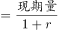
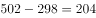
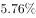
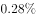

# 基期量计算（现期÷(1−r)反推基期）＋时段差拼合（全年−上半年＝下半年）

考点：[[20-考点/资料分析/增长/基期量计算（现期÷(1−r)反推基期）＋时段差拼合（全年−上半年＝下半年）|增长 / 基期量计算（现期÷(1−r)反推基期）＋时段差拼合（全年−上半年＝下半年）]]
材料：[[15-材料/资料分析/239409 全国互联网保险收入（总量及财产险、人|239409 全国互联网保险收入（总量及财产险、人]]

**问法模型**：题干问'2016年下半年'这一材料未直接给出的时段 → 采用'基期反推＋时段差'模型：先用238÷(1−同比减少率)反推2016年上半年，再用2016年全年502减去该基期值

## 推理链
1. 第1步：从题干确认求'2016年下半年'，材料仅给两个断面——2016年全年互联网财产险502亿元、2017年上半年互联网财产险238亿元且同比减少（材料文本中该减少率数值留空，按官方解析口径代入约20%）
2. 第2步：确立两条规则：①基期反推公式：基期量＝现期量÷(1−r)，2017上半年的'同比'基期即2016年上半年；②时段差拼合：2016年下半年＝2016年全年−2016年上半年
3. 第3步：代入计算：由官方答案B(205)反推，2016年上半年＝502−205＝297亿元，对应减少率r≈1−238/297≈20%，即2016年上半年≈238÷(1−20%)＝238×5/4＝297.5亿元
4. 第4步：2016年下半年＝502−297.5＝204.5亿元
5. 第5步：与选项对照：204.5与B项205最接近；若误算502−238＝264会落向C，若误用238×(1−20%)≈190则502−190≈312落向D，均与B不符，确认选B

**最快解法**：⚡ 百化分：同比减少约20%＝1/5，基期＝238÷(4/5)＝238×5/4≈297.5（口算：238＋238/4）；再502−297.5≈204.5≈205，直接锁定B；选项间隔大（145/205/264/304），无需精算

## 易错点
- ⚠ 基期方向反了：2017上半年'同比减少'，说明基期(2016上半年)大于238，须用238÷(1−r)；若误用238×(1−20%)≈190，得502−190≈312会误选D(304)
- ⚠ 时段错配：误把2017年上半年的238直接当作2016年上半年与502相减，得264恰好对应C项，是最强干扰项——238是另一时段流量，必须先反推2016上半年
- ⚠ 材料中全部百分比数值留空，且材料混有三套比重分母（全国总保费/财产险保费/人身险保费）与'较上半年占比减少'（百分点口径），本题只需同比减少率，勿被比重数据诱导做乘除

## 母题抽象
> 🧩 当题干所求时段＝材料两个现期断面之差（如下半年＝全年−上半年）且其中一段仅有现期与同比增减率时，先用'现期÷(1±r)'反推该段基期（减少用1−r、增加用1+r），再做大时段减小时段

**同类特征**：求材料未直接给出的时段（下半年）、需'全年−上半年'时段差拼合、涉及'同比减少'的基期量反推、单位为亿元、问'约为多少'、文字型两断面材料、选项为间隔较大的单值

## 相关题
（暂无）

---

### 题干
2016年下半年全国互联网财产险收入约为多少亿元？

### 选项
- A. 145
- B. 205　✅
- C. 264
- D. 304

### 官方解析

根据题干“2016年下半年……亿元”，结合材料给出2016年全年和2017年上半年数据，可判定本题为基期计算问题。定位文字材料第一段可知：2016年全年互联网财产险收入为502亿元；定位文字材料第二段可知：2017年上半年互联网财产险收入为238亿元，同比减少。代入公式基期量，可得：2016年上半年互联网财产险收入亿元，则2016年下半年互联网财产险收入约为亿元，与B项最为接近。

故正确答案为B。

### 给定材料

根据以下资料，回答下列问题。

        2016年全年全国互联网保险收入为2299亿元，同比增加，占全国总保费收入的，较2016年上半年占比减少。其中互联网财产险收入为502亿元，同比减少，占全国财产险保费收入的，较2016年上半年占比减少；互联网人身险收入为1797亿元，同比增加，占全国人身险保费收入的，较2016年上半年占比增加。

        2017年上半年全国互联网保险收入为1346亿元，同比减少，占全国总保费收入的。其中互联网财产险收入为238亿元，同比减少，占全国财产险保费收入的；互联网人身险收入为1108亿元，同比减少，占全国人身险保费收入的。

> [!warning] 疑点（官方解析可能有误，待人工复核）
> 材料原文及官方解析中所有百分比数值（含本题所需的2017年上半年财产险同比减少率）均显示为空缺；按官方答案B(205)反推：502−205＝297＝238÷(1−r)，得r≈19.9%（约20%），与解析结论自洽，属数值显示缺失而非解析错误，代入时按r≈20%处理
