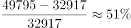
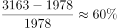
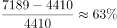
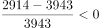

# 区间增长率与固定阈值比较计数（2018较2015增速高于50%）

考点：[[20-考点/资料分析/增长/区间增长率与固定阈值比较计数（2018较2015增速高于50%）|增长 / 区间增长率与固定阈值比较计数（2018较2015增速高于50%）]]
材料：[[15-材料/资料分析/239412 2014-2018年我国软件行业收入|239412 2014-2018年我国软件行业收入]]

**问法模型**：题干问'2018较2015的同比增速高于50%的地区有几个'→ 对各地区分别求区间增长率（2018/2015−1）并与50%阈值逐一比较后计数

## 推理链
1. 第1步：从表1提取2018年与2015年各地区收入（注意列年份倒序，2018在左、2015在右）：东部49795/32917，中部3163/1978，西部7189/4410，东北2914/3943
2. 第2步：区间增长率=现期/基期−1；'增速高于50%'的判别式可等价变形为：现期 > 基期×1.5（乘法代替除法）
3. 第3步：逐项用1.5倍验证：东部32917×1.5=49375.5<49795✓；中部1978×1.5=2967<3163✓；西部4410×1.5=6615<7189✓；东北3943×1.5=5914.5>2914✗（2914<3943本身即为负增长，直接排除）
4. 第4步：截位直除复核增速：东部16878/32917≈51.3%，中部1185/1978≈59.9%，西部2779/4410≈63.0%，东北−1029/3943≈−26.1%，高于50%的恰为东部、中部、西部3个
5. 第5步：与选项对照，3个对应选项C，故正确答案为C

**最快解法**：⚡ 1.5倍基准法（乘除转换）：将'增速>50%'化为'2018年值 > 2015年值×1.5'，只做三次乘法比较——东部32917×1.5≈4.94万<4.98万、中部2967<3163、西部6615<7189均满足；东北2018低于2015必为负增长直接排除，得3个，选C

## 易错点
- ⚠ 口径陷阱：'2018较2015的同比增速'实为跨3年的区间增长率（2018/2015−1），不是2018相对2017的当年同比，按错口径计算结果全错
- ⚠ 表1列年份为倒序（2018在最左），基期2015须取右侧对应列，取错列则增速正负颠倒
- ⚠ 东北地区2018（2914）低于2015（3943）为负增长，凭'各地区都在增长'的直觉会误判；另'合计'行不是地区，不参与计数（合计增速约45.8%<50%，但计入即错）

## 母题抽象
> 🧩 当题干出现'现期年较基期年增速高于X%的地区/项目有几个'时，用区间增长率公式并把判别式转化为'现期值 vs 基期值×(1+X%)'的乘法比较逐项打钩，现期<基期的负增长项直接排除，最后数个数对选项

**同类特征**：'2018较2015'跨多年区间、'同比增速高于'（隐含阈值50%）、'的地区有'（按地区逐项比较计数）、四个地区+合计行的表格结构、答案为'几个'的计数型选项

## 相关题
（暂无）

---

### 题干

2018年软件行业总收入较2015年的同比增速高于的地区有（  ）

### 选项
- A. 1个
- B. 2个
- C. 3个　✅
- D. 4个

### 官方解析

根据题干“同比增速高于50%的有”，可判定本题为一般增长率问题。，定位表格可得，东部地区：；中部地区：；西部地区：；东北地区：，故同比增速高于的有3个。

故正确答案为C。

### 给定材料

 根据以下资料，回答下列问题 

> [!warning] 疑点（官方解析可能有误，待人工复核）
> 所给题干文字缺失阈值'50%'（官方解析据'高于50%'判定），且'同比增速'实为跨3年区间增速的口语化表述，口径不够严谨；但按官方标准（2018/2015−1>50%）计算东部约51.3%、中部约59.9%、西部约63.0%、东北约−26.1%，3个成立，答案C无误

<!-- CODEX-ANSWER-REVIEW:BEGIN -->
### 本次独立复核

**复核状态：** `resolved`（答案与解析已核定）

**计分答案：** C（可计分）

**复核解析：**

按2018/2015−1计算跨三年累计增幅：东部(49795/32917−1)≈51.3%；中部(3163/1978−1)≈59.9%；西部(7189/4410−1)≈63.0%；东北为负。严格大于50%的有东部、中部、西部，共3个，选C。应将题面“同比增速”修订为“相较2015年的累计增幅”，因为这是三年累计比率而非单年同比。

**相关信息：**

2018较2015是跨期累计增长率，不能称单年同比。金额单位亿元。

**题源依据：** [固定版本原题](https://github.com/Mentat-Uran/kaogongzhentizhengliu/blob/84ab93d4b64b61d897bece8a1c0a5bab06b4feb2/10-%E7%9C%9F%E9%A2%98/%E8%B5%84%E6%96%99%E5%88%86%E6%9E%90/%E5%A2%9E%E9%95%BF/2377375%20%E5%8C%BA%E9%97%B4%E5%A2%9E%E9%95%BF%E7%8E%87%E4%B8%8E%E5%9B%BA%E5%AE%9A%E9%98%88%E5%80%BC%E6%AF%94%E8%BE%83%E8%AE%A1%E6%95%B0%EF%BC%882018%E8%BE%832015%E5%A2%9E%E9%80%9F%E9%AB%98%E4%BA%8E50%25%EF%BC%89.md)；固定内容 commit `84ab93d4b64b61d897bece8a1c0a5bab06b4feb2`，Markdown blob `491c76f7755524b0c16b305e770b8bf2c444f676`。
<!-- CODEX-ANSWER-REVIEW:END -->
