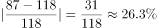
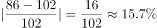
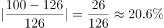
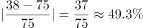
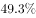

# 减少幅度（降幅-负增长率）比较

考点：[[20-考点/资料分析/增长/减少幅度（降幅-负增长率）比较|增长 / 减少幅度（降幅/负增长率）比较]]
材料：[[15-材料/资料分析/239413 2008年与2018年我国居民一天主|239413 2008年与2018年我国居民一天主]]

**问法模型**：题干出现'与2008年相比，2018年……减少幅度最大'→对四个活动分别求降幅=（2008年值−2018年值）÷2008年值，比较取最大。

## 推理链
1. 第1步：锁定'全国居民平均'口径列，提取四选项两期数据：家庭生产经营活动2018年87、2008年118；家务劳动86、102；看电视100、126；交通活动38、75
2. 第2步：减少幅度即降幅=（基期−现期）÷基期=减少量÷2008年值
3. 第3步：先求减少量：家庭生产经营118−87=31分钟，家务劳动102−86=16分钟，看电视126−100=26分钟，交通活动75−38=37分钟
4. 第4步：再求降幅：31/118≈26.3%，16/102≈15.7%，26/126≈20.6%，37/75≈49.3%
5. 第5步：交通活动降幅49.3%远超其余三项（均不足30%），且其减少量37分钟亦为四者最大，两种口径均指向交通活动，对照选项选D

**最快解法**：⚡ 观察法（分子大分母小必最大）+截位直除：四个降幅31/118、16/102、26/126、37/75中，37/75分子最大且分母最小，必为最大分数；且37/75≈50%（半数判定：75的一半是37.5），远超其余项（15%~27%），直接锁定交通活动，无需逐项精算。

## 易错点
- ⚠ 口径串列：必须取'全国居民平均'列，若误串到男/女/城镇/农村列（如农村家庭生产经营239分钟、城镇仅42分钟）会得出完全不同的比较结果
- ⚠ 基期现期混淆：看电视2008年=126（基期）、2018年=100（现期），降幅应除以126而非100；年份列头顺序需先核对
- ⚠ '减少幅度'指降幅（相对量，除以基期）而非减少量（绝对分钟差），本题两者恰好同指向交通活动，但口径混用在同类题中是最大陷阱；另需排除睡觉休息、健身锻炼等正增长项的干扰

## 母题抽象
> 🧩 当题干出现'与基期年相比，现期年……减少幅度最大/降幅最大'特征时，先锁定题干指定口径列，用（基期−现期）÷基期比较降幅，可先用'减少量最大且基期最小者必为降幅最大'的观察法速判，再粗验其余项。

**同类特征**：与2008年相比，2018年、全国居民、平均时间、减少幅度最大、选项为四类具体活动、两时点同口径对比

## 相关题
- [[10-真题/资料分析/增长/2377381 增长率比较（一般增长率）|2377381]]（陕西 2019，相关度2）
- [[10-真题/资料分析/其他/2377385 同一时点两口径绝对差比较（男女分列差值）|2377385]]（陕西 2019，相关度1）

---

### 题干
与2008年相比，2018年全国居民花费在（  ）上的平均时间减少幅度最大。

### 选项
- A. 家庭生产经营活动
- B. 家务劳动
- C. 看电视
- D. 交通活动　✅

### 官方解析

根据题干所求“与2008年相比，2018年……减少幅度最大”，可判定此题为增长率比较问题，比较减少幅度最大，即找降幅最大的活动。定位表格材料可得，家庭生产经营活动减少幅度为；家务劳动减少幅度为；看电视减少幅度为；交通活动减少幅度为，故减少幅度最大为交通活动。

故正确答案为D。

### 给定材料

根据以下资料，回答下列问题

        2008与2018年我国居民一天主要活动平均时间   单位：分钟

注：1.部分数据因四舍五入的原因，存在总计与分项合计不等的情况；

2.2008年数据根据2018年统计口径有所合并和调整。

