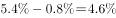
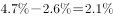
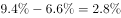
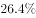

# 基期增长率换算与比较排序（增速与'提高-回落百分点'联动）

考点：[[20-考点/资料分析/增长/基期增长率换算与比较排序（增速与'提高-回落百分点'联动）|增长 / 基期增长率换算与比较排序（增速与'提高/回落百分点'联动）]]
材料：[[15-材料/资料分析/239414 2018年1季度全国钢铁行业（粗钢、|239414 2018年1季度全国钢铁行业（粗钢、]]

**问法模型**：题干要求'按2017年1季度（基期）产量同比增速从高到低排序'→先用'基期增速=现期增速−提高量（提高作减、回落作加）'逐项还原各产品2017Q1增速，再比较排序

## 推理链
1. 第1步：定位材料第一段：2018年1季度粗钢、钢材、铁合金产量增速分别同比提高0.8、2.6、6.6个百分点；焦炭2018年1季度为下降，且'去年同期为增长'（即2017年1季度为正增长）。
2. 第2步：规则：基期(2017Q1)增速=现期(2018Q1)增速−提高量；'提高'作减、'回落'作加；该'百分点'是增速自身的变动，不是产量的变动。
3. 第3步：代入换算：粗钢2017Q1增速=现期增速−0.8个百分点，钢材=现期增速−2.6个百分点，铁合金=现期增速−6.6个百分点；焦炭2017Q1增速由材料直接给出为正增长（所给文本中各项具体百分数空缺，须以完整版材料数值代入）。
4. 第4步：以完整版材料中各现期增速数值代入换算后，2017年1季度增速从高到低为：焦炭（材料直接给出的正增长，数值最高）＞粗钢（仅减0.8个百分点，居第二）＞铁合金（减6.6个百分点）＞钢材（减2.6个百分点后最低）。
5. 第5步：与选项对照：四个选项中仅D项'焦炭＞粗钢＞铁合金＞钢材'与还原后的基期增速排序一致，故选D。

**最快解法**：⚡ 公式法+选项锁定：先抓焦炭秒杀——2018Q1下降且'去年同期为增长'，基期增速为正且由材料直接给出（官方解析明确'焦炭增长最快'），四个选项中只有D把焦炭排在第一位，可直接锁定D；再用'提高作减'验证：粗钢减0.8、钢材减2.6、铁合金减6.6个百分点，代入现期增速即可确认粗钢＞铁合金＞钢材的次序。

## 易错点
- ⚠ 基期/现期混淆陷阱：排序对象是2017年1季度的增速而非2018年1季度，若直接按现期增速从高到低排，得到的正是A项顺序（铁合金＞粗钢＞钢材＞焦炭，焦炭现期下降排末位），落入命题人设计的现期陷阱。
- ⚠ 加减方向陷阱：'提高X个百分点'还原基期增速必须作减法（'回落'才作加法）；把'提高0.8个百分点'误作加法、或把'提高量'误当现期增速本身，四项全部算错。
- ⚠ 符号陷阱：焦炭'下降，去年同期为增长'意味着现期为负、基期为正，若误判焦炭基期增速为负，会把它排到末位而错选A或B。

## 母题抽象
> 🧩 当题干要求按'上年同期（基期）增速'排序、而材料只给现期增速和'提高/回落X个百分点'时，用'基期增速=现期增速−提高量（提高作减、回落作加）'逐项还原后再排序；遇'去年同期为增长/下降'的项，直接采用材料给出的基期符号与数值，不必换算。

**同类特征**：按2017年1季度（上年同期）增速从高到低排序、增速同比提高/回落X个百分点、现期增速具体百分数在材料文本中空缺、焦炭'下降，去年同期为增长'、四个选项为同一组产品的不同排序

## 相关题
（暂无）

---

### 题干
将以下产品按2017年1季度产量同比增速从高到低排序，正确的是：

### 选项
- A. 铁合金＞粗钢＞钢材＞焦炭
- B. 粗钢＞铁合金＞钢材＞焦炭
- C. 钢材＞粗钢＞焦炭＞铁合金
- D. 焦炭＞粗钢＞铁合金＞钢材　✅

### 官方解析

定位文字材料第一段，可知2018年1季度全国粗钢、钢材、铁合金、焦炭产量同比增速及变化百分点。加减计算可得2017年1季度各产品的同比增速，粗钢：；钢材：；铁合金：；焦炭为。显然焦炭增长最快，只有D项符合。

故正确答案为D。

### 给定材料

根据以下资料，回答下列问题

        2018年1季度，全国粗钢产量21215万吨，同比增长，增速同比提高0.8个百分点；钢材产量24693万吨，增长，提高2.6个百分点；铁合金产量815万吨，增长，提高6.6个百分点；焦炭产量10285万吨，下降，去年同期为增长。

        2018年1季度，钢材出口1515万吨，同比下降；进口345万吨，下降；铁矿砂进口27051万吨，下降；焦炭出口227万吨，增长。

        2018年3月份，6.5mm高线、1.0mm冷轧板卷平均价格分别为3963元/吨和4741元/吨，比上月下跌121元/吨和66元/吨；20mm中板平均价格为4233元/吨，比上月上涨70元/吨。

        2018年1季度，全国十种有色金属产量1339万吨，同比增长，增速同比回落6.6个百分点。其中，铜产量221万吨，增长，提高1.4个百分点；电解铝产量812万吨，增长，回落10.6个百分点；铅产量127万吨，增长，提高1.2个百分点；锌产量142万吨，增长，回落1.3个百分点；氧化铝产量1589万吨，下降，去年同期为增长。

        2018年3月份，上海期货交易所当月期货铜、电解铝、铅、锌平均价格分别为52038元/吨、14103元/吨、18906元/吨和25797元/吨，比上月下跌、、和，同比上涨、、和。

> [!warning] 疑点（官方解析可能有误，待人工复核）
> 所给材料文本中各项现期增速及焦炭基期增速的具体百分数均为空缺，官方解析也未列出具体数值，仅凭所给文本无法完整复核四个基期增速的具体大小，须以完整版材料数值代入验证；官方答案D与解析'焦炭增长最快，只有D项符合'的逻辑一致，答案本身无矛盾，仅提示材料文本不完整的口径问题。
