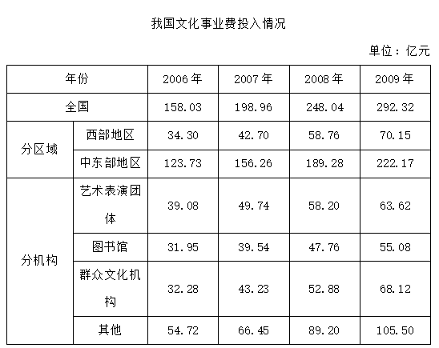

# 增长率比较（部分与全国整体比较）

考点：[[20-考点/资料分析/增长/增长率比较（部分与全国整体比较）|增长 / 增长率比较（部分与全国整体比较）]]

**问法模型**：题干问'2008年同比增速高于全国平均水平的是'→ 先算全国增速作基准（(248.04-198.96)/198.96≈24.7%），再逐项算各部分增长率与之比较，取高于基准者

## 推理链
1. 第1步：题干要求比较2008年同比增速与全国平均，由表格提取：全国2007年文化事业费198.96亿元、2008年248.04亿元
2. 第2步：增长率公式 = (现期-基期)/基期，全国增速 = (248.04-198.96)/198.96 = 49.08/198.96 ≈ 24.7%
3. 第3步：对A~D四项分别用表格中2007、2008两年数据计算增长率：西部地区增速高于24.7%，艺术表演团体、图书馆、群众文化机构的增速均低于24.7%
4. 第4步：四项中只有西部地区增速高于全国平均24.7%，与选项对照，故选A

**最快解法**：⚡ 两期占比比较法（比重升降判定增速高低）：部分增速＞整体增速 ⟺ 部分占整体比重上升。只需口算/目测各项2008年占全国的比重大于2007年占比，仅西部地区占比上升即增速超过全国24.7%，免去逐项除法；若直除，用截位法以49.08/198.96≈24.7%为基准比较

## 易错点
- ⚠ 基期现期混淆：同比增速的分母必须是2007年数据，误用2008年作分母会算成下降率口径
- ⚠ 增长量与增长率混淆：某项增加额（亿元）大不代表增速高，必须除以基期再比较
- ⚠ 漏掉全国基准：只比较四个选项之间的大小，而未先算出全国增速24.7%作为比较标准

## 母题抽象
> 🧩 当题干出现'某部分增速高于全国/整体平均水平'的特征时，不必逐项硬算增长率，用两期占比比较：2008年占整体比重＞2007年占比 ⟺ 部分增速＞整体增速，再验证唯一选项即可

**同类特征**：同比增速高于全国平均水平、给出两个相邻年份数据、部分与整体增速比较、增长率比较类、表格多类别并列（地区+机构类型）、四选一单选

## 相关题
- [[10-真题/资料分析/比重/1758918 两期比重比较（比重升降⟺部分增速与整体增速大小）|1758918]]（上海 2016，相关度1）
- [[10-真题/资料分析/比重/1796336 两期比重升降判断（比较部分增速a与整体增速b）|1796336]]（黑龙江 2016，相关度1）

---

### 题干
2008年，文化事业费投入同比增速高于全国平均水平的是：

### 选项
- A. 西部地区　✅
- B. 艺术表演团体
- C. 图书馆
- D. 群众文化机构

### 官方解析
由题干“2008年······同比增速高于全国平均水平的是”，可判定本题为增长率比较问题。定位表格可得2007、2008年各项文化事业费投入金额，根据，计算各项增长率进行比较即可。2007年全国文化事业费投入金额为198.96亿元，2008年为248.04亿元，增长率。
A西部地区：；
B艺术表演团体：；
C图书馆：；
D群众文化机构：。
比较可知，只有西部地区的文化事业费投入同比增速高于全国平均水平。
故正确答案为A。

### 给定材料

