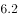
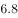
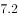
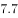

# 增长率计算（全省=两区域加总后的同比增速）

考点：[[20-考点/资料分析/增长/增长率计算（全省=两区域加总后的同比增速）|增长 / 增长率计算（全省=两区域加总后的同比增速）]]
材料：[[15-材料/资料分析/239832 广东省分区域（珠三角-东翼-西翼-粤|239832 广东省分区域（珠三角-东翼-西翼-粤]]

**问法模型**：题干问'2018年广东省生产总值同比增长'→ 先将珠三角与粤东西北两部分现期、基期分别加总得全省值，再用增长率=现期/基期−1 计算

## 推理链
1. 第1步：题干要求2018年广东省（全省）生产总值同比增速，材料未直接给出全省数据，需先加总：由注释'粤东西北指广东省除珠三角之外的所有地区'，故全省=珠三角+粤东西北
2. 第2步：定位表2，2018年珠三角81048.50、粤东西北19977.45亿元；2017年珠三角75809.75、粤东西北19345.38亿元
3. 第3步：2018年全省=81048.50+19977.45=101025.95亿元，2017年全省=75809.75+19345.38=95155.13亿元
4. 第4步：增长率=101025.95/95155.13−1=5870.82/95155.13≈6.2%
5. 第5步：与选项对照，A约为6.2%，故正确答案为A

**最快解法**：⚡ 分块增量法+截位直除：珠三角增量≈81048.50−75809.75≈5239，粤东西北增量≈19977.45−19345.38≈632，合计增量≈5871；5871/95155≈5871/95200，截位直除得约6.2%，锁定A

## 易错点
- ⚠ 全省口径陷阱：广东省=珠三角+粤东西北两部分，需先加总再算增速；只算珠三角增速约6.9%或只算粤东西北增速约3.3%都是出题人设置的干扰方向
- ⚠ 基期现期配对：增长率=增长量/基期（2017年）值，误用2018年现期作分母会算错
- ⚠ 表格混用陷阱：本题只取表2相邻两年（2017、2018）数据；表1为2016年横截面且进出口总额单位为亿美元，勿把2016年珠三角67841.85误当作相邻年份使用

## 母题抽象
> 🧩 当题干问'全省/整体'某指标增速、而材料只给'两个互补区域'的分块时间序列时，先分别加总现期与基期，再按'增量/基期'求增速，并警惕只算单一区域得到的干扰选项

**同类特征**：全省=两区域加总（珠三角+粤东西北）、同比增长/增速计算、现期2018、基期2017相邻两年、表2时间序列取数、材料未直接给整体数据需加总、口径注释决定加总范围

## 相关题
（暂无）

---

### 题干
2018年，广东省生产总值同比增长（    ）。

### 选项
- A. 

　✅
- B. 

- C. 

- D. 

### 官方解析
由题干“2018年，广东省生产总值同比增长”，结合选项为百分数，可判定本题为增长率计算问题。定位表2可得，2018年珠三角地区、粤东西北地区生产总值分别为81048.50、19977.45亿元，2017年分别为75809.75、19345.38亿元。根据文字部分可知，粤东西北地区是指广东省除珠三角地区之外的所有地区，则2018年广东省生产总值同比增长率为
故正确答案为A。

### 给定材料

