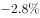
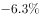
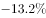

# 年均增长率计算

考点：[[20-考点/资料分析/增长/年均增长率计算|增长 / 年均增长率计算]]
材料：[[15-材料/资料分析/239833 2012—2017年深圳市进出口情况|239833 2012—2017年深圳市进出口情况]]

**问法模型**：题干问'2012-2017年，深圳市进口总额的年均增长率约为'→年均增长率模型：r=(现期/基期)^(1/n)-1，n=末年-首年=5

## 推理链
1. 第1步：从图中白色柱（进口总额）提取数据：基期2012年1954.69亿美元，现期2017年1697.85亿美元，且1697.85<1954.69，预判r为负值
2. 第2步：套用年均增长率公式(1+r)^n=现期/基期，2012→2017年份间隔n=5（不是6）
3. 第3步：代入计算比值：1697.85/1954.69≈0.869<0.87，即(1+r)^5≈0.869
4. 第4步：选项中r数值较小，用二项式近似(1+r)^5≈1+5r，则1+5r<0.87，解得r<-2.6%
5. 第5步：精确求解r=0.869^(1/5)-1≈-2.8%（负增长），与选项对照：只有A项（约-2.8%）略小于-2.6%，其余选项不满足，故选A

**最快解法**：⚡ 截位直除+二项式近似（(1+r)^n≈1+nr）：先截位直除1697.85/1954.69≈0.869<0.87，由1+5r<0.87速得r<-2.6%，再结合负增长方向与精确值约-2.8%锁定A

## 易错点
- ⚠ 年份间隔数错：2012至2017共5次增长（n=5），误取n=6会得出约-2.3%而误选其他选项
- ⚠ 基期现期方向放反：若误用1954.69/1697.85作比值会得到约+2.8%的正增长率，混淆增长与下降方向
- ⚠ 口径混淆：白色柱才是进口总额（1954.69→1697.85），勿误用斜纹柱出口总额或出口+进口加总的进出口总额（4668.31→4141.43）

## 母题抽象
> 🧩 当题干出现'某指标在A-B年的年均增长率约为'时，取区间首年为基期、末年为现期，n=末年-首年，用r=(现期/基期)^(1/n)-1求解；r较小时可用(1+r)^n≈1+nr速算，并先由现期与基期大小关系预判r正负以快速排除干扰项

**同类特征**：'2012-2017年'区间表述、'年均增长率约为'问法、进口总额（图中白色柱数据）、现期值小于基期值（负增长）、选项为含负值的百分比、年份间隔n=5

## 相关题
- [[10-真题/资料分析/增长/2444068 年均增长率计算|2444068]]（江西 2019，相关度2）
- [[10-真题/资料分析/增长/3018816 年均增长率计算|3018816]]（广东 2021，相关度2）

---

### 题干
2012-2017年，深圳市进口总额的年均增长率约为（    ）。

### 选项
- A. 

　✅
- B. 

- C. 

- D. 

### 官方解析
由题干“2012-2017年，深圳市进口总额的年均增长率约为（）”判定此题为年均增长率问题。根据公式：，由材料可知，，结合选项增长率数值较小，根据进行估算，则有1+5r＜0.87，解得r＜-2.6%，只有A项略小于-2.6%。
故正确答案为A。

### 给定材料

