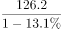

# 基期量比较排序（基期销量从高至低）

考点：[[20-考点/资料分析/增长/基期量比较排序（基期销量从高至低）|增长 / 基期量比较排序（基期销量从高至低）]]
材料：[[15-材料/资料分析/239834 2018年1-9月中国汽车行业产销统|239834 2018年1-9月中国汽车行业产销统]]

**问法模型**：题干问2017年1-9月（基期）四类车型销量从高至低排序 → 基期量=现期销量÷(1+销量增速)逐个还原后比较大小，增长车型分母>1、下降车型分母<1，再用分数性质定性比大小

## 推理链
1. 第1步：题干时间为2017年1-9月（基期），材料时间为2018年1-9月（现期），判定为基期量排序题；提取现期销量——轿车842.6万辆、SUV 723.5万辆、MPV 126.2万辆、交叉型乘用车33.7万辆，其中轿车/SUV为同比'增长'、MPV/交叉型为同比'下降'（本材料版本各增速数值留空缺失）
2. 第2步：所用公式为基期量=现期量/(1+增速)：增长车型分母(1+增速)>1、基期小于现期；下降车型分母(1-降幅)<1、基期大于现期；四个分母均在1附近
3. 第3步：轿车与SUV比较：两分数为842.6/(1+轿车销量增速)与723.5/(1+SUV销量增速)，依官方解析轿车分子大（842.6>723.5）且分母小，'分子大分母小则分数一定大'，故轿车>SUV，排除B、D
4. 第4步：MPV与交叉型比较：两分数为126.2/(1-MPV降幅)与33.7/(1-交叉型降幅)，二者分母均略小于1且十分接近，而MPV分子126.2约为交叉型分子33.7的3.7倍、差距悬殊，故MPV>交叉型，排除A
5. 第5步：四类车型2017年1-9月销量从高至低为轿车>SUV>MPV>交叉型乘用车，与选项C一致，故正确答案为C

**最快解法**：⚡ 分数性质比较法（免精算）：四个分母(1±增速)均贴近1且组内接近，排序由分子主导——增长组比分子定前两位（842.6>723.5→轿车>SUV），下降组分母接近、比分子定后两位（126.2≈3.7×33.7→MPV>交叉型），直接锁定C；如需验证可对842.6与723.5作截位直除除以各自(1+增速)

## 易错点
- ⚠ 增降方向混排：MPV与交叉型同比'下降'，分母为(1-降幅)<1、基期值反而大于现期值，若把'下降'误处理成基期更小或正负号处理错误，比较方向即错
- ⚠ 本材料版本全部同比增速百分数留空缺失，严禁凭记忆或经验代入增速数值精算，须依据分数性质与分子悬殊差距作定性判断
- ⚠ 产量与销量成对且数值极近（轿车产841.3/销842.6、SUV产737.1/销723.5），本题须取销量列842.6/723.5/126.2/33.7；另勿把中国品牌乘用车724.2万辆（乘用车销量子集，恰介于SUV 723.5与轿车842.6之间）误当作第四类车型参与排序

## 母题抽象
> 🧩 当题干出现'基期（上年同期）多个主体按指标从高至低排序'特征时，用基期量=现期量÷(1+增速)还原并优先做定性分数比较：分子大且分母小者必大、分子悬殊而分母接近时直接比分子，可完全避开逐项精算

**同类特征**：问基期时间（2017年1-9月）、按销量从高至低排列、四类车型逐一比较、同比增长与下降混排、现期产销成对数据须取销量列

## 相关题
（暂无）

---

### 题干
2017年1-9月，乘用车的四类车型按销量从高至低排列，依次为（    ）。

### 选项
- A. 
轿车SUV交叉型乘用车MPV

- B. 
SUV轿车交叉型乘用车MPV

- C. 
轿车SUVMPV交叉型乘用车
　✅
- D. 
SUV轿车MPV交叉型乘用车

### 官方解析

根据题干“2017年1-9月，乘用车的四类车型按销量从高至低排列，依次为”，结合材料时间为2018年1-9月，可判定本题为基期比较问题。根据，可知：2017年1-9月轿车销量为万辆；SUV销量为万辆，和 两个分数比较，的分子大分母小，分数一定大，说明轿车SUV，排除B、D项。剩余A、C项，只需要比较交叉型乘用车和MPV的销量，2017年1-9月MPV销量为万辆，交叉型乘用车销量为万辆，和比较，分母十分接近，MPV的分子远远大于交叉型乘用车，因此MPV交叉型乘用车，排除A项。

故正确答案为C。

### 给定材料

        2018年1-9月汽车行业统计数据如下：

        乘用车累计产销分别完成1735.1万辆和1726.0万辆，同比分别增长和。其中，轿车产销分别完成841.3万辆和842.6万辆，同比分别增长和；SUV产销分别完成737.1万辆和723.5万辆，同比分别增长和；MPV产销分别完成124.4万辆和126.2万辆，同比分别下降和；交叉型乘用车产销分别完成32.2万辆和33.7万辆，同比分别下降和。中国品牌乘用车累计销售724.2万辆，同比下降。

        商用车累计产销分别完成314.1万辆和323.1万辆，同比分别增长和。分车型情况看，客车产销分别完成33.9万辆和33.3万辆，同比分别下降和；货车产销分别完成280.1万辆和289.8万辆，同比分别增长和。

        新能源汽车中，纯电动汽车产销分别完成55.5万辆和54.1万辆，同比分别增长和；插电式混合动力汽车产销分别完成18.0万辆和18.1万辆，同比分别增长和。

        汽车整车出口81.4万辆，同比增长。分车型情况看，乘用车出口60.1万辆，同比增长；商用车出口21.3万辆，同比增长。

> [!warning] 疑点（官方解析可能有误，待人工复核）
> 本材料版本为纯文字挖空版（0图0表），各车型同比增速百分数整体缺失，官方解析中参与比较的分数数值与公式亦被隐去，故无法在本版本代入增速完成数值精算，'轿车分子大分母小'的判断依赖原版增速数据；但按分数性质与分子量级（842.6>723.5、126.2约为33.7的3.7倍、四个分母均在1附近）可定性复核排序轿车>SUV>MPV>交叉型，与官方答案C一致，答案本身无矛盾

<!-- CODEX-ANSWER-REVIEW:BEGIN -->
### 本次独立复核

**复核状态：** `resolved`（答案与解析已核定）

**计分答案：** C（可计分）

**复核解析：**

2017年四类车型按2018销量及增速还原：轿车842.6/1.013≈831.8，SUV723.5/1.039≈696.3，MPV126.2/0.869≈145.2，交叉型33.7/0.804≈41.9；排序轿车、SUV、MPV、交叉型，C。

**相关信息：**

基期量=现期量/(1+增长率)；若同比下降则除以(1−降幅)。注意百分点与百分比口径。

**题源依据：** [固定版本原题](https://github.com/Mentat-Uran/kaogongzhentizhengliu/blob/84ab93d4b64b61d897bece8a1c0a5bab06b4feb2/10-%E7%9C%9F%E9%A2%98/%E8%B5%84%E6%96%99%E5%88%86%E6%9E%90/%E5%A2%9E%E9%95%BF/2385134%20%E5%9F%BA%E6%9C%9F%E9%87%8F%E6%AF%94%E8%BE%83%E6%8E%92%E5%BA%8F%EF%BC%88%E5%9F%BA%E6%9C%9F%E9%94%80%E9%87%8F%E4%BB%8E%E9%AB%98%E8%87%B3%E4%BD%8E%EF%BC%89.md)；固定内容 commit `84ab93d4b64b61d897bece8a1c0a5bab06b4feb2`，Markdown blob `baf300f6b0168459470b50b270152ddeb610392a`。
<!-- CODEX-ANSWER-REVIEW:END -->
