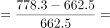
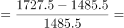
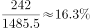
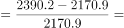

# 同比增长率比较（分项增速比大小）

考点：[[20-考点/资料分析/增长/同比增长率比较（分项增速比大小）|增长 / 同比增长率比较（分项增速比大小）]]
材料：[[15-材料/资料分析/239972 2013~2017年我国环境污染治理|239972 2013~2017年我国环境污染治理]]

**问法模型**：题干为'2017年……同比增速最高的是'→对四个分项分别用（2017年值−2016年值）÷2016年值求同比增速后比大小

## 推理链
1. 第1步：题干限定'城镇环境基础设施建设投资额中'，即只取表中'其中'下属分项行，定位2016、2017两列：集中供热662.5→778.3、排水1485.5→1727.5、园林绿化2170.9→2390.2、市容环境卫生561.1→623.0
2. 第2步：同比增速=（现期−基期）÷基期，基期为上一年2016年
3. 第3步：代入计算：集中供热115.8÷662.5≈17.5%；排水242.0÷1485.5≈16.3%；园林绿化219.3÷2170.9≈10.1%；市容环境卫生61.9÷561.1≈11.0%
4. 第4步：17.5%＞16.3%＞11.0%＞10.1%，集中供热同比增速最高，对应A项
5. 第5步：可用交叉相乘复核A与B：115.8×1485.5≈17.2万＞242×662.5≈16.0万，确认集中供热＞排水

**最快解法**：⚡ 先粗筛排除：园林绿化约1/10、市容环境卫生约1/9明显偏小；再对A、B截位直除——115.8/662.5≈17.5%，242/1485.5≈16.3%，分母接近6倍关系的两个分数中分子占比更大的胜出，锁定A；勿被排水增量242最大迷惑

## 易错点
- ⚠ 增长量与增长率混淆：排水增量242亿元最大，只看增量会误选B；增速=增量÷基期，排水基期1485.5约为集中供热基期662.5的2.2倍，摊薄了增速
- ⚠ 基期口径取错：同比增速的基期是2016年，勿误用材料首年2013年作基期（那是另一类口径）
- ⚠ '其中'隶属陷阱：四个选项只是'城镇环境基础设施建设投资'的分项，取数时勿与'投资总额''工业污染源治理投资''验收项目环保投资'等同表其他行混淆；燃气(532.0→566.7，约+6.5%)同为分项但不在选项中，勿臆加比较对象

## 母题抽象
> 🧩 当题干出现'某年……中，同比增速最高/最低的是'时，锁定对应分项行相邻两列，用（现期−基期）÷基期逐项求增速再比大小；当各选项增长量与基期量差异都大时，切勿只比增量，必须比'增量÷基期'

**同类特征**：同比增速最高、城镇环境基础设施建设投资额中、其中分项之间比较、相邻两年（2016→2017）数据、四个分项选一、增长率比大小

## 相关题
- [[10-真题/资料分析/增长/15833678 基期（上年同期）增速还原与比较|15833678]]（黑龙江 2026，相关度1）
- [[10-真题/资料分析/增长/2136894 增长率（同比增速）大小比较与排序|2136894]]（北京 2018，相关度1）
- [[10-真题/资料分析/增长/2188208 混合增长率定性比较（由累计同比增速推单季同比增速区间）|2188208]]（陕西 2018，相关度1）

---

### 题干
2017年，我国城镇环境基础设施建设投资额中，同比增速最高的是：

### 选项
- A. 集中供热　✅
- B. 排水
- C. 园林绿化
- D. 市容环境卫生

### 官方解析

根据题干“2017年···同比增速最高······”可判定本题为一般增长率的比较问题，根据，定位统计表最后两列可知2017年与2016年数据。

A项集中供热2017年增速；

B项排水2017年增速；

C项园林绿化2017年增速；

D项市容环境卫生2017增速。

综上，2017年集中供热投资额同比增速最高。

故正确答案为A。

### 给定材料

根据所给资料，回答下列问题。

